# Informe de la campaña final de barridos — Ciclo Kalina KCS-11

*Borrador estructurado del 2026-10-10. Reúne las conclusiones, los datos, las tablas y las figuras del
análisis de resultados. Todas las cifras salen de `01_datos/todos_los_puntos.csv` y fueron
validadas (validación cruzada: 76 de 78; las 2 diferencias son de definición) y revisadas tres veces.*

---

## Resumen ejecutivo

*Cada punto remite a su conclusión con su evidencia en «Conclusiones».*

1. **Con los datos del profesor el ciclo no converge** (estudio 1.1: 0 de 41). La fuente a 623 K es
   incompatible con el resto del enunciado (**C10**).
2. **Con la fuente a ~390–410 K se conservan 8 de los 10 datos de diseño** (estudio 4.3), o las dos presiones
   del profesor con ε_cond ≥ 0.875 (estudio 4.2) (**C11**).
3. **La factibilidad la deciden P_baja y ε_cond** (KS 0.43 cada una, IC 95 % solapados), seguidas de
   r_P (0.35); las eficiencias de las máquinas no deciden la clase (KS ≤ 0.12, p > 0.1). El mecanismo
   es el margen de cavitación O2 (**C1**).
4. **La frontera KALINA es un umbral y los diseños quedan pegados a ella**: A\* está a < 6 % del
   rango de O2 en 8 de 9 variables (**C2**).
5. **Lo que decide la clase no es lo que mueve η**: P_alta (PRCC +0.58), η_t (+0.38) y ε_reg (+0.27)
   suben η sin cambiar la clase; ε_cond decide la clase sin mover η (**C5**).
6. **P_baja es antagónica**: asegura KALINA pero baja η 0.40–0.55 pp por cada 100 kPa; 1 K de margen
   de subenfriamiento cuesta ~14 kPa y ~0.16 pp (**C6**).
7. **Hay interacciones**: la P_baja mínima depende de P_alta (913 → 547 kPa), del clima (−12.5 a
   −25.7 kPa por K más frío) y de x_b (+144 kPa por cada 0.1) (**C3, C8, C9**).
8. **El análisis es robusto**: rankings estables entre 300 y 500 puntos (ρ = 0.93 y 0.99), teqp
   igual al motor real, y la Fase 1 y Húsavík reproducidas (robustez).

---

## Introducción y pregunta

El enunciado del curso fija un ciclo Kalina KCS-11 con fuente de gases a 350 °C (623.15 K) y
sumidero a 27 °C (300.03 K). La campaña final buscó responder:

- ¿Funciona el ciclo con los datos del profesor?
- Si no, ¿qué es lo mínimo que hay que cambiar para que sea KALINA?
- ¿En qué rangos de presión (P_alta, P_baja, ΔP, r_P) aparece KALINA?
- ¿Qué datos del enunciado se pueden conservar?

### Punto del profesor (PP) y punto ancla (A\*)

| Dato | PP (enunciado) | A\* (ancla de estudio 3.1) |
|---|---|---|
| P_alta | 3000 kPa | 3000 kPa |
| P_baja | 400 kPa | **563.64 kPa** |
| x_b | 0.50 | 0.50 |
| T_fuente | 623.15 K | **403 K** |
| T_sumidero | 300.03 K | 300.03 K |
| η_t / η_p | 0.85 / 0.75 | 0.85 / 0.75 |
| ε_HRVG / ε_reg / ε_cond | 0.85 / 0.75 / 0.80 | 0.85 / 0.75 / 0.80 |
| Resultado | NO_CONVERGIO | KALINA, η = 8.48 % |

---

## Metodología

> **Nomenclatura (2026-10-12).** Todo se numera como los capítulos de un informe: pregunta (1–6) → estudio (2.4) → parte (2.4a, cuando hay datos fijos distintos; reemplaza al antiguo "bloque"). Tablas y figuras siguen al estudio (Tabla 4.1-1, Figura 3.2-2); las de síntesis llevan S. Los números de sección de este documento llevan § para no confundirse con los estudios. Los códigos antiguos (M05, KF-M05-3, B09-3, TAB-M05-00) solo quedan como "código de origen".

| Pregunta | Estudios (código de origen) |
|---|---|
| 1 · ¿Funciona el ciclo con los datos del profesor? | **1.1** Repetir el caso del profesor (M01) |
| 2 · ¿Qué es lo mínimo que hay que cambiar para que funcione? | **2.1** Un solo cambio (M02-N1); **2.2** Dos cambios (M02-N2); **2.3** Dos cambios con η y ε en 0.40–0.95 (M02R); **2.4** Sumidero más frío (M02S) |
| 3 · ¿Qué variables importan y cuánto? | **3.1** Sensibilidad local alrededor de A* (M03); **3.2** Sensibilidad global (500 puntos) (M04, M04b); **3.3** P_baja alta (1500–2500 kPa) (M04c) |
| 4 · ¿Qué datos del profesor se pueden conservar? | **4.1** Escenarios de conservación (M05); **4.2** Mapa con las presiones del profesor (M05c); **4.3** Escalera de conservación (M09) |
| 5 · ¿Cuánta eficiencia se puede lograr? | **5.1** Búsqueda de la η máxima (M07) |
| 6 · ¿Son confiables los resultados? | **6.1** Verificación con el motor de referencia (M06); **6.2** Planta real de Húsavík (M10, M10b) |
| A · Anexo: equipos fuera del rango realista (no entra en las conclusiones) | **A.1** Equipos fuera del rango realista (M08) |

### Definiciones

| Término | Significado |
|---|---|
| Punto genuino | KALINA, CORREGIBLE o INVIABLE: el modelo lo resolvió de verdad |
| N2 (falso convergido) | El solver dice que convergió pero el clasificador lo descarta; no cuenta |
| KALINA confiable | KALINA dentro del rango del modelo de propiedades (IAPWS G4-01) y con η y ε en [0.40, 0.95] |
| O1 / O2 / O3 / O5 | Título del vapor / cavitación / trabajo neto / separador bifásico |
| Piso de O2 | Temperatura con la que se evalúa la cavitación: 300.03 K en estudio 1.1–estudio 3.1; = T_sumidero desde estudio 2.4 |
| Banda de η | ±0.4–0.7 pp: diferencias menores no son concluyentes |
| Bloque | Puntos con las mismas variables fijas en los mismos valores; solo se comparan dentro de una parte |

### Familias de barridos y métodos

| Familia | Casos | Método |
|---|---|---|
| R reproducibilidad | estudio 1.1 | repetición punto a punto |
| F factibilidad | estudio 2.1, estudio 2.2, estudio 2.3, estudio 2.4 | mallas 1D/2D + bisección de fronteras |
| L local | estudio 3.1 | una variable a la vez (15 valores) + elasticidad ±1 % |
| G global | estudio 3.2, estudio 3.3 | LHS; RSA/KS, PRCC, PAWN, CART, bootstrap |
| C conservación | estudio 4.1, estudio 4.2, estudio 4.3 | LHS por escenario, malla dirigida, escalera de selección |
| V verificación | estudio 6.1 | teqp contra el motor real; costo del subenfriamiento |
| O optimización | estudio 5.1 | búsqueda por patrones (primero KALINA, después η) |
| H caso real | estudio 6.2 | Húsavík: re-evaluación, OFAT, malla |
| X anecdótico | anexo A.1 | fuera del rango realista; no entra en conclusiones |

### Regla de presentación

Ningún gráfico ni tabla de caso mezcla partes con datos fijos distintos. Cada figura lleva título
con la conclusión, recuadro de condiciones y pie con datos fijos, barridos, filtro, n y fuente.

### Panorama de la campaña

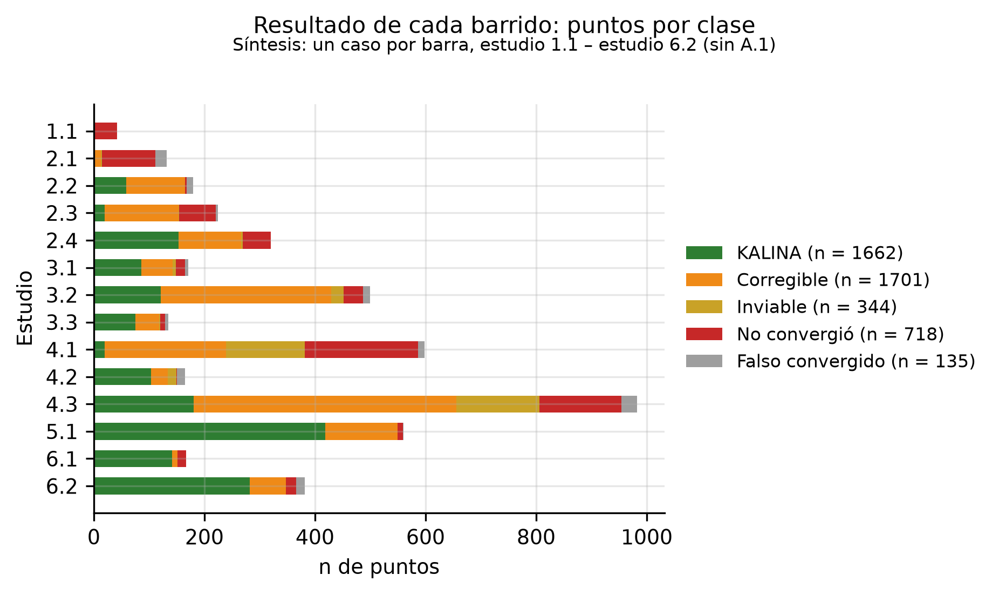

*Figura S-1. Resultado de cada barrido por clase (4 581 puntos sin anexo A.1). Tabla: Tabla S-1.*

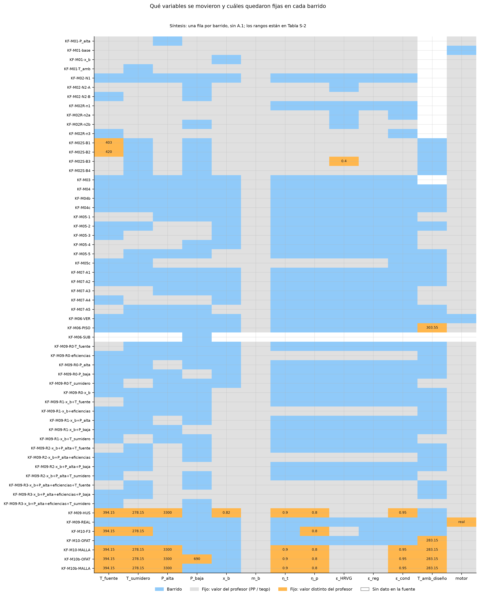

*Figura S-2. Qué variables se movieron y cuáles quedaron fijas en cada barrido. Tabla: Tabla S-2.*

---

## Resultados por pregunta

Cada estudio lleva el número de su pregunta (2.4 = estudio 4 de la pregunta 2); las partes con datos fijos distintos llevan una letra (2.4a). Ver la hoja Nomenclatura del Excel.

### Pregunta 1 · ¿Funciona el ciclo con los datos del profesor?

#### Estudio 1.1 — Reproducibilidad del caso del profesor

- **Qué:** los 41 puntos de la Fase 1 (base, P_alta 2000–4000 kPa, x_b 0.40–0.70, T_amb horaria).
- **Resultado:** 42 corridas, **0 genuinas**; coincidencia de clase con la F1: 41 de 41.
- **Conclusión:** el código actual reproduce al profesor: con sus datos el ciclo no converge; mover
  solo P_alta, x_b o el clima no cambia nada. El bloqueo está en el lado caliente.
- **Tablas:** Tabla 1.1-1, -01, -02. Sin figura (nada que graficar).

### Pregunta 2 · ¿Qué es lo mínimo que hay que cambiar para que funcione?

#### Estudio 2.1 — Un solo cambio sobre el profesor

- **Qué:** 10 variables, de a una (10 valores + bisección); η/ε en [0.75, 0.85]. 132 corridas.
- **Resultado:** 15 genuinas, **0 KALINA**, 21 N2. Solo T_fuente, ε_HRVG y x_b dan genuinos.
  El más cercano: T_fuente = 402.9 K, solo falla O2 por 2.0 K (η = 9.86 %).
- **Conclusión:** con un cambio no hay KALINA; el que más acerca es bajar la fuente a ~400 K.

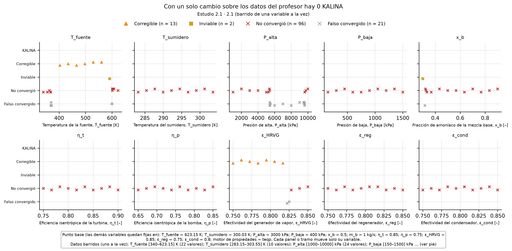

#### Estudio 2.2 — Dos cambios (P_baja + una variable del lado caliente)

- **Ruta A** (conserva la fuente, ε_HRVG × P_baja): 36 genuinas, **0 KALINA** (bloquea O2).
- **Ruta B** (T_fuente × P_baja): **59 KALINA (48 confiables)** con T_fuente 390–434 K. Menor
  P_baja: 445.5 kPa a 390 K (η 2.45 %); mayor η: 9.15 % a 420 K / 736 kPa. Se elige **A\***.

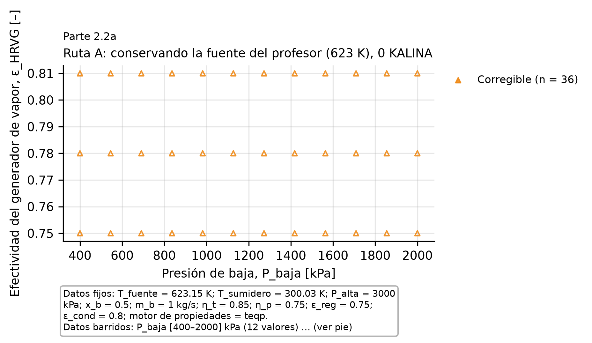
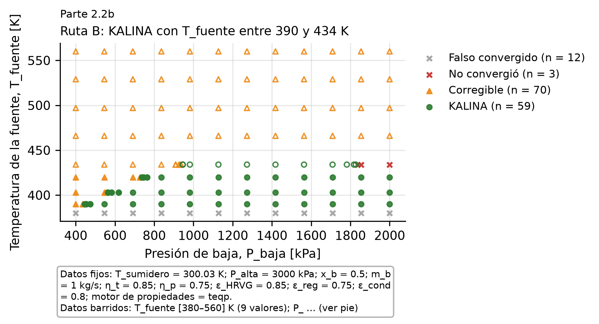

#### Estudio 2.3 — Dos cambios con η y ε en [0.40, 0.95]

| Parte | KALINA | Confiables | Lectura |
|---|---|---|---|
| 2.3a (una variable) | 0 | 0 | un cambio sigue sin alcanzar |
| 2.3b (ε_HRVG × ε_cond, P_baja 400) | 0 | 0 | 48 corregibles, todos por O2 |
| 2.3c (ε_HRVG × P_baja) | 19 filas (13 distintos) | 0 | ε_HRVG 0.40–0.50 con P_baja 1318–2000 kPa; todos fuera de rango |
| 2.3d (T_fuente × ε_cond) | 1 | 1 | presiones del profesor + T_fuente 403 K + ε_cond 0.95: η 9.50 % |

- **Conclusión:** con 623 K hay KALINA solo bajando mucho ε_HRVG y subiendo P_baja, y ninguno es
  confiable. Con las presiones exactas del profesor sí hay un KALINA confiable (antecedente de estudio 4.2).

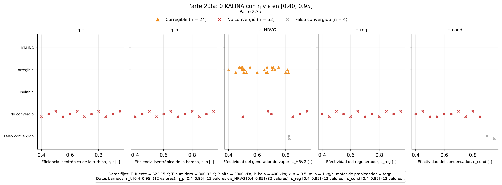
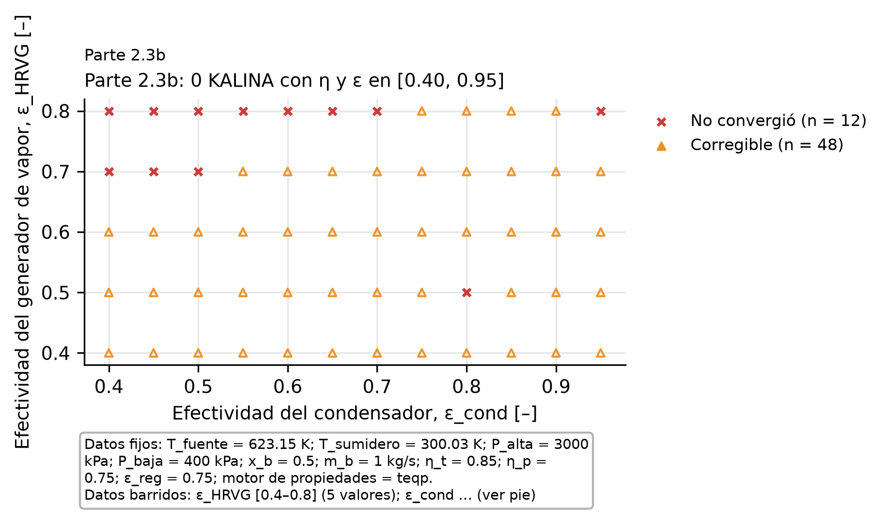
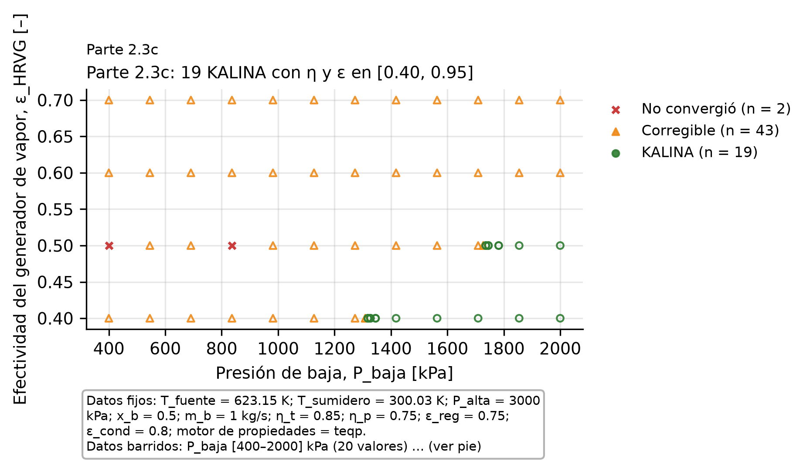
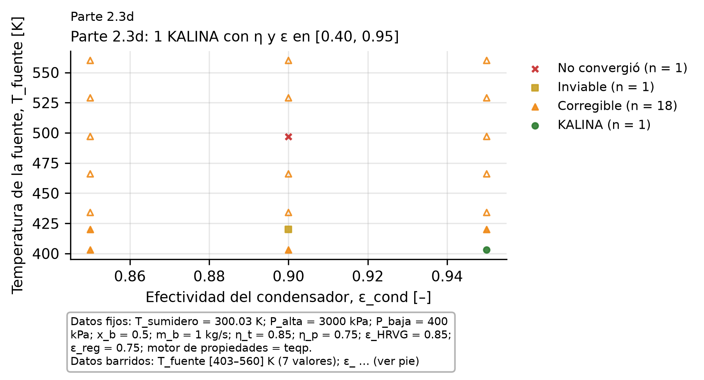

#### Estudio 2.4 — Sumidero más frío con P_baja libre

| Base | KALINA (confiables) | 300.03 K: P_baja mín. / η máx. | 278.15 K: P_baja mín. / η máx. |
|---|---|---|---|
| 2.4a (T_fuente 403 K) | 59 (59) | 562.5 kPa / 8.49 % | 290.6 kPa / 10.41 % |
| 2.4b (T_fuente 420 K) | 60 (60) | 740.6 kPa / 9.11 % | 393.8 kPa / 11.91 % |
| 2.4c (ε_HRVG 0.40) | 34 (0) | 1312.5 kPa / 6.30 % | 750 kPa / 9.69 % |
| 2.4d (profesor exacto) | 0 | — | — |

- **Conclusión:** un sumidero ~22 K más frío reduce a la mitad la P_baja necesaria y sube η 2–3 pp.
  El profesor exacto nunca es KALINA: el problema es la fuente, no el clima.

### Pregunta 3 · ¿Qué variables importan y cuánto?

#### Estudio 3.1 — Sensibilidad local alrededor de A\*

- **Qué:** 10 variables × 15 valores + elasticidad ±1 % del rango. 171 corridas: 148 genuinas,
  86 KALINA.
- **Ranking (Tabla 3.1-3):** mayor elasticidad T_fuente (E = 10.9), luego x_b (3.4); mayor Δη x_b
  (10.8 pp) y P_baja (6.8 pp). Las palancas que suben η sin perder KALINA son ε_reg (hasta 10.96 %)
  y η_t (9.62 %).
- **Conclusión:** A\* está al filo de O2: en 8 de 9 variables la frontera está a menos del 6 % del
  rango (P_alta: bajarla 64 kPa ya rompe O2).

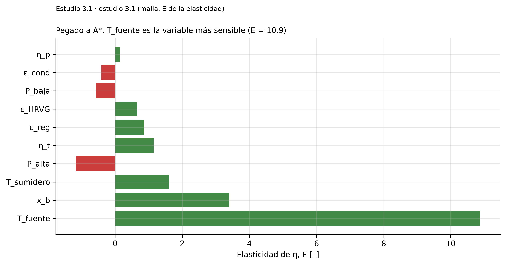
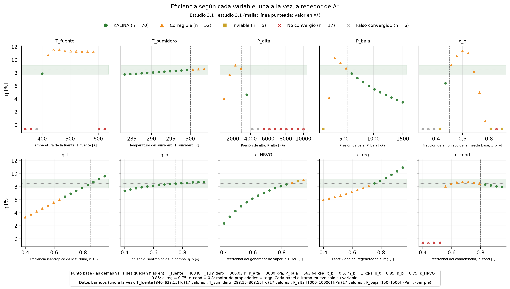
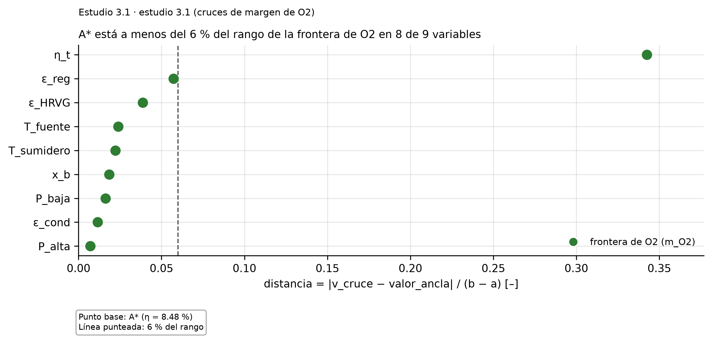

#### Estudio 3.2 — Sensibilidad global (LHS de 500 puntos)

- **Caja:** T_fuente 380–500 K, T_sumidero 278–303.5 K, P_alta 2000–5000, P_baja 300–1500 kPa,
  x_b 0.50–0.85, η/ε en rangos realistas.
- **Resultado:** 452 genuinas, 121 KALINA (83 confiables).

| Magnitud | p5 – p95 | mín – máx |
|---|---|---|
| P_alta | 2156 – 4842 kPa | 2005 – 4961 kPa |
| P_baja | 683 – 1461 kPa | 547 – 1493 kPa |
| ΔP | 968 – 3718 kPa | 710 – 4117 kPa |
| r_P | 1.69 – 5.34 | 1.55 – 8.38 |

- **Qué decide KALINA (KS):** P_baja y ε_cond (0.43), r_P (0.35), T_fuente (0.29).
- **Qué mueve η (PRCC):** P_baja (−0.68), P_alta (+0.58), η_t (+0.38), T_fuente (+0.29).
- **Conclusión:** subir P_baja ayuda a cumplir O2 pero baja η: los óptimos de η quedan al filo de O2.

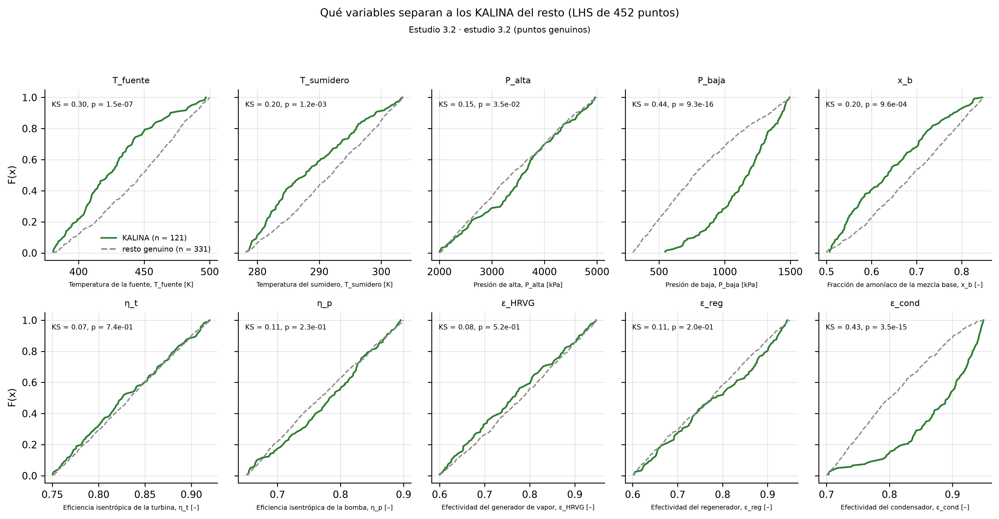
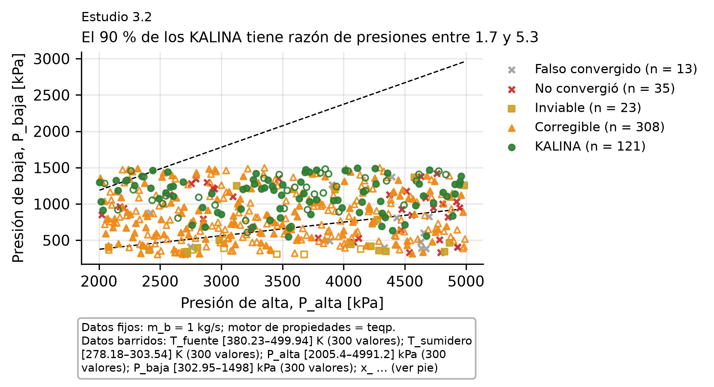
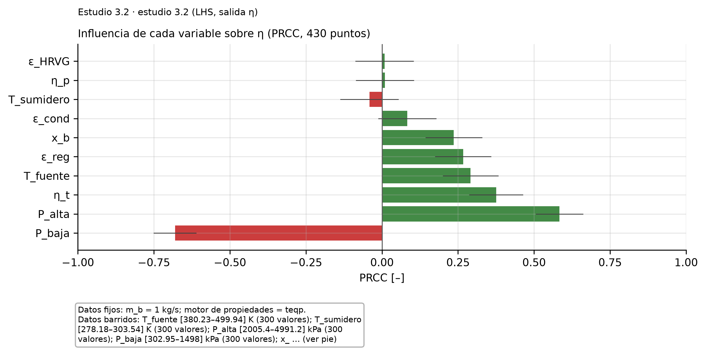
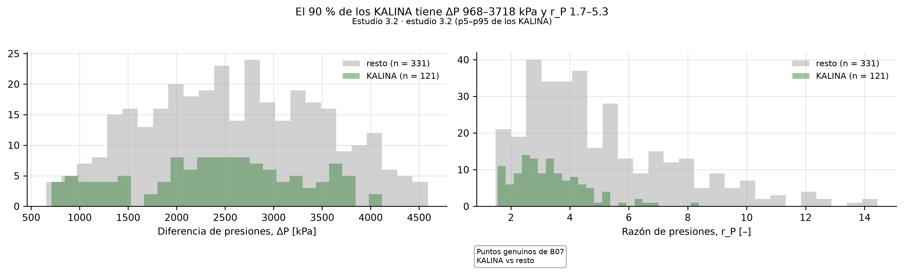

#### Estudio 3.3 — Techo de P_baja (1500–2500 kPa)

- 135 evaluados: 120 genuinos, 75 KALINA (45 confiables); 33–75 % de KALINA por franja.
- **Conclusión:** no hay techo de clasificación hasta 2500 kPa; lo que limita una P_baja alta es
  r_P → 1 y la eficiencia (mediana 4.29 %), no la cavitación.

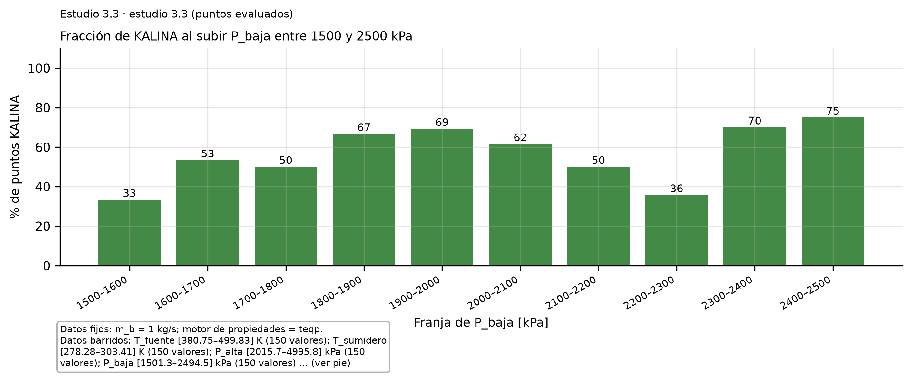

### Pregunta 4 · ¿Qué datos del profesor se pueden conservar?

#### Estudio 4.1 — Escenarios de conservación (LHS de 120 por escenario)

| Escenario | Conserva | KALINA | Confiables |
|---|---|---|---|
| 4.1a | T_fuente y T_sumidero | 4 | 2 |
| 4.1b | P_alta y P_baja | 0 | 0 |
| 4.1c | presiones + clima | 0 | 0 |
| 4.1d | P_alta + temperaturas | 6 | 0 |
| 4.1e | T_fuente + x_b | 10 | 0 |

- **Conclusión:** conservar 623 K casi nunca da KALINA confiable (2 de 20, con P_baja 1.36–1.97 MPa
  y x_b 0.71–0.83). Las presiones del profesor sí son posibles, pero en una franja tan angosta que
  el LHS no la encontró → estudio 4.2.

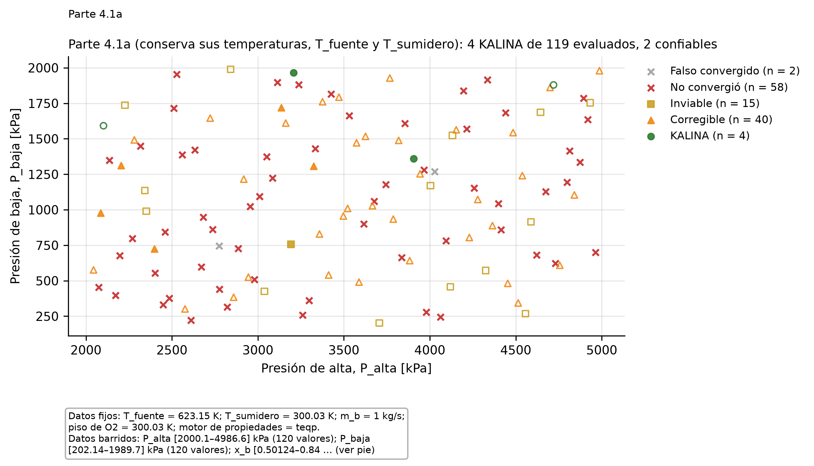
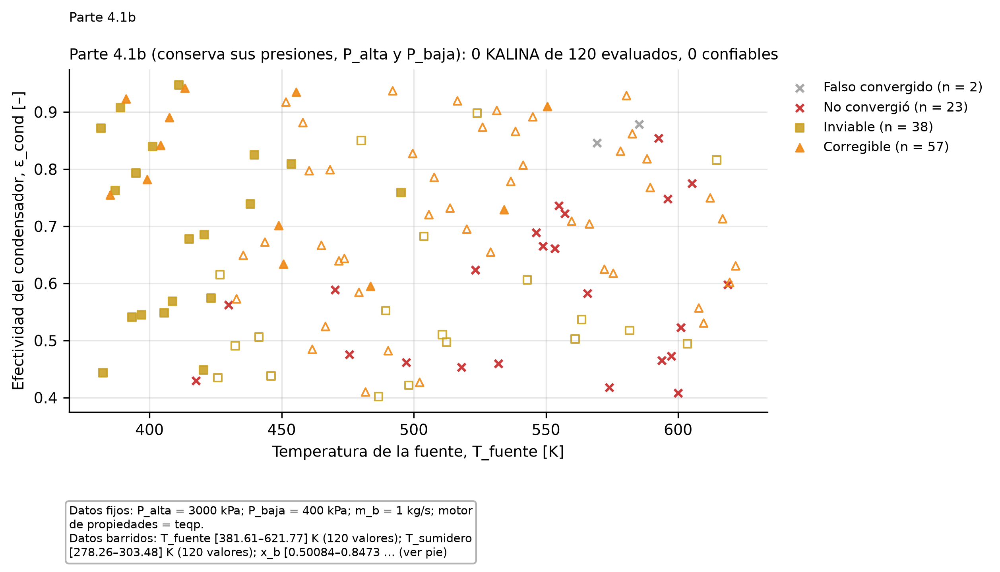
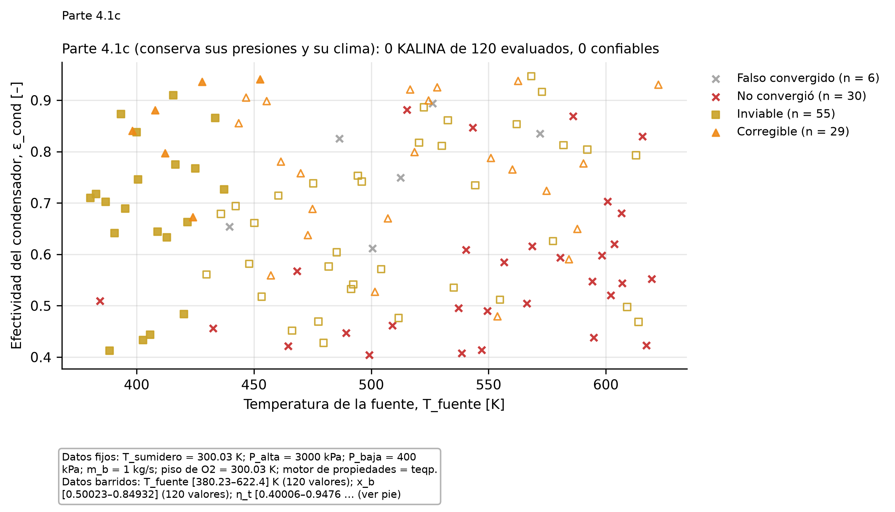
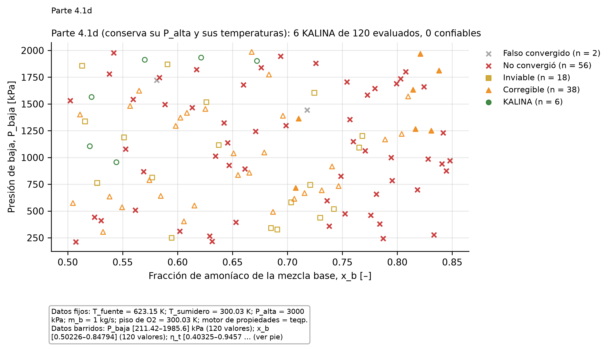
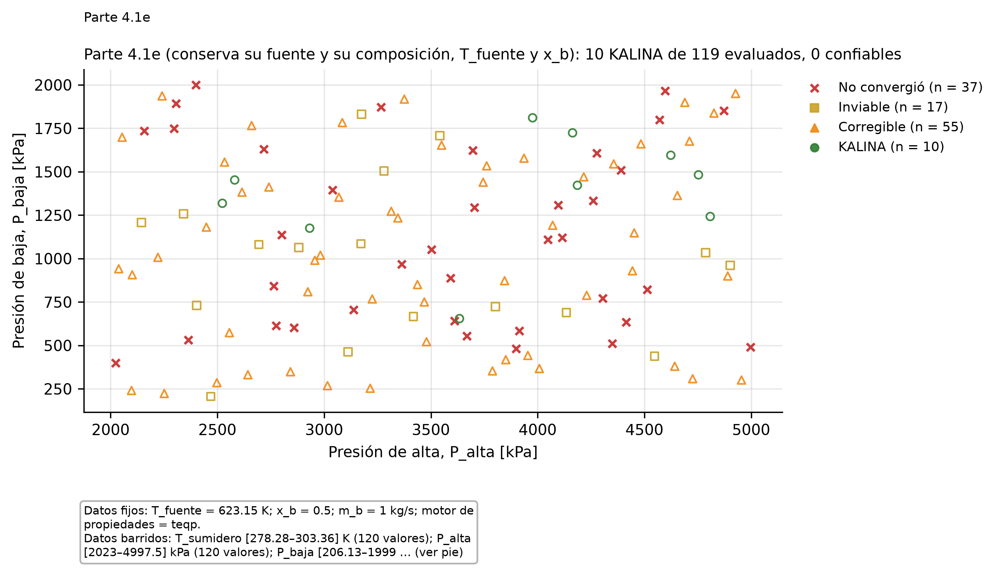

#### Estudio 4.2 — La franja KALINA con las presiones del profesor

- Malla T_fuente 385–410 K × ε_cond 0.85–0.95 × T_sumidero {278.15, 290.65, 300.03} K: 165 corridas,
  **104 KALINA, todos confiables**. Por debajo de 390 K, O3 (trabajo negativo).

| ε_cond (clima 300.03 K) | Celdas KALINA | T_fuente |
|---|---|---|
| 0.85 | 0 | — |
| 0.875 | 1 | 390 K |
| 0.90 | 2 | 390–392.5 K |
| 0.925 | 4 | 390–397.5 K |
| 0.95 | 9 | 390–410 K |

- Mejor η: 10.81 % (410 K, ε_cond 0.95, 300.03 K), confirmado por el motor real.
- **Conclusión:** las dos presiones del profesor son compatibles con KALINA si la fuente está a
  390–410 K y ε_cond ≥ 0.875 (con clima más frío basta 0.85).

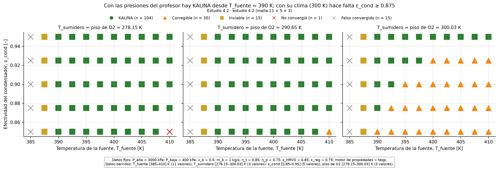

#### Estudio 4.3 — Escalera de conservación de los datos del profesor

| Ronda | Conjunto elegido | Datos conservados | KALINA (confiables) |
|---|---|---|---|
| 0 | x_b | 1 | 29 (15) |
| 1 | x_b + P_alta | 2 | 11 (7) |
| 2 | x_b + P_alta + eficiencias | 7 | 13 (7) |
| 3 | **x_b + P_alta + eficiencias + P_baja** | **8 de 10** | **5 (5)** |

- Conjunto final: conserva P_alta, P_baja, x_b y las cinco η/ε; solo se mueven T_fuente
  (391–409 K) y T_sumidero (280–293 K). η hasta 10.6 %, subenfriamiento ≥ 2 K.
- Ningún conjunto con T_fuente = 623 K da KALINA confiable (x_b + P_alta + eficiencias + T_fuente: 30/30 NO_CONVERGIO).

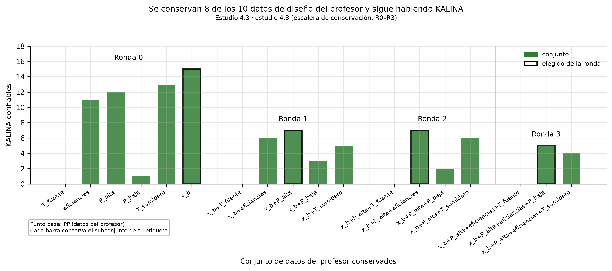

### Pregunta 5 · ¿Cuánta eficiencia se puede lograr?

#### Estudio 5.1 — Máxima eficiencia dentro de KALINA

| Arranque | Conserva | η máx. | Confiables |
|---|---|---|---|
| 5.1a | nada (desde estudio 3.2) | 14.98 % | 98 de 102 |
| 5.1b | nada (desde estudio 2.4) | 15.48 % | 63 de 63 |
| 5.1c | temperaturas del profesor | 12.74 % | 90 de 91 |
| **5.1d** | **presiones y clima del profesor** | **15.60 %** | 80 de 80 |
| 5.1e | fuente + x_b del profesor | 11.09 % | 0 de 83 |

- **Conclusión:** η máx. 15.6 % con T_fuente 415 K y equipos a 0.95 (cota superior, no diseño).
  5.1c prueba que 623 K admite KALINA confiables solo con x_b ≈ 0.85 y presiones altas.

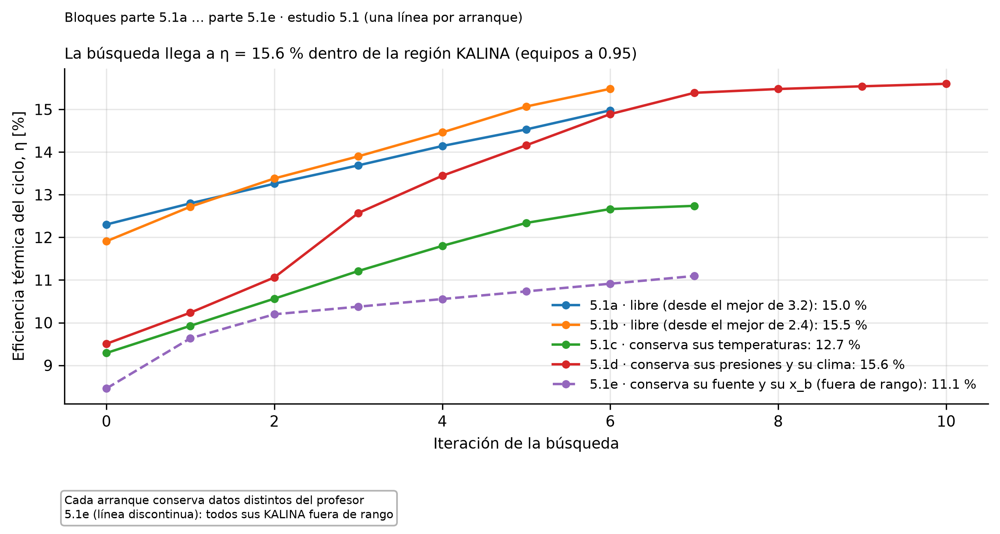

### Pregunta 6 · ¿Son confiables los resultados?

#### Estudio 6.1 — Verificación con el motor real y costo del margen de cavitación

- teqp y el motor real coinciden en todos los puntos que el motor real resolvió (|Δη| < 0.003 pp).
  Con 300 s, 10 de 12 se cortan por tiempo; con 1500 s (estudio 4.3) se confirman A\*, 5.1d y Húsavík.
- Piso de O2 en 303.55 K: 9 de 12 pasan a CORREGIBLE (déficit 0.5–3.2 K): los diseños están al filo.
- Exigir 2 K de subenfriamiento: +25–46 kPa de P_baja y −0.3 a −0.5 pp de η.

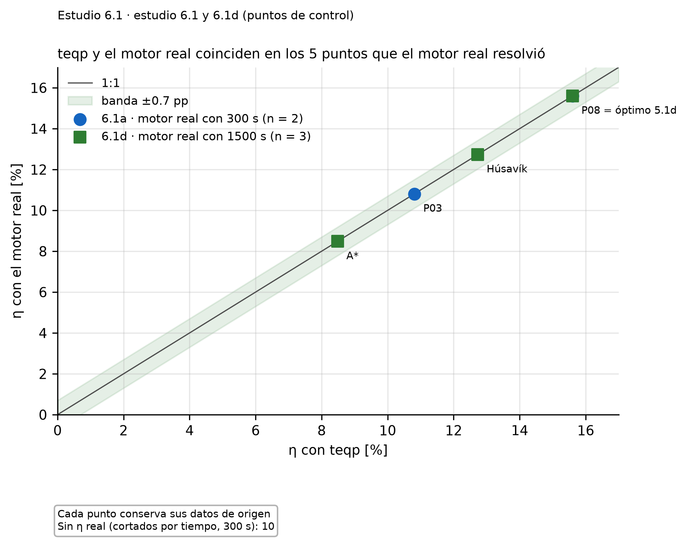

#### Estudio 6.2 — Húsavík revisitado

- **F3:** los 97 KALINA de septiembre se reproducen sin cambio de clase (Δη < 10⁻¹¹ pp); 83 son
  confiables (14 usan η_t o ε_cond > 0.95).
- **OFAT** (ancla Húsavík): KALINA con T_fuente 380–401 K, T_sumidero 273–283 K, P_alta 2821–4000,
  P_baja 700–1200 kPa, x_b 0.60–0.825, ε_HRVG 0.60–0.925; ε_cond solo 0.95. Casi todo rompe por O2.
- **MALLA:** la P_baja mínima KALINA sube de 500 kPa (x_b 0.70) a 800 kPa (x_b ≥ 0.85); su P_baja
  real (690 kPa) coincide con la mínima KALINA.

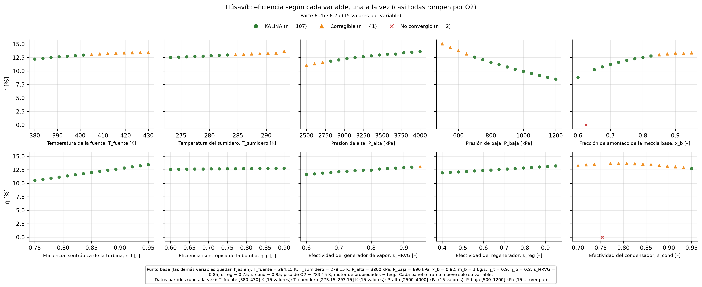

#### Parte 6.2d — Húsavík con poco amoníaco

| x_b | Qué pasa |
|---|---|
| 0.30–0.45 | sin ciclo: 0 genuinos de 32 (16 no convergen, 16 N2) |
| 0.50 | KALINA formal, η 0.1–1.2 % |
| 0.55 | primer KALINA útil: P_baja mín. 300 kPa, η 9.6 % |
| 0.60 / 0.65 / 0.70 | P_baja mín. 400 / 500 / 500 kPa |

- **Conclusión:** con el ancla de Húsavík, x_b = 0.50 es el límite; con otras condiciones (estudio 4.2, estudio 4.3)
  x_b = 0.50 sí da η de 8–11 %.

---

### Anexo · Equipos fuera del rango realista (no entra en las conclusiones)

#### Estudio A.1 — Anecdótico (fuera del rango realista)

η y ε de 0.20 a 0.99. Solo ilustrativo; no entra en conclusiones ni en tableros.

---

## Síntesis

### Datos del profesor que se pueden conservar (Tabla S-4)

| Dato | ¿Se conserva con KALINA? | Respaldo |
|---|---|---|
| P_alta 3000 kPa | sí | estudio 4.3, estudio 4.2 |
| P_baja 400 kPa | sí; con su clima exige ε_cond ≥ 0.875 | estudio 4.3, estudio 4.2 |
| x_b 0.50 | sí (con Húsavík queda al límite) | estudio 4.3, estudio 6.2 |
| η_t, η_p, ε_HRVG, ε_reg | sí | estudio 4.3 |
| ε_cond 0.80 | sí, si el sitio es más frío (≤ ~293 K) | estudio 4.3, estudio 4.2 |
| T_sumidero 300.03 K | con condiciones | estudio 4.3, estudio 4.2 |
| **T_fuente 623.15 K** | **no (bloqueo estructural)** | estudio 1.1, estudios 2.1 y 2.2, estudio 4.3 |

### Criterios que bloquean (Tabla S-5)

O2 aparece en el 88–100 % de los genuinos no KALINA de todos los casos salvo estudio 4.2 (67 %); O3 pesa en estudio 4.1
(39 %), estudio 4.2 (33 %) y estudio 4.3 (24 %), por fuentes frías o x_b baja.

### Rangos KALINA comparados (Tabla S-3)

Ver Tabla S-3: p5, mediana y p95 de P_alta, P_baja, ΔP, r_P, T_fuente y x_b de los KALINA
confiables por parte (3.2, 4.1a–4.1e, 4.2, el conjunto final de 4.3 y la malla de Húsavík 6.2c).

---

## Conclusiones (con la evidencia de los datos)

### Cómo se sostiene cada conclusión

Cada conclusión trae: la **afirmación**, la **evidencia** (estadístico, n, intervalo o p), el
**comportamiento de los datos** (dirección, monotonía, linealidad, umbral, interacción) y el **grado
de confianza**:

| Grado | Criterio |
|---|---|
| **Fuerte** | Estadístico significativo (p < 0.005, umbral de Bonferroni para 10 variables) **y** el mismo resultado en al menos dos casos o métodos independientes |
| **Moderada** | Significativo en un solo caso o método, o con un intervalo que se solapa con el de otra variable |
| **Indicativa** | Patrón visible, pero con n pequeño, efecto dentro de la banda de η (±0.4–0.7 pp) o apoyado en puntos N2 |

Fuentes de los estadísticos: `m4b_rsa.csv` (KS con IC bootstrap al 95 %, 1000 remuestreos),
`m4b_prcc.csv` (PRCC con IC al 95 %), `m4b_pawn.csv`, `m4b_convergencia.csv`, `m4b_cart.txt` y
regresiones propias sobre `todos_los_puntos.csv`.

---

### Factibilidad: qué decide que el ciclo sea KALINA

**C1. La factibilidad la deciden el lado frío (P_baja, ε_cond) y la razón de presiones; el lado
caliente y la x_b pesan menos, y las eficiencias de las máquinas casi nada.** *Fuerte.*

| Variable | KS (KALINA vs. resto) | IC 95 % | p | Lectura |
|---|---|---|---|---|
| P_baja | **0.43** | 0.37 – 0.52 | < 10⁻¹⁵ | decide |
| ε_cond | **0.43** | 0.35 – 0.52 | < 10⁻¹⁴ | decide |
| r_P | 0.35 | 0.30 – 0.45 | < 10⁻⁹ | decide |
| T_fuente | 0.29 | 0.21 – 0.39 | 3·10⁻⁷ | influye |
| T_sumidero | 0.20 | 0.14 – 0.31 | 0.001 | influye |
| x_b | 0.19 | 0.14 – 0.30 | 0.002 | influye |
| P_alta, ΔP | 0.13 – 0.14 | — | 0.05 – 0.08 | no significativa |
| η_t, η_p, ε_HRVG, ε_reg | 0.07 – 0.12 | — | 0.12 – 0.67 | no decide |

*n = 121 KALINA contra 379 no KALINA (estudio 3.2, LHS de 500 puntos).*

- **Comportamiento:** los IC de P_baja y ε_cond se solapan casi por completo, así que **no se puede
  decir cuál de las dos pesa más**; las dos están claramente por encima de T_fuente.
- **Mecanismo:** el margen de cavitación m_O2 explica la clase. Su PRCC (n = 452): P_baja **+0.76**,
  ε_cond **+0.73**, T_fuente **−0.68**, T_sumidero **−0.54**, x_b **−0.47**; las eficiencias de
  turbina y bomba no lo mueven (|PRCC| < 0.05, p > 0.4). Subir P_baja eleva la temperatura de
  burbuja; un condensador más efectivo enfría más el líquido; una fuente más caliente, un sumidero
  más caliente o más amoníaco empujan el líquido hacia la saturación.
- **Consistencia:** O2 es el criterio que bloquea en el 88–100 % de los genuinos no KALINA de todos
  los casos salvo estudio 4.2 (67 %; Tabla S-5), y las variables de m_O2 son las que mueven las fronteras en
  estudio 2.4 (T_sumidero), estudio 4.2 (ε_cond, T_fuente) y estudio 6.2 (x_b, P_baja).

**C2. La frontera de KALINA es un umbral, no una transición suave, y los diseños quedan pegados a
ella.** *Fuerte.*

- En estudio 3.1, el ancla A\* está a menos del **6 % del rango** de la frontera de O2 en **8 de 9** variables;
  en P_alta, a 0.7 % (bajarla 64 kPa rompe O2).
- Con el piso de O2 en 303.55 K, **9 de 12** puntos clave pasan de KALINA a CORREGIBLE, con déficits
  de 0.5–3.2 K (estudio 6.1).
- Los óptimos de estudio 5.1 terminan en el borde de O2 o de O1.
- **Consecuencia:** el criterio O2 del modelo no tiene margen propio. Un diseño "KALINA" sin margen
  de subenfriamiento es frágil frente a pequeñas variaciones del clima.

**C3. El efecto de P_baja depende de P_alta (interacción).** *Fuerte.*

| Franja de P_alta [kPa] | P_baja mínima KALINA [kPa] | % KALINA |
|---|---|---|
| 2000 – 2500 | 913 | 21.7 |
| 2500 – 3000 | 683 | 19.3 |
| 3000 – 3500 | 607 | 25.0 |
| 3500 – 4000 | **547** | **34.9** |
| 4000 – 5000 | 558 – 634 | 21 – 23 |

- La P_baja mínima baja ~360 kPa al pasar de 2000–2500 a 3500–4000 kPa, y deja de bajar por encima
  de 4000 kPa. Es una interacción no lineal: por eso P_alta sola no es significativa en el KS (0.13),
  pero r_P sí (0.35).
- **Consecuencia:** la ventana de diseño debe darse en **r_P (1.7–5.3, p5–p95)** junto con P_baja, no
  en P_alta sola.

**C4. La frontera es multivariada: las reglas de una variable a la vez no la capturan bien.**
*Moderada.*

- El árbol CART (profundidad 4) clasifica KALINA con **78.8 %** de exactitud en validación cruzada,
  apenas por encima del **75.8 %** que daría decir "nunca es KALINA". Sus cortes principales
  (ε_cond ≈ 0.89, P_baja ≈ 770–1025 kPa, T_fuente ≈ 416 K) son orientativos, no una regla de diseño.
- **Lectura:** la factibilidad depende de una combinación (el signo de m_O2), no de cortes paralelos
  a los ejes. Por eso las mallas dirigidas (estudio 4.2, estudio 4.3) encontraron franjas que el muestreo al azar no vio.

---

### Desempeño: qué mueve la eficiencia η

**C5. Lo que decide la factibilidad no es lo que mueve η.** *Fuerte.*

| Variable | PRCC sobre η | IC 95 % | ¿Decide KALINA? (KS) |
|---|---|---|---|
| P_baja | **−0.68** | −0.75 – −0.61 | sí (0.43) |
| P_alta | **+0.58** | 0.51 – 0.66 | no (0.13) |
| η_t | **+0.38** | 0.29 – 0.46 | no (0.09) |
| T_fuente | +0.29 | 0.20 – 0.38 | sí (0.29) |
| ε_reg | +0.27 | 0.17 – 0.36 | no (0.12) |
| x_b | +0.24 | 0.14 – 0.33 | sí (0.19) |
| ε_cond | +0.08 (p = 0.09) | −0.01 – 0.18 | **sí (0.43)** |
| T_sumidero, η_p, ε_HRVG | ≈ 0 (p > 0.39) | — | — |

*n = 430 puntos genuinos con W_net > 0 (estudio 3.2).*

- **ε_cond** decide la clase pero no mueve η; **P_alta, η_t y ε_reg** mueven η pero no deciden la
  clase. Solo **P_baja** está en los dos, y con efectos opuestos (C6).
- **Consecuencia práctica:** primero se elige ε_cond y P_baja para ser KALINA; después se sube η con
  P_alta, η_t y ε_reg sin arriesgar la clase.

**C6. P_baja tiene un efecto antagónico: subirla asegura KALINA pero baja η, de forma casi lineal.**
*Fuerte.*

- En estudio 2.4 (base 2.4a, clima 300 K, 9 puntos KALINA): η baja **0.55 pp por cada 100 kPa** de P_baja
  (R² = 0.98).
- En estudio 6.1, cada kelvin de subenfriamiento exigido cuesta **13.9 kPa** de P_baja (mediana; 3.8–23.3) y
  **0.16 pp** de η (mediana; 0.07–0.24), en 10 pares punto-margen.
- Por eso los óptimos de η quedan pegados a la frontera de O2 (C2).

**C7. Cerca de A\*, η responde de forma monótona y casi lineal a las eficiencias, pero de forma no
monótona a T_fuente y x_b.** *Fuerte para las eficiencias; moderada para el resto.*

| Variable (estudio 3.1, malla, genuinos con W_net > 0) | n | ρ de Spearman | Pendiente | R² |
|---|---|---|---|---|
| η_t | 15 | +1.00 | +0.115 pp por 0.01 | 1.00 |
| ε_reg | 15 | +1.00 | +0.089 pp por 0.01 | 0.98 |
| ε_HRVG | 15 | +1.00 | +0.115 pp por 0.01 | 0.95 |
| η_p | 15 | +1.00 | +0.024 pp por 0.01 | 0.94 |
| T_sumidero (P_baja fija) | 15 | +1.00 | +0.042 pp/K | 1.00 |
| P_baja | 14 | −0.71 | −0.40 pp por 100 kPa | 0.54 |
| T_fuente | 10 | −0.01 | — (no monótona) | 0.28 |
| x_b | 8 | −0.43 | — (no monótona) | 0.30 |

- **T_fuente y x_b** cambian de régimen dentro del rango: no convergencia, KALINA y CORREGIBLE se
  alternan (Figura 3.1-3). Para ellas, la elasticidad local (E = 10.9 y 3.4) **solo vale pegado a A\***
  y no debe extrapolarse.
- **Local vs. global:** ε_HRVG sube η con fuerza en A\* (+0.115 pp por 0.01), pero su PRCC global es
  ≈ 0. Es un efecto que depende del punto, no una tendencia de toda la caja.

**C8. Un sumidero más frío ayuda sobre todo porque permite bajar P_baja, no por un efecto directo
sobre η.** *Fuerte.*

| Base (estudio 2.4) | P_baja mínima KALINA | η en esa P_baja |
|---|---|---|
| 2.4a (T_fuente 403 K) | −12.5 kPa por K más frío (R² = 0.99) | +0.088 pp por K (R² = 1.00) |
| 2.4b (T_fuente 420 K) | −15.9 kPa/K (R² = 1.00) | +0.128 pp/K (R² = 1.00) |
| 2.4c (ε_HRVG 0.40) | −25.7 kPa/K (R² = 1.00) | +0.155 pp/K (R² = 1.00) |

- Con P_baja fija (estudio 3.1), el efecto directo de T_sumidero sobre η es pequeño (0.85 pp en todo el rango,
  **dentro de la banda** de incertidumbre). El beneficio llega por la vía indirecta: un clima frío
  relaja O2, permite una P_baja menor, y la P_baja menor sube η (C6).
- Las relaciones son lineales en 278–300 K, con pendientes que crecen cuanto más exigida está la
  base (2.4c > 2.4b > 2.4a).

**C9. Más amoníaco (x_b) exige más P_baja para evitar la cavitación.** *Fuerte en Húsavík;
consistente con estudio 3.2.*

- Malla de Húsavík (parte 6.2c, x_b 0.55–0.91): la P_baja mínima KALINA sube **~144 kPa por cada 0.1
  de x_b** (R² = 0.97).
- Coincide con el PRCC global de x_b sobre m_O2 (−0.47).
- Por debajo de x_b = 0.50 no hay ningún punto genuino (32 de 32 sin ciclo); con x_b = 0.50, η < 1.3 %
  en Húsavík. Ese límite inferior **depende del punto base**: con la fuente a ~400 K y las presiones
  del profesor, x_b = 0.50 da η de 8–11 % (estudio 4.2, estudio 4.3).

---

### Conclusiones sobre el enunciado del profesor

**C10. La fuente a 623 K es incompatible con el resto del enunciado.** *Fuerte.*

- Con todos los datos del profesor: 0 de 41 converge (estudio 1.1). Con un cambio: 0 KALINA (estudio 2.1).
- Conservando la fuente, solo hay KALINA confiables lejos del enunciado: x_b 0.71–0.85, P_alta
  3200–5000 kPa y P_baja 1.36–1.97 MPa (92 puntos, estudio 5.1c y estudio 4.1a). Con la x_b o las presiones del
  profesor: 0 confiables en todos los barridos (estudio 2.4c, estudios 4.1d y 4.1e, estudio 5.1e y los 4 conjuntos de estudio 4.3 con
  T_fuente).
- **Mecanismo:** T_fuente es la tercera variable que más baja el margen de cavitación (PRCC −0.68), y
  a 623 K ese efecto no se compensa con las presiones y la composición del enunciado.

**C11. Con la fuente a ~390–410 K se conservan 8 de los 10 datos de diseño.** *Fuerte.*

- La escalera de estudio 4.3 conserva las 2 presiones, x_b y las 5 η/ε, moviendo solo T_fuente (391–409 K) y
  T_sumidero (280–293 K): 5 de 5 KALINA confiables, con subenfriamiento real ≥ 2 K.
- La malla dirigida de estudio 4.2 lo confirma con otra combinación: las 2 presiones del profesor dan 104 de
  165 KALINA (todos confiables) con T_fuente 390–410 K. La T_fuente máxima KALINA sube con ε_cond:
  390 → 410 K al pasar de 0.875 a 0.95 en el clima de 300 K.
- η crece **0.39 pp por K** de T_fuente dentro de esa franja (R² = 0.90): de 390 a 410 K se ganan
  ~8 pp de η sin salir de KALINA, siempre que ε_cond acompañe.

---

### Robustez del análisis

| Prueba | Resultado | Lectura |
|---|---|---|
| Convergencia del ranking (300 → 500 puntos) | ρ de Spearman 0.93 (KS) y 0.99 (PRCC) | los rankings son estables; P_baja sigue 1.ª en KS y PRCC |
| Significancia con 10 pruebas | 6 de 10 PRCC sobre η con p < 10⁻⁵ | sobreviven a Bonferroni (α = 0.005) |
| PAWN sobre η (T_máx) | P_baja 0.44, P_alta 0.42, η_t 0.30, T_fuente 0.27 | mismo grupo líder que el PRCC, sin suponer monotonía |
| Motor de propiedades | teqp = motor real en 5 de 5 puntos (Δη < 0.003 pp) | las conclusiones no dependen del motor |
| Reproducibilidad | 41/41 (F1) y 97/97 (Húsavík F3) | el código actual reproduce lo anterior |
| Banda de η | ±0.4–0.7 pp | no se concluye nada de diferencias menores (p. ej. T_sumidero con P_baja fija, ε_cond y η_p en estudio 3.1) |

### Lo que los datos no permiten afirmar

- **El orden entre P_baja y ε_cond** como decisores de KALINA: sus IC se solapan (C1).
- **Una regla de corte simple** para la factibilidad: el CART apenas supera la tasa base (C4).
- **Tendencias globales a partir de estudio 3.1:** T_fuente y x_b no son monótonas alrededor de A\* (C7).
- **El borde superior** de la franja de estudio 4.2 (T_fuente > 410 K no se exploró).
- **Lo que ocurre fuera de las cajas** de estudio 3.2 (P_baja > 1500 kPa solo en estudio 3.3, con otra muestra).

## Limitaciones

- Los LHS por escenario (estudio 4.1, estudio 4.3) son exploraciones; las franjas angostas solo se mapean con mallas
  dirigidas (estudio 4.2).
- En estudio 4.2 no se exploró T_fuente > 410 K.
- El motor real solo confirmó 5 puntos; los demás se cortaron por tiempo.
- Diferencias de η menores que 0.7 pp no son concluyentes.
- El margen de O2 del modelo es 0 K: los diseños están al filo de la cavitación.

## Recomendaciones

- Para el diseño: fuente ~400–410 K, presiones del profesor o P_baja en 683–1461 kPa, y un margen
  de subenfriamiento de ~2 K (+25–50 kPa de P_baja).
- Reportar η como "8–11 % con eficiencias medias; hasta ~15 % con equipos de alta eficiencia".
- Citar Húsavík como validación del modelo con una planta real.

## Anexo — Dónde están los datos

- Fichas por estudio (plantilla de 12 secciones): `04_fichas/Ficha_<estudio>_….md`
- Tablas: `02_tablas/<estudio>/Tabla_<estudio>-<n>.md` (y `.csv`); síntesis en `02_tablas/S/`
- Figuras con su pie: `03_figuras/<estudio>/Figura_<estudio>-<n>_….png` y `.pie.md`
- Excel con tablero interactivo, hoja Nomenclatura y gráficos nativos por pregunta (hojas «N Gráficos»):
  `../datos/Excel_kalina_final_final_final.xlsx`
