# Informe de la campaña final de barridos M1–M10b — Ciclo Kalina KCS-11

*Borrador estructurado del 2026-10-10. Reúne las conclusiones, los datos, las tablas y las figuras del
análisis de resultados. Todas las cifras salen de `01_datos/todos_los_puntos.csv` y fueron
validadas (A4: 76 de 78; las 2 diferencias son de definición) y revisadas tres veces.*

---

## 0. Resumen ejecutivo

1. **Con los datos del profesor el ciclo no converge** (M1: 41 de 41 NO_CONVERGIO). El bloqueo
   estructural es la **fuente a 623 K**.
2. **Bajando la fuente a ~390–410 K, casi todo el enunciado se conserva:** 8 de los 10 datos de
   diseño (M9: las dos presiones, x_b y las cinco η/ε), o las dos presiones del profesor con
   ε_cond ≥ 0.875 en su clima de 300 K (M5c).
3. **La cavitación (O2) es el criterio que manda** en todas las familias de barridos. Se cierra
   subiendo P_baja; dar 2 K de margen cuesta ~25–46 kPa de P_baja y < 0.5 pp de η (M6).
4. **Ventana de presiones:** el 90 % de los KALINA tiene P_baja 683–1461 kPa, P_alta 2156–4842 kPa,
   ΔP 968–3718 kPa y r_P 1.7–5.3 (M4/M4b).
5. **η es secundaria:** ~8–11 % con eficiencias medias; hasta 15.6 % con equipos a 0.95 (M7).
6. **El modelo queda validado:** reproduce la Fase 1 (M1) y la planta real de Húsavík (M10), y
   coincide con el motor de propiedades de referencia (M6/M9).

---

## 1. Introducción y pregunta

El enunciado del curso fija un ciclo Kalina KCS-11 con fuente de gases a 350 °C (623.15 K) y
sumidero a 27 °C (300.03 K). La campaña final buscó responder:

- ¿Funciona el ciclo con los datos del profesor?
- Si no, ¿qué es lo mínimo que hay que cambiar para que sea KALINA?
- ¿En qué rangos de presión (P_alta, P_baja, ΔP, r_P) aparece KALINA?
- ¿Qué datos del enunciado se pueden conservar?

### 1.1 Punto del profesor (PP) y punto ancla (A\*)

| Dato | PP (enunciado) | A\* (ancla de M3) |
|---|---|---|
| P_alta | 3000 kPa | 3000 kPa |
| P_baja | 400 kPa | **563.64 kPa** |
| x_b | 0.50 | 0.50 |
| T_fuente | 623.15 K | **403 K** |
| T_sumidero | 300.03 K | 300.03 K |
| η_t / η_p | 0.85 / 0.75 | 0.85 / 0.75 |
| ε_HRVG / ε_reg / ε_cond | 0.85 / 0.75 / 0.80 | 0.85 / 0.75 / 0.80 |
| Resultado | NO_CONVERGIO | KALINA, η = 8.48 % |

---

## 2. Metodología

### 2.1 Definiciones

| Término | Significado |
|---|---|
| Punto genuino | KALINA, CORREGIBLE o INVIABLE: el modelo lo resolvió de verdad |
| N2 (falso convergido) | El solver dice que convergió pero el clasificador lo descarta; no cuenta |
| KALINA confiable | KALINA dentro del rango del modelo de propiedades (IAPWS G4-01) y con η y ε en [0.40, 0.95] |
| O1 / O2 / O3 / O5 | Título del vapor / cavitación / trabajo neto / separador bifásico |
| Piso de O2 | Temperatura con la que se evalúa la cavitación: 300.03 K en M1–M3; = T_sumidero desde M2S |
| Banda de η | ±0.4–0.7 pp: diferencias menores no son concluyentes |
| Bloque | Puntos con las mismas variables fijas en los mismos valores; solo se comparan dentro de un bloque |

### 2.2 Familias de barridos y métodos

| Familia | Casos | Método |
|---|---|---|
| R reproducibilidad | M1 | repetición punto a punto |
| F factibilidad | M2-N1, M2-N2, M2R, M2S | mallas 1D/2D + bisección de fronteras |
| L local | M3 | una variable a la vez (15 valores) + elasticidad ±1 % |
| G global | M4, M4b, M4c | LHS; RSA/KS, PRCC, PAWN, CART, bootstrap |
| C conservación | M5, M5c, M9 | LHS por escenario, malla dirigida, escalera de selección |
| V verificación | M6 | teqp contra el motor real; costo del subenfriamiento |
| O optimización | M7 | búsqueda por patrones (primero KALINA, después η) |
| H caso real | M10, M10b | Húsavík: re-evaluación, OFAT, malla |
| X anecdótico | M8 | fuera del rango realista; no entra en conclusiones |

### 2.3 Regla de presentación

Ningún gráfico ni tabla de caso mezcla bloques con datos fijos distintos. Cada figura lleva título
con la conclusión, recuadro de condiciones y pie con datos fijos, barridos, filtro, n y fuente.

### 2.4 Panorama de la campaña

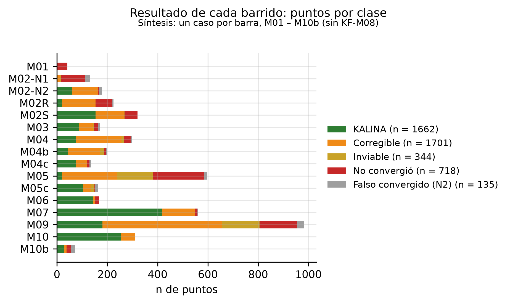

*FIG-G01. Resultado de cada barrido por clase (4 581 puntos sin M8). Tabla: TAB-G01.*

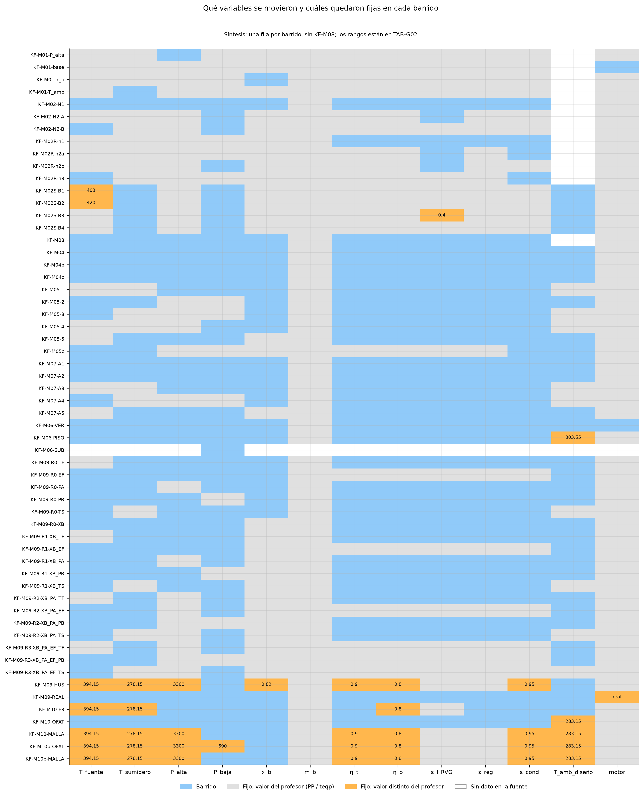

*FIG-G02. Qué variables se movieron y cuáles quedaron fijas en cada barrido. Tabla: TAB-G02.*

---

## 3. Resultados por barrido

### 3.1 M1 — Reproducibilidad del caso del profesor

- **Qué:** los 41 puntos de la Fase 1 (base, P_alta 2000–4000 kPa, x_b 0.40–0.70, T_amb horaria).
- **Resultado:** 42 corridas, **0 genuinas**; coincidencia de clase con la F1: 41 de 41.
- **Conclusión:** el código actual reproduce al profesor: con sus datos el ciclo no converge; mover
  solo P_alta, x_b o el clima no cambia nada. El bloqueo está en el lado caliente.
- **Tablas:** TAB-M01-00, -01, -02. Sin figura (nada que graficar).

### 3.2 M2-N1 — Un solo cambio sobre el profesor

- **Qué:** 10 variables, de a una (10 valores + bisección); η/ε en [0.75, 0.85]. 132 corridas.
- **Resultado:** 15 genuinas, **0 KALINA**, 21 N2. Solo T_fuente, ε_HRVG y x_b dan genuinos.
  El más cercano: T_fuente = 402.9 K, solo falla O2 por 2.0 K (η = 9.86 %).
- **Conclusión:** con un cambio no hay KALINA; el que más acerca es bajar la fuente a ~400 K.

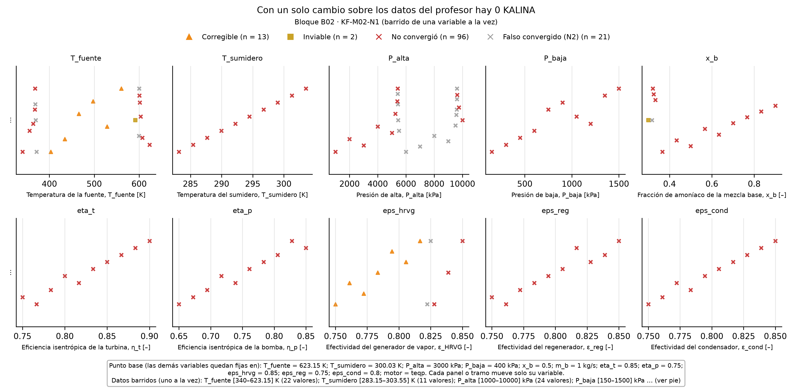

### 3.3 M2-N2 — Dos cambios (P_baja + una variable del lado caliente)

- **Ruta A** (conserva la fuente, ε_HRVG × P_baja): 36 genuinas, **0 KALINA** (bloquea O2).
- **Ruta B** (T_fuente × P_baja): **59 KALINA (48 confiables)** con T_fuente 390–434 K. Menor
  P_baja: 445.5 kPa a 390 K (η 2.45 %); mayor η: 9.15 % a 420 K / 736 kPa. Se elige **A\***.

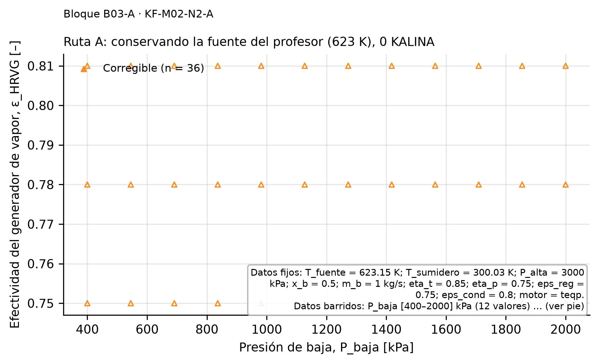
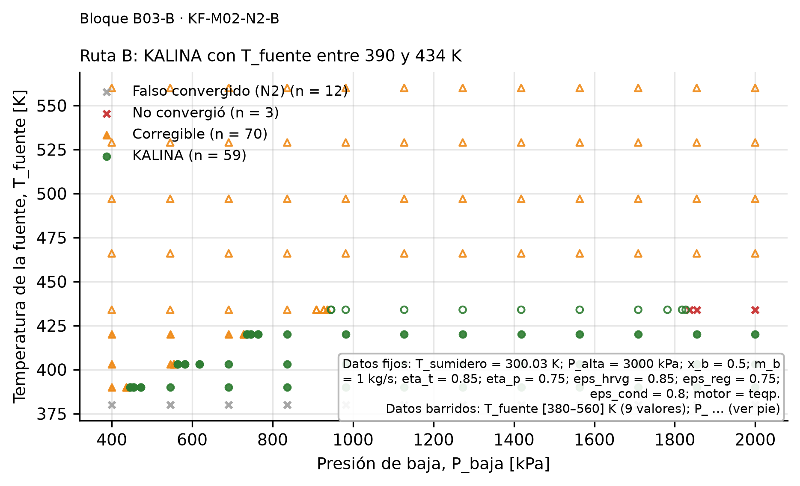

### 3.4 M2R — M2 con η y ε en [0.40, 0.95]

| Parte | KALINA | Confiables | Lectura |
|---|---|---|---|
| n1 (una variable) | 0 | 0 | un cambio sigue sin alcanzar |
| n2a (ε_HRVG × ε_cond, P_baja 400) | 0 | 0 | 48 corregibles, todos por O2 |
| n2b (ε_HRVG × P_baja) | 19 filas (13 distintos) | 0 | ε_HRVG 0.40–0.50 con P_baja 1318–2000 kPa; todos fuera de rango |
| n3 (T_fuente × ε_cond) | 1 | 1 | presiones del profesor + T_fuente 403 K + ε_cond 0.95: η 9.50 % |

- **Conclusión:** con 623 K hay KALINA solo bajando mucho ε_HRVG y subiendo P_baja, y ninguno es
  confiable. Con las presiones exactas del profesor sí hay un KALINA confiable (antecedente de M5c).

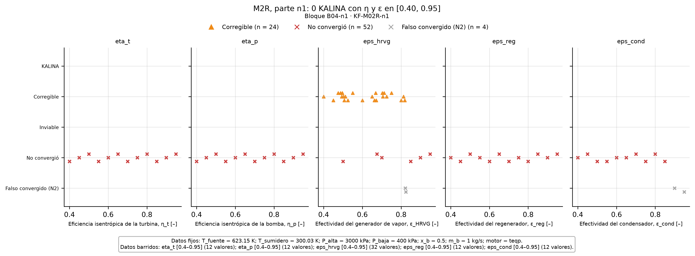
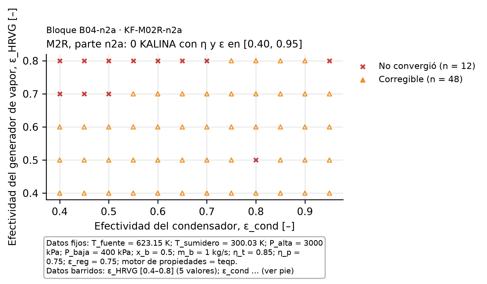
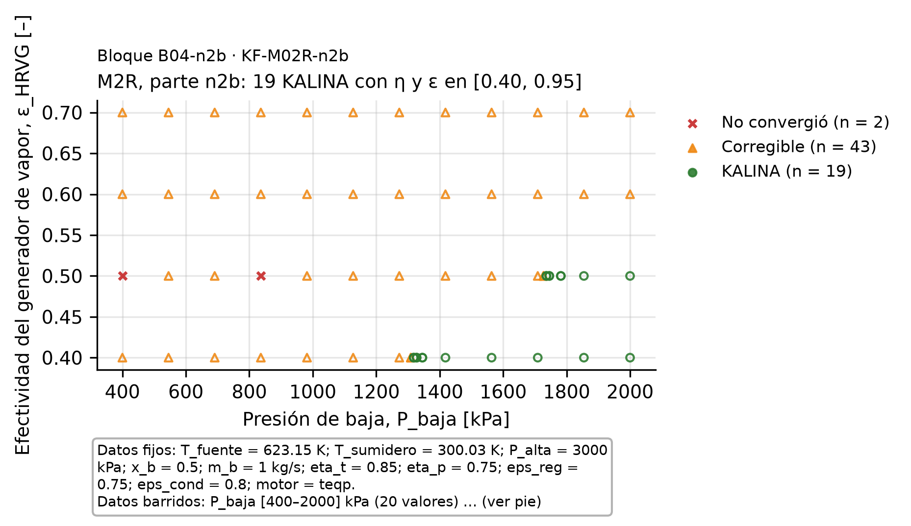
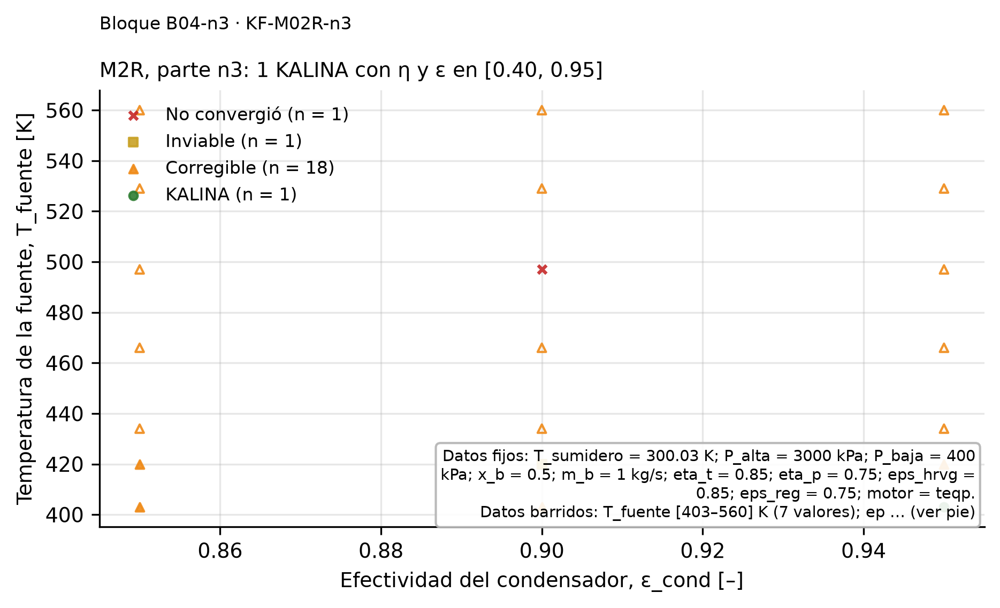

### 3.5 M2S — Sumidero más frío con P_baja libre

| Base | KALINA (confiables) | 300.03 K: P_baja mín. / η máx. | 278.15 K: P_baja mín. / η máx. |
|---|---|---|---|
| B1 (T_fuente 403 K) | 59 (59) | 562.5 kPa / 8.49 % | 290.6 kPa / 10.41 % |
| B2 (T_fuente 420 K) | 60 (60) | 740.6 kPa / 9.11 % | 393.8 kPa / 11.91 % |
| B3 (ε_HRVG 0.40) | 34 (0) | 1312.5 kPa / 6.30 % | 750 kPa / 9.69 % |
| B4 (profesor exacto) | 0 | — | — |

- **Conclusión:** un sumidero ~22 K más frío reduce a la mitad la P_baja necesaria y sube η 2–3 pp.
  El profesor exacto nunca es KALINA: el problema es la fuente, no el clima.

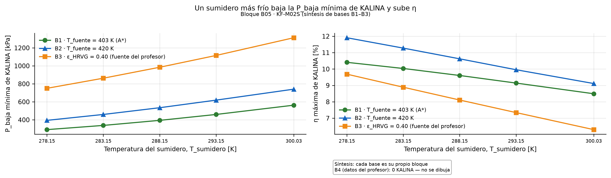

### 3.6 M3 — Sensibilidad local alrededor de A\*

- **Qué:** 10 variables × 15 valores + elasticidad ±1 % del rango. 171 corridas: 148 genuinas,
  86 KALINA.
- **Ranking (TAB-M03-02):** mayor elasticidad T_fuente (E = 10.9), luego x_b (3.4); mayor Δη x_b
  (10.8 pp) y P_baja (6.8 pp). Las palancas que suben η sin perder KALINA son ε_reg (hasta 10.96 %)
  y η_t (9.62 %).
- **Conclusión:** A\* está al filo de O2: en 8 de 9 variables la frontera está a menos del 6 % del
  rango (P_alta: bajarla 64 kPa ya rompe O2).

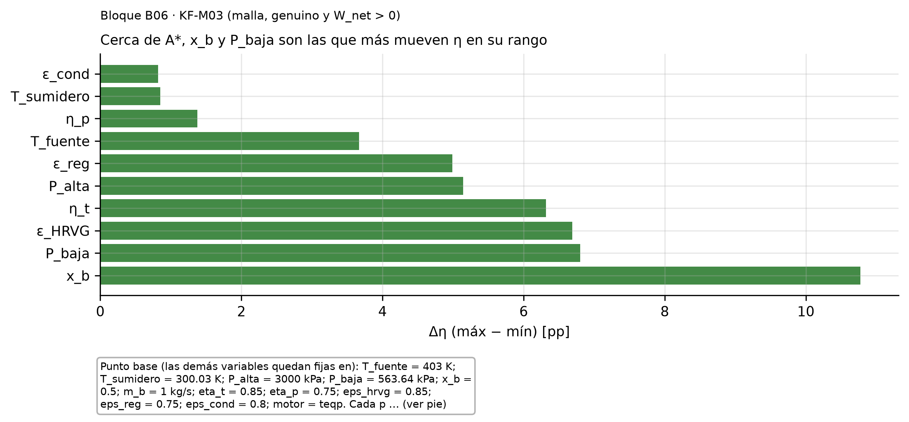

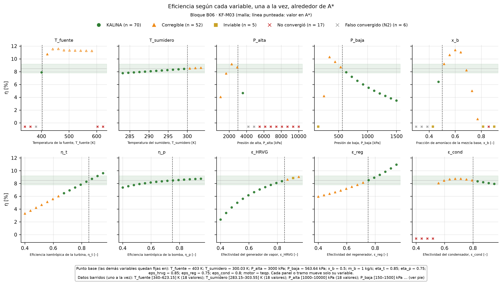
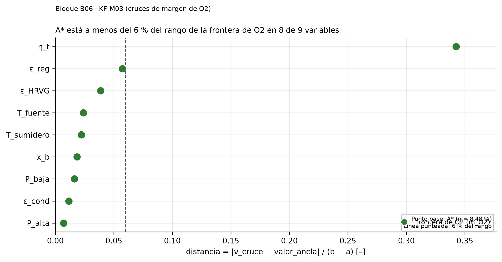

### 3.7 M4 + M4b — Sensibilidad global (LHS de 500 puntos)

- **Caja:** T_fuente 380–500 K, T_sumidero 278–303.5 K, P_alta 2000–5000, P_baja 300–1500 kPa,
  x_b 0.50–0.85, η/ε en rangos realistas.
- **Resultado:** 452 genuinas, 121 KALINA (83 confiables).

| Magnitud | p5 – p95 | mín – máx |
|---|---|---|
| P_alta | 2156 – 4842 kPa | 2005 – 4961 kPa |
| P_baja | 683 – 1461 kPa | 547 – 1493 kPa |
| ΔP | 968 – 3718 kPa | 710 – 4117 kPa |
| r_P | 1.69 – 5.34 | 1.55 – 8.38 |

- **Qué decide KALINA (KS):** P_baja y ε_cond (0.43), r_P (0.35), T_fuente (0.29).
- **Qué mueve η (PRCC):** P_baja (−0.68), P_alta (+0.58), η_t (+0.38), T_fuente (+0.29).
- **Conclusión:** subir P_baja ayuda a cumplir O2 pero baja η: los óptimos de η quedan al filo de O2.

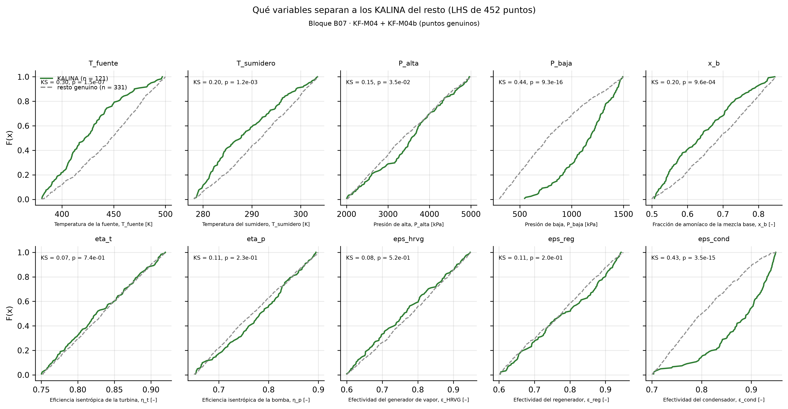
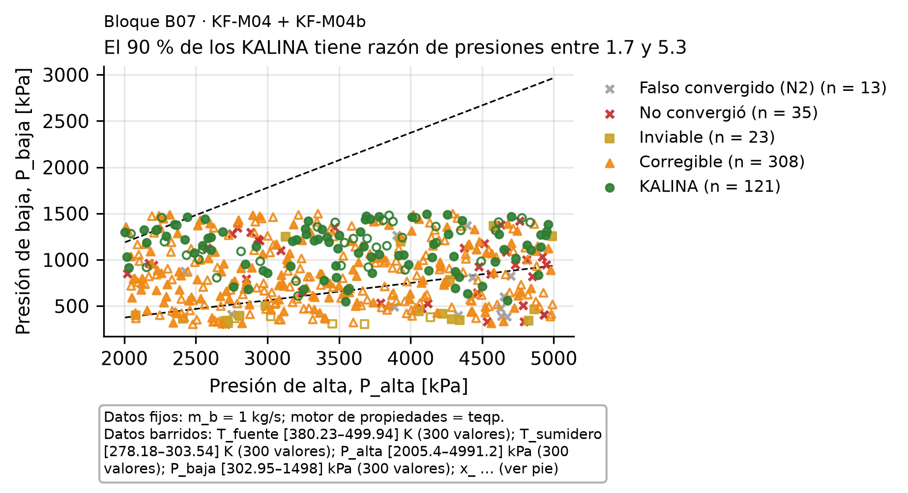
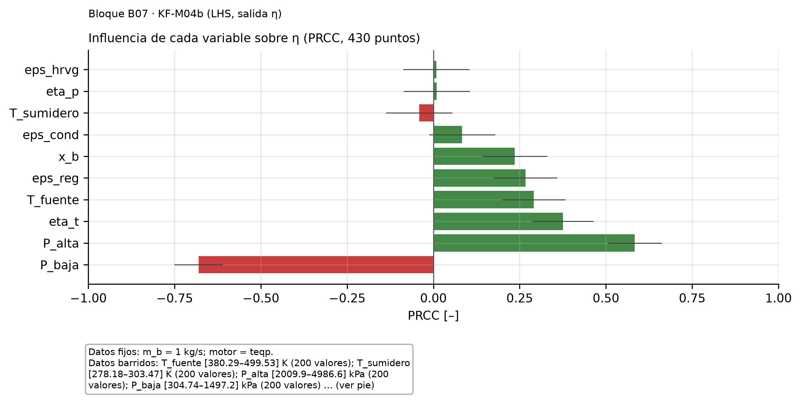
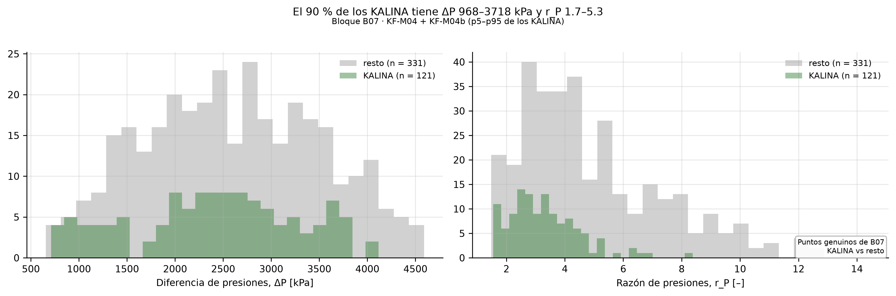

### 3.8 M4c — Techo de P_baja (1500–2500 kPa)

- 135 evaluados: 120 genuinos, 75 KALINA (45 confiables); 33–75 % de KALINA por franja.
- **Conclusión:** no hay techo de clasificación hasta 2500 kPa; lo que limita una P_baja alta es
  r_P → 1 y la eficiencia (mediana 4.29 %), no la cavitación.

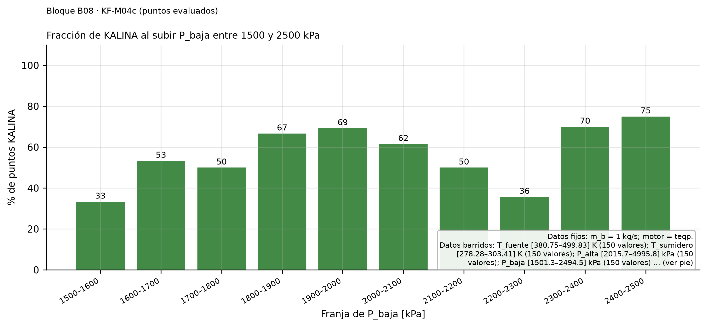

### 3.9 M5 — Escenarios de conservación (LHS de 120 por escenario)

| Escenario | Conserva | KALINA | Confiables |
|---|---|---|---|
| S1 | T_fuente y T_sumidero | 4 | 2 |
| S2 | P_alta y P_baja | 0 | 0 |
| S3 | presiones + clima | 0 | 0 |
| S4 | P_alta + temperaturas | 6 | 0 |
| S5 | T_fuente + x_b | 10 | 0 |

- **Conclusión:** conservar 623 K casi nunca da KALINA confiable (2 de 20, con P_baja 1.36–1.97 MPa
  y x_b 0.71–0.83). Las presiones del profesor sí son posibles, pero en una franja tan angosta que
  el LHS no la encontró → M5c.

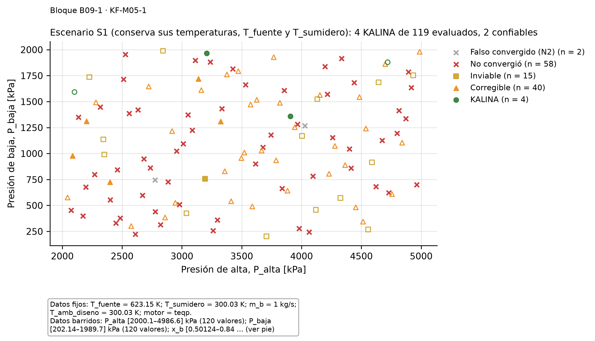
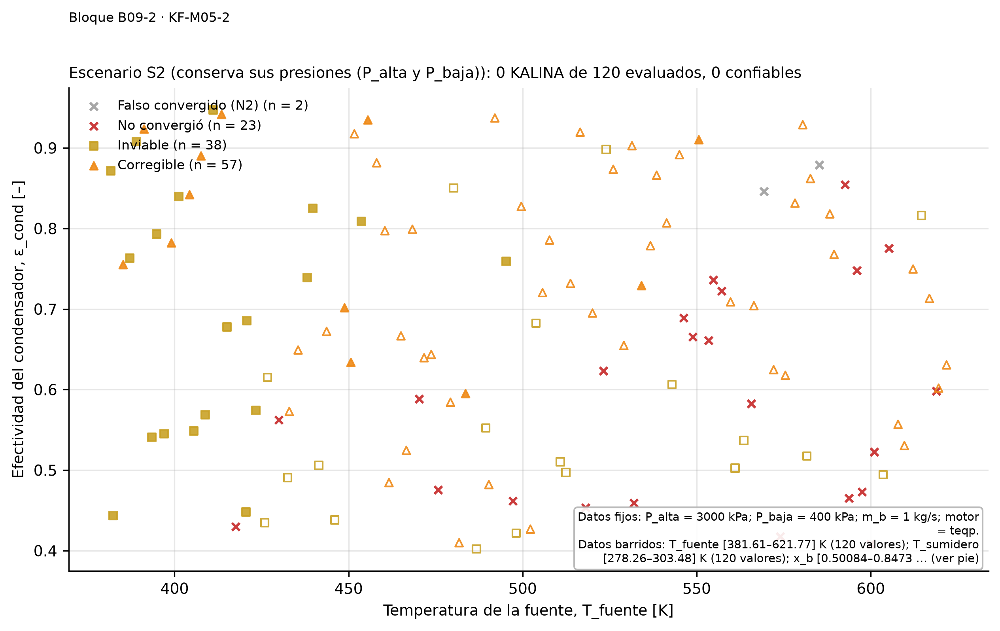
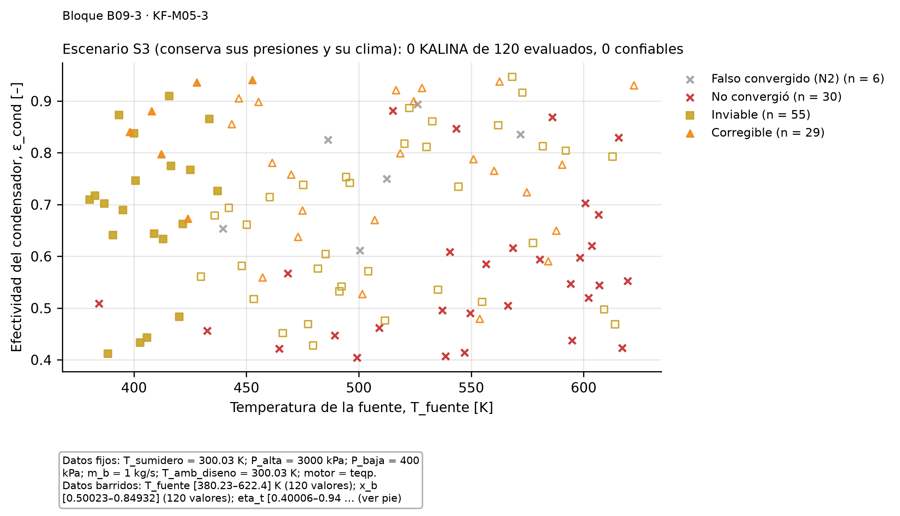
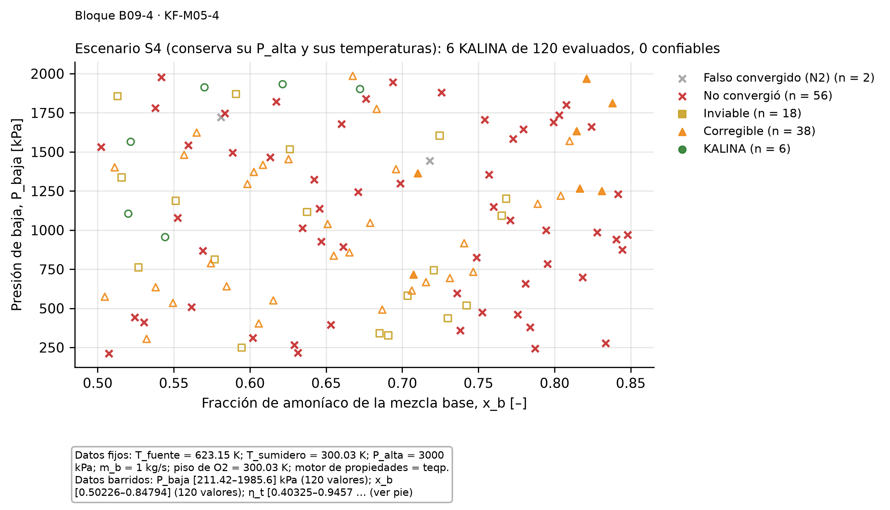
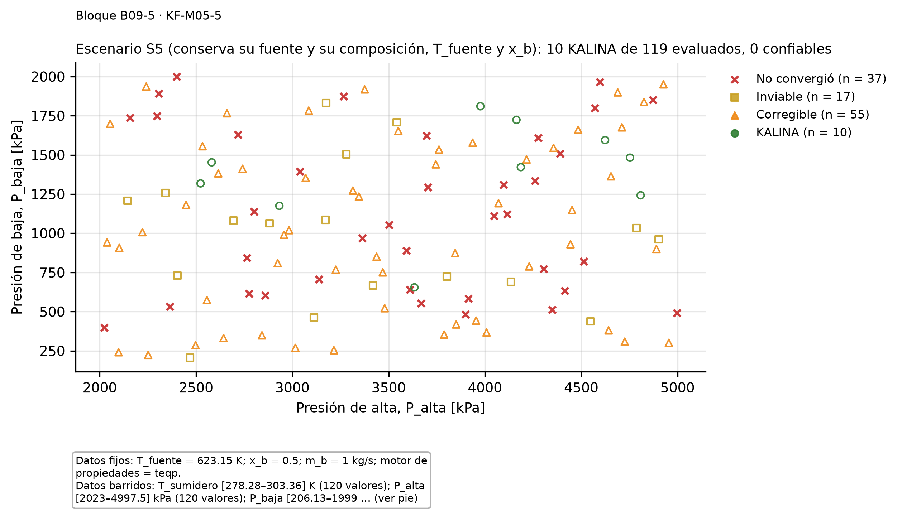

### 3.10 M5c — La franja KALINA con las presiones del profesor

- Malla T_fuente 385–410 K × ε_cond 0.85–0.95 × T_sumidero {278.15, 290.65, 300.03} K: 165 corridas,
  **104 KALINA, todos confiables**. Por debajo de 390 K, O3 (trabajo negativo).

| ε_cond (clima 300.03 K) | Celdas KALINA | T_fuente |
|---|---|---|
| 0.85 | 0 | — |
| 0.875 | 1 | 390 K |
| 0.90 | 2 | 390–392.5 K |
| 0.925 | 4 | 390–397.5 K |
| 0.95 | 9 | 390–410 K |

- Mejor η: 10.81 % (410 K, ε_cond 0.95, 300.03 K), confirmado por el motor real.
- **Conclusión:** las dos presiones del profesor son compatibles con KALINA si la fuente está a
  390–410 K y ε_cond ≥ 0.875 (con clima más frío basta 0.85).

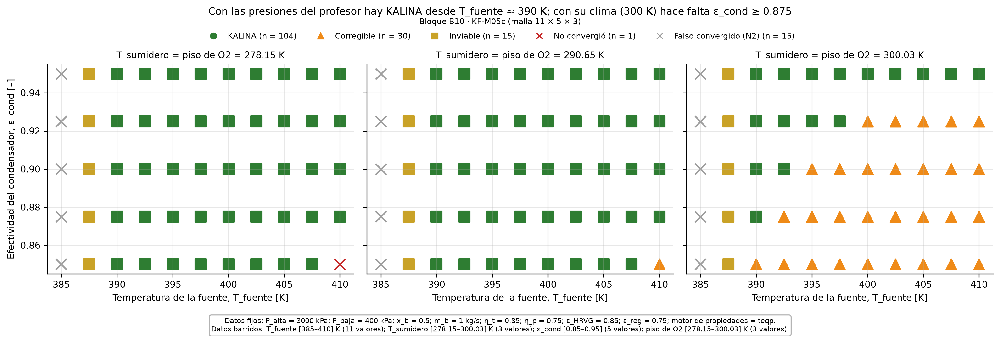

### 3.11 M6 — Verificación con el motor real y costo del margen de cavitación

- teqp y el motor real coinciden en todos los puntos que el motor real resolvió (|Δη| < 0.003 pp).
  Con 300 s, 10 de 12 se cortan por tiempo; con 1500 s (M9) se confirman A\*, A4 y Húsavík.
- Piso de O2 en 303.55 K: 9 de 12 pasan a CORREGIBLE (déficit 0.5–3.2 K): los diseños están al filo.
- Exigir 2 K de subenfriamiento: +25–46 kPa de P_baja y −0.3 a −0.5 pp de η.

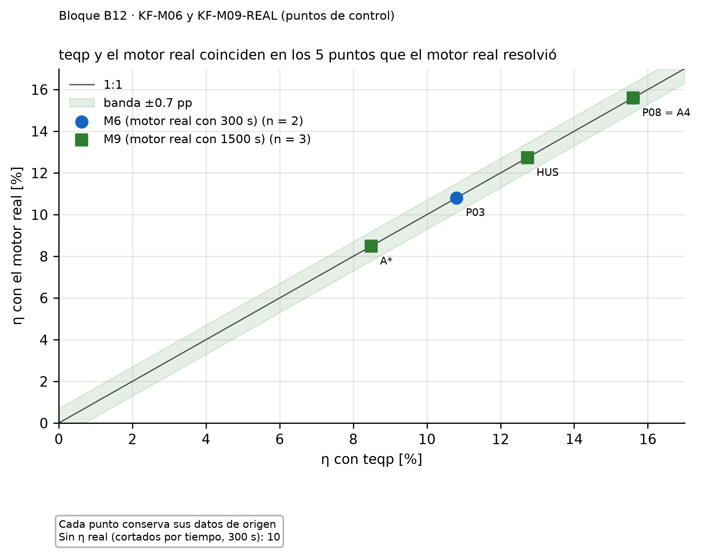

### 3.12 M7 — Máxima eficiencia dentro de KALINA

| Arranque | Conserva | η máx. | Confiables |
|---|---|---|---|
| A1 | nada (desde M4b) | 14.98 % | 98 de 102 |
| A2 | nada (desde M2S) | 15.48 % | 63 de 63 |
| A3 | temperaturas del profesor | 12.74 % | 90 de 91 |
| **A4** | **presiones y clima del profesor** | **15.60 %** | 80 de 80 |
| A5 | fuente + x_b del profesor | 11.09 % | 0 de 83 |

- **Conclusión:** η máx. 15.6 % con T_fuente 415 K y equipos a 0.95 (cota superior, no diseño).
  A3 prueba que 623 K admite KALINA confiables solo con x_b ≈ 0.85 y presiones altas.

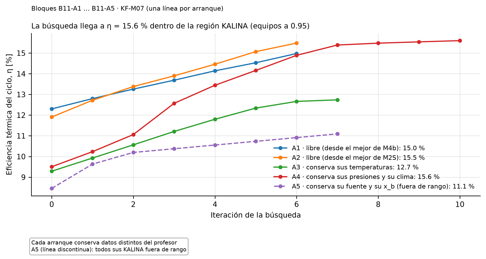

### 3.13 M8 — Anecdótico (fuera del rango realista)

η y ε de 0.20 a 0.99. Solo ilustrativo; no entra en conclusiones ni en tableros.

### 3.14 M9 — Escalera de conservación de los datos del profesor

| Ronda | Conjunto elegido | Datos conservados | KALINA (confiables) |
|---|---|---|---|
| 0 | XB | 1 | 29 (15) |
| 1 | XB+PA | 2 | 11 (7) |
| 2 | XB+PA+EF | 7 | 13 (7) |
| 3 | **XB+PA+EF+PB** | **8 de 10** | **5 (5)** |

- Conjunto final: conserva P_alta, P_baja, x_b y las cinco η/ε; solo se mueven T_fuente
  (391–409 K) y T_sumidero (280–293 K). η hasta 10.6 %, subenfriamiento ≥ 2 K.
- Ningún conjunto con T_fuente = 623 K da KALINA confiable (XB+PA+EF+TF: 30/30 NO_CONVERGIO).

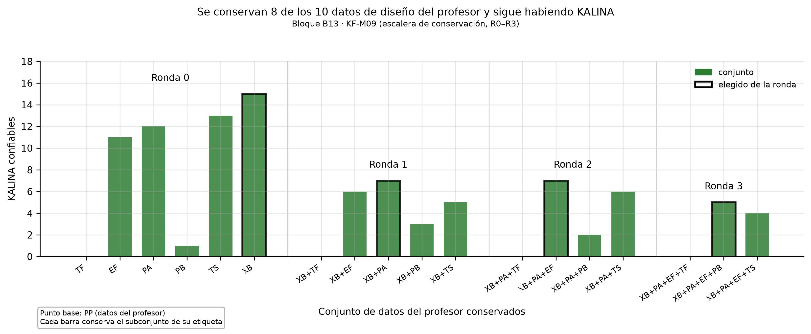

### 3.15 M10 — Húsavík revisitado

- **F3:** los 97 KALINA de septiembre se reproducen sin cambio de clase (Δη < 10⁻¹¹ pp); 83 son
  confiables (14 usan η_t o ε_cond > 0.95).
- **OFAT** (ancla Húsavík): KALINA con T_fuente 380–401 K, T_sumidero 273–283 K, P_alta 2821–4000,
  P_baja 700–1200 kPa, x_b 0.60–0.825, ε_HRVG 0.60–0.925; ε_cond solo 0.95. Casi todo rompe por O2.
- **MALLA:** la P_baja mínima KALINA sube de 500 kPa (x_b 0.70) a 800 kPa (x_b ≥ 0.85); su P_baja
  real (690 kPa) coincide con la mínima KALINA.

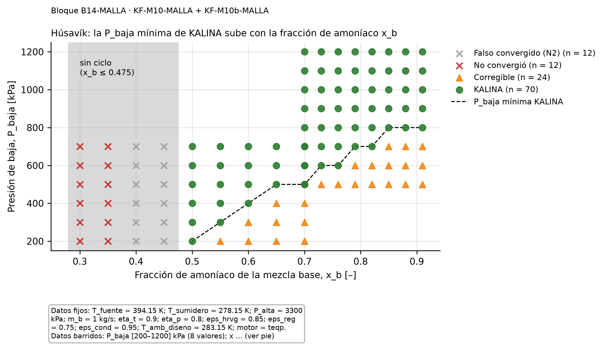

### 3.16 M10b — Húsavík con poco amoníaco

| x_b | Qué pasa |
|---|---|
| 0.30–0.45 | sin ciclo: 0 genuinos de 32 (16 no convergen, 16 N2) |
| 0.50 | KALINA formal, η 0.1–1.2 % |
| 0.55 | primer KALINA útil: P_baja mín. 300 kPa, η 9.6 % |
| 0.60 / 0.65 / 0.70 | P_baja mín. 400 / 500 / 500 kPa |

- **Conclusión:** con el ancla de Húsavík, x_b = 0.50 es el límite; con otras condiciones (M5c, M9)
  x_b = 0.50 sí da η de 8–11 %.

---

## 4. Síntesis

### 4.1 Datos del profesor que se pueden conservar (TAB-G04)

| Dato | ¿Se conserva con KALINA? | Respaldo |
|---|---|---|
| P_alta 3000 kPa | sí | M9, M5c |
| P_baja 400 kPa | sí; con su clima exige ε_cond ≥ 0.875 | M9, M5c |
| x_b 0.50 | sí (con Húsavík queda al límite) | M9, M10b |
| η_t, η_p, ε_HRVG, ε_reg | sí | M9 |
| ε_cond 0.80 | sí, si el sitio es más frío (≤ ~293 K) | M9, M5c |
| T_sumidero 300.03 K | con condiciones | M9, M5c |
| **T_fuente 623.15 K** | **no (bloqueo estructural)** | M1, M2, M9 |

### 4.2 Criterios que bloquean (TAB-G05)

O2 aparece en el 88–100 % de los genuinos no KALINA de todos los casos salvo M5c (67 %); O3 pesa en M5
(39 %), M5c (33 %) y M9 (24 %), por fuentes frías o x_b baja.

### 4.3 Rangos KALINA comparados (TAB-G03)

Ver TAB-G03: p5, mediana y p95 de P_alta, P_baja, ΔP, r_P, T_fuente y x_b de los KALINA
confiables por bloque (M4/M4b, M5 S1–S5, M5c, M9 final, Húsavík malla).

---

## 5. Conclusiones generales

1. El bloqueo estructural del enunciado es la fuente a 623 K: con ella solo hay KALINA confiables
   lejos del resto del enunciado (x_b 0.71–0.85, P_alta 3200–5000 kPa, P_baja 1.36–1.97 MPa).
2. Con la fuente a ~390–410 K se conservan 8 de los 10 datos de diseño del profesor.
3. La cavitación (O2) manda; se corrige subiendo P_baja, y un margen de 2 K es barato.
4. La ventana de presiones de diseño es P_baja 683–1461 kPa y r_P 1.7–5.3 (90 % de los KALINA).
5. η: 8–11 % con eficiencias medias; 15.6 % es una cota con equipos a 0.95.
6. El modelo está validado con la Fase 1, Húsavík y el motor real.

## 6. Limitaciones

- Los LHS por escenario (M5, M9) son exploraciones; las franjas angostas solo se mapean con mallas
  dirigidas (M5c).
- En M5c no se exploró T_fuente > 410 K.
- El motor real solo confirmó 5 puntos; los demás se cortaron por tiempo.
- Diferencias de η menores que 0.7 pp no son concluyentes.
- El margen de O2 del modelo es 0 K: los diseños están al filo de la cavitación.

## 7. Recomendaciones

- Para el diseño: fuente ~400–410 K, presiones del profesor o P_baja en 683–1461 kPa, y un margen
  de subenfriamiento de ~2 K (+25–50 kPa de P_baja).
- Reportar η como "8–11 % con eficiencias medias; hasta ~15 % con equipos de alta eficiencia".
- Citar Húsavík como validación del modelo con una planta real.

## Anexo — Dónde están los datos

- Fichas por caso (plantilla de 12 secciones): `04_fichas/`
- Tablas: `02_tablas/<caso>/TAB-*.md` (y `.csv`)
- Figuras con su pie: `03_figuras/<caso>/FIG-*.png` y `*.pie.md`
- Excel con tablero interactivo: `../datos/Excel_kalina_final_final_final.xlsx`
