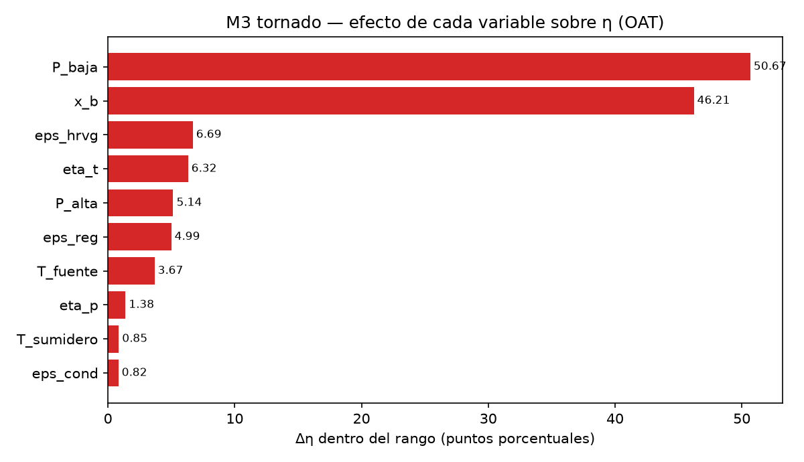
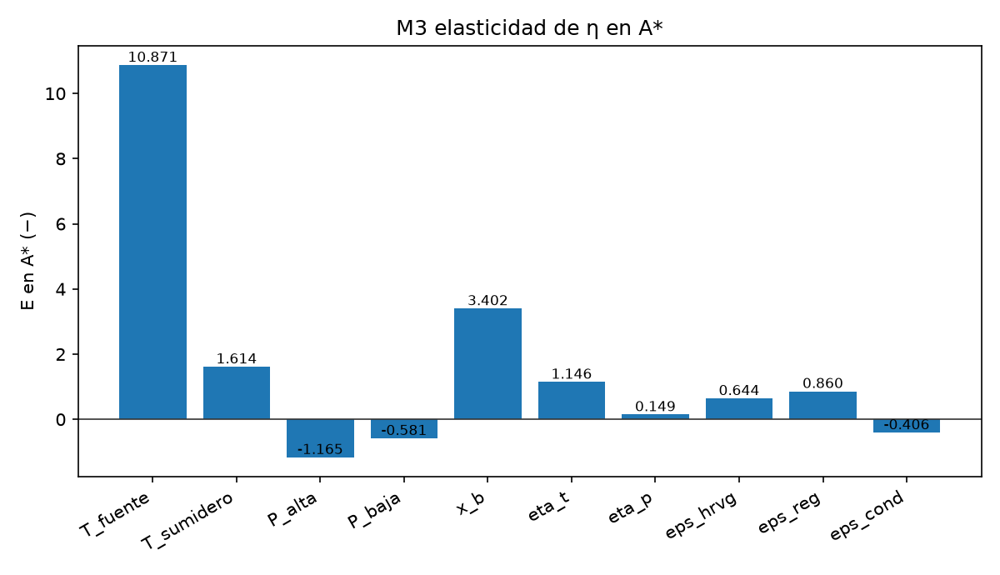
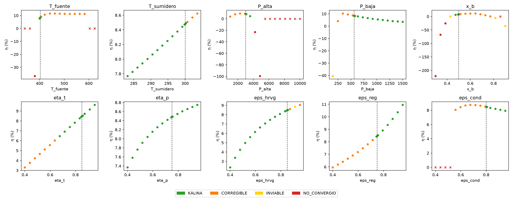

# REPORTE M3 — sensibilidad local (una variable a la vez) alrededor de A\*
## 1. La pregunta
Hay 10 datos que definen el ciclo: dos temperaturas, dos presiones, la composición y cinco eficiencias. La pregunta es: **si muevo UNA sola variable dentro de su rango y dejo las otras nueves exactamente en el punto A\*, ¿cuánto cambia la eficiencia η y en qué momento el ciclo deja de ser KALINA?** De ahí sale un ranking de qué dato conviene cuidar más.
## 2. Qué se hizo, en simple
- **El punto de partida (A\*).** `T_fuente = 403.0 K`, `P_baja = 563.6363636363637 kPa` y las otras ocho variables tal como las dio el profesor. Ahí el ciclo quedó **KALINA** con η = 0.0848.
- **La malla (OAT).** Por cada variable se recorrieron 15 valores repartidos por igual entre su rango (1.º valor = extremo inferior, 15.º = extremo superior), con las otras nueve quietas en A\*: 10 × 15 = 150 corridas.
- **Los dos vecinos.** Para la elasticidad se corrieron además A\* ± h con h = 1 % del rango de cada variable: 10 × 2 = 20 corridas. Más el ancla sola: **1 + 150 + 20 = 171 corridas**, con 5 procesos y el motor `teqp`.
- **Qué cuenta como punto bueno (genuino).** Solo KALINA, CORREGIBLE e INVIABLE. Una fila que el solver cerró pero que el clasificador marca NO_CONVERGIO es un punto fijo espurio (N2) y no cuenta para nada.
- **Qué se midió.** Δη = η mayor − η menor dentro de la malla; E = qué tanto cambia η (en tanto por uno) ante un empujoncito del 1 % en A\*; las fronteras se interpolan linealmente entre los dos puntos vecinos donde un margen cambia de signo; y la *zona KALINA* es el tramo de valores de la malla, contiguo al valor de A\*, donde la clase sigue siendo KALINA.
- **Salidas.** `m3_ofat.csv` (171 filas), `m3_resumen.csv` (10 filas, una por variable), `m3_cruces.csv` (30 filas: 21 cambios de clase y 9 cruces de margen) y las tres figuras de §6.
## 3. Una tabla por variable

| variable | rango [a, b] | E en A\* | Δη (pp) | zona KALINA (malla) | al bajar | al subir |
|---|---|---|---|---|---|---|
| T_fuente | [340, 623.15] | 10.871 | 3.67 | 400.675 … 400.675 | N2,S6,O3,O5,C1,C3,C3 (NO_CONVERGIO) | O2 (CORREGIBLE) |
| T_sumidero | [283.15, 303.55] | 1.614 | 0.85 | 283.15 … 299.179 | — (llega al extremo del rango) | O2 (CORREGIBLE) |
| P_alta | [1000, 10000] | -1.165 | 5.14 | 3571.43 … 3571.43 | O2 (CORREGIBLE) | N2,O3,O5,C1,C3,C3 (NO_CONVERGIO) |
| P_baja | [150, 1500] | -0.581 | 50.67 | 632.143 … 1500 | O2 (CORREGIBLE) | — (llega al extremo del rango) |
| x_b | [0.3, 0.9] | 3.402 | 46.21 | 0.471429 … 0.471429 | O3 (INVIABLE) | O2 (CORREGIBLE) |
| eta_t | [0.4, 0.95] | 1.146 | 6.32 | 0.675 … 0.95 | O2 (CORREGIBLE) | — (llega al extremo del rango) |
| eta_p | [0.4, 0.95] | 0.149 | 1.38 | 0.4 … 0.95 | — (llega al extremo del rango) | — (llega al extremo del rango) |
| eps_hrvg | [0.4, 0.95] | 0.644 | 6.69 | 0.4 … 0.832143 | — (llega al extremo del rango) | O2 (CORREGIBLE) |
| eps_reg | [0.4, 0.95] | 0.860 | 4.99 | 0.753571 … 0.95 | O2 (CORREGIBLE) | — (llega al extremo del rango) |
| eps_cond | [0.4, 0.95] | -0.406 | 0.82 | 0.832143 … 0.95 | O2 (CORREGIBLE) | — (llega al extremo del rango) |
## 4. Ranking de influencia sobre η

**Por elasticidad |E| en A\* (pegado al ancla):**

1. **T_fuente** — |E| = 10.871
2. **x_b** — |E| = 3.402
3. **T_sumidero** — |E| = 1.614
4. **P_alta** — |E| = 1.165
5. **eta_t** — |E| = 1.146
6. **eps_reg** — |E| = 0.860
7. **eps_hrvg** — |E| = 0.644
8. **P_baja** — |E| = 0.581
9. **eps_cond** — |E| = 0.406
10. **eta_p** — |E| = 0.149

**Por Δη en todo el rango (de un extremo a otro de la malla):**

1. **P_baja** — Δη = 50.67 pp
2. **x_b** — Δη = 46.21 pp
3. **eps_hrvg** — Δη = 6.69 pp
4. **eta_t** — Δη = 6.32 pp
5. **P_alta** — Δη = 5.14 pp
6. **eps_reg** — Δη = 4.99 pp
7. **T_fuente** — Δη = 3.67 pp
8. **eta_p** — Δη = 1.38 pp
9. **T_sumidero** — Δη = 0.85 pp
10. **eps_cond** — Δη = 0.82 pp

Las dos listas **no tienen por qué coincidir**: E mide solo a un 1 % del rango de A\*, mientras Δη mide los 15 puntos de la malla, que cubren el rango completo. Una variable puede ser empinada pegada al ancla y aplanarse lejos (o al revés), y Δη además crece con el ancho del rango de esa variable.

- **P_baja** pasa de la 8ª posición por |E| a la 1ª por Δη.
- **T_fuente** pasa de la 1ª posición por |E| a la 7ª por Δη.
- **T_sumidero** pasa de la 3ª posición por |E| a la 9ª por Δη.
- **eps_hrvg** pasa de la 7ª posición por |E| a la 3ª por Δη.
- **eta_p** pasa de la 10ª posición por |E| a la 8ª por Δη.
Recuerde: las diferencias de η menores que 0.4–0.7 pp no son concluyentes (§9).
## 5. Las fronteras más cercanas al ancla

Distancia entre el valor interpolado de cada frontera y el valor de A\* en esa variable, medida como fracción del rango de la variable (0 = justo en el ancla, 1 = a todo lo ancho del rango):

| variable | margen | valor de cruce | valor de A\* | distancia (fracción del rango) |
|---|---|---|---|---|
| P_alta | m_O2 | 2936.35 | 3000 | 0.007 |
| eps_cond | m_O2 | 0.793647 | 0.8 | 0.012 |
| P_baja | m_O2 | 541.568 | 563.636 | 0.016 |
| x_b | m_O2 | 0.511097 | 0.5 | 0.018 |
| T_sumidero | m_O2 | 300.485 | 300.033 | 0.022 |
| T_fuente | m_O2 | 409.779 | 403 | 0.024 |
| eps_hrvg | m_O2 | 0.871268 | 0.85 | 0.039 |
| eps_reg | m_O2 | 0.718542 | 0.75 | 0.057 |
| eta_t | m_O2 | 0.661586 | 0.85 | 0.343 |

Entre puntos consecutivos de la malla hubo **21 cambios de clase** (registrados en `m3_cruces.csv` con las dos clases y el par de valores).
## 6. Figuras

Tornado (Δη dentro del rango, de mayor a menor):

Elasticidad E en A\* (n/d = no se pudo calcular, con el motivo en §3):

Curvas η por variable: cada punto con el color de su clase, la línea punteada marca el valor de A\*; los puntos sin η (no convergidos) se dibujan como × sobre el eje:

## 7. Tiempos
La corrida completa (171 corridas) tardó 5822 s. Por punto (`t_s`): mínimo 36.3 s, mediana 153.1 s, máximo 396.9 s, media 168.6 s (171 puntos).
## 8. Conclusión
La variable que más mueve η **pegada al ancla** es **T_fuente** (elasticidad |E| = 10.871), y la que más la mueve **recorriendo todo su rango** es **P_baja** (Δη = 50.67 pp).
De los 171 puntos corridos, 148 son genuinos y 86 son KALINA.
La zona KALINA alrededor de A\* se pudo medir en 10 de las 10 variables (detalle en §3).
El detalle de qué criterio se rompe primero por cada lado está en la columna de §3, y qué tan al filo está A\* se ve en §5.
## 9. Lo que no se sabe
- **OAT no ve interacciones.** Cada variable se mueve sola con las otras nueve en A\*: dos variables que se compensan entre sí no aparecen en este cuadro. Por eso el siguiente paso (M4) es obligatorio.
- **Las diferencias de η menores que 0.4–0.7 pp no son concluyentes.** Es la banda de incertidumbre del modelo de propiedades (G4-01): cualquier diferencia a esa escala puede ser ruido, no un efecto real.
- **Hay puntos fuera del rango confiable:** 8 de los 171 corridos (temperaturas de líquido por encima de 420 K, sin respaldo experimental). Sus η hay que tomarlas con pinzas.
## 10. Qué sigue
M4 (sensibilidad global con muestreo LHS y análisis RSA/PAWN/PRCC). Aquí no se propone ningún valor concreto: las tablas de §3 y §5 son insumos para que el director decida.

## 11. Nota del director (Claude, auditoría 2026-10-06): Δη sin puntos de trabajo negativo

El `delta_eta` de `m3_resumen.csv` se calculó sobre todos los puntos genuinos, como pedía el
TASK_CONTEXT, e incluye puntos INVIABLE por O3 (W_net ≤ 0, η negativa: −40 % con P_baja = 150 kPa
y −35 % con x_b = 0.90). Eso infla el rango de η de P_baja (50.7 pp) y de x_b (46.2 pp).
Recalculado solo con los puntos genuinos de la malla que producen trabajo (W_net > 0):

| Variable | Δη (pp, W_net > 0) | η máxima KALINA en la malla | con valor |
|---|---|---|---|
| x_b | 10.78 | 6.42 % | 0.471 |
| P_baja | 6.80 | 7.91 % | 632 kPa |
| eps_hrvg | 6.69 | 8.36 % | 0.832 |
| eta_t | 6.32 | 9.62 % | 0.95 |
| P_alta | 5.14 | 4.66 % | 3571 kPa |
| eps_reg | 4.99 | **10.96 %** | **0.95** |
| T_fuente | 3.67 | 7.90 % | 400.7 K |
| eta_p | 1.38 | 8.75 % | 0.95 |
| T_sumidero | 0.85 | 8.44 % | 299.2 K |
| eps_cond | 0.82 | 8.35 % | 0.832 |

Lectura: alrededor de A\* (η = 8.48 %), las palancas que más **suben η sin perder KALINA** son
ε_reg (hasta 10.96 % con 0.95) y η_t (9.62 % con 0.95). x_b y P_alta son las que más mueven η,
pero casi toda su malla sale de la zona KALINA (O2 o O3), así que el ancla está en un "pasillo"
estrecho para esas dos. El bloqueo dominante fuera de la zona KALINA es siempre O2.

