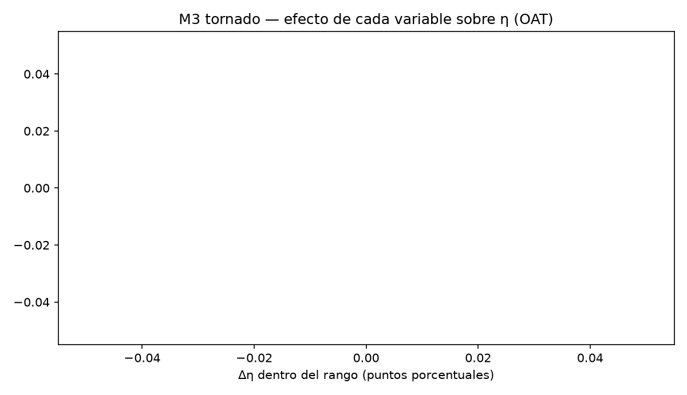
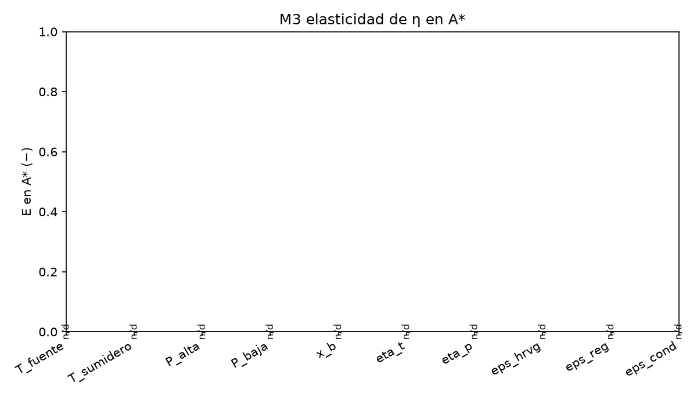
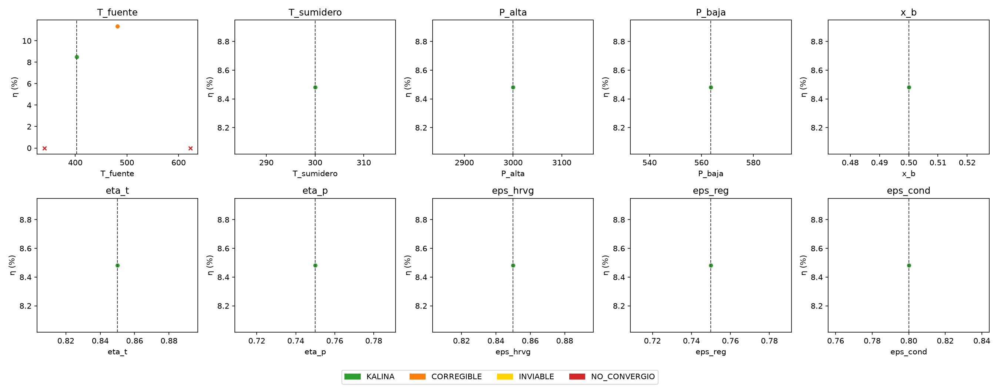

# REPORTE M3 — sensibilidad local (una variable a la vez) alrededor de A\*
## 1. La pregunta
Hay 10 datos que definen el ciclo: dos temperaturas, dos presiones, la composición y cinco eficiencias. La pregunta es: **si muevo UNA sola variable dentro de su rango y dejo las otras nueves exactamente en el punto A\*, ¿cuánto cambia la eficiencia η y en qué momento el ciclo deja de ser KALINA?** De ahí sale un ranking de qué dato conviene cuidar más.
## 2. Qué se hizo, en simple
- **El punto de partida (A\*).** `T_fuente = 403.0 K`, `P_baja = 563.6363636363637 kPa` y las otras ocho variables tal como las dio el profesor. Ahí el ciclo quedó **KALINA** con η = 0.0848.
- **La malla (OAT).** Por cada variable se recorrieron 15 valores repartidos por igual entre su rango (1.º valor = extremo inferior, 15.º = extremo superior), con las otras nueve quietas en A\*: 10 × 15 = 150 corridas.
- **Los dos vecinos.** Para la elasticidad se corrieron además A\* ± h con h = 1 % del rango de cada variable: 10 × 2 = 20 corridas. Más el ancla sola: **1 + 150 + 20 = 171 corridas**, con 5 procesos y el motor `teqp`.
- **Qué cuenta como punto bueno (genuino).** Solo KALINA, CORREGIBLE e INVIABLE. Una fila que el solver cerró pero que el clasificador marca NO_CONVERGIO es un punto fijo espurio (N2) y no cuenta para nada.
- **Qué se midió.** Δη = η mayor − η menor dentro de la malla; E = qué tanto cambia η (en tanto por uno) ante un empujoncito del 1 % en A\*; las fronteras se interpolan linealmente entre los dos puntos vecinos donde un margen cambia de signo; y la *zona KALINA* es el tramo de valores de la malla, contiguo al valor de A\*, donde la clase sigue siendo KALINA.
- **Salidas.** `m3_ofat.csv` (4 filas), `m3_resumen.csv` (10 filas, una por variable), `m3_cruces.csv` (2 filas: 2 cambios de clase y 0 cruces de margen) y las tres figuras de §6.
## 3. Una tabla por variable

| variable | rango [a, b] | E en A\* | Δη (pp) | zona KALINA (malla) | al bajar | al subir |
|---|---|---|---|---|---|---|
| T_fuente | [340, 623.15] | — (faltan los dos vecinos) | — | vacía | sin zona KALINA | sin zona KALINA |
| T_sumidero | [283.15, 303.55] | — (faltan los dos vecinos) | — | vacía | sin zona KALINA | sin zona KALINA |
| P_alta | [1000, 10000] | — (faltan los dos vecinos) | — | vacía | sin zona KALINA | sin zona KALINA |
| P_baja | [150, 1500] | — (faltan los dos vecinos) | — | vacía | sin zona KALINA | sin zona KALINA |
| x_b | [0.3, 0.9] | — (faltan los dos vecinos) | — | vacía | sin zona KALINA | sin zona KALINA |
| eta_t | [0.4, 0.95] | — (faltan los dos vecinos) | — | vacía | sin zona KALINA | sin zona KALINA |
| eta_p | [0.4, 0.95] | — (faltan los dos vecinos) | — | vacía | sin zona KALINA | sin zona KALINA |
| eps_hrvg | [0.4, 0.95] | — (faltan los dos vecinos) | — | vacía | sin zona KALINA | sin zona KALINA |
| eps_reg | [0.4, 0.95] | — (faltan los dos vecinos) | — | vacía | sin zona KALINA | sin zona KALINA |
| eps_cond | [0.4, 0.95] | — (faltan los dos vecinos) | — | vacía | sin zona KALINA | sin zona KALINA |
## 4. Ranking de influencia sobre η

**Por elasticidad |E| en A\* (pegado al ancla):**

ninguna: no se pudo calcular ninguna E

**Por Δη en todo el rango (de un extremo a otro de la malla):**

ninguna: no hay Δη calculable

Las dos listas **no tienen por qué coincidir**: E mide solo a un 1 % del rango de A\*, mientras Δη mide los 15 puntos de la malla, que cubren el rango completo. Una variable puede ser empinada pegada al ancla y aplanarse lejos (o al revés), y Δη además crece con el ancho del rango de esa variable.

Ninguna variable cambia más de una posición entre los dos rankings.

Variables sin E: T_fuente (faltan los dos vecinos); T_sumidero (faltan los dos vecinos); P_alta (faltan los dos vecinos); P_baja (faltan los dos vecinos); x_b (faltan los dos vecinos); eta_t (faltan los dos vecinos); eta_p (faltan los dos vecinos); eps_hrvg (faltan los dos vecinos); eps_reg (faltan los dos vecinos); eps_cond (faltan los dos vecinos).
Recuerde: las diferencias de η menores que 0.4–0.7 pp no son concluyentes (§9).
## 5. Las fronteras más cercanas al ancla

Distancia entre el valor interpolado de cada frontera y el valor de A\* en esa variable, medida como fracción del rango de la variable (0 = encima del ancla, 1 = al otro extremo del rango):

No cambió de signo ningún margen entre dos puntos consecutivos de la malla: no hay frontera interpolada dentro del rango medido.

Entre puntos consecutivos de la malla hubo **2 cambios de clase** (registrados en `m3_cruces.csv` con las dos clases y el par de valores).
## 6. Figuras

Tornado (Δη dentro del rango, de mayor a menor):

Elasticidad E en A\* (n/d = no se pudo calcular, con el motivo en §3):

Curvas η por variable: cada punto con el color de su clase, la línea punteada marca el valor de A\*; los puntos sin η (no convergidos) se dibujan como × sobre el eje:

## 7. Tiempos
El tiempo total de la corrida no está en stdout.txt. Por punto (`t_s`): mínimo 31.0 s, mediana 69.4 s, máximo 77.9 s, media 61.6 s (4 puntos).
## 8. Conclusión
No hay suficientes puntos genuinos para cerrar un ranking.
De los 4 puntos corridos, 2 son genuinos y 1 son KALINA.
Ninguna variable tiene zona KALINA alrededor del ancla con esta malla.
El detalle de qué criterio se rompe primero por cada lado está en la columna de §3, y qué tan al filo está A\* se ve en §5.
## 9. Lo que no se sabe
- **OAT no ve interacciones.** Cada variable se mueve sola con las otras nueve en A\*: dos variables que se compensan entre sí no aparecen en este cuadro. Por eso el siguiente paso (M4) es obligatorio.
- **Las diferencias de η menores que 0.4–0.7 pp no son concluyentes.** Es la banda de incertidumbre del modelo de propiedades (G4-01): cualquier diferencia a esa escala puede ser ruido, no un efecto real.
- **Hay puntos fuera del rango confiable:** 1 de los 4 corridos (temperaturas de líquido por encima de 420 K, sin respaldo experimental). Sus η hay que tomarlas con pinzas.
## 10. Qué sigue
M4 (sensibilidad global con muestreo LHS y análisis RSA/PAWN/PRCC). Aquí no se propone ningún valor concreto: las tablas de §3 y §5 son insumos para que el director decida.
