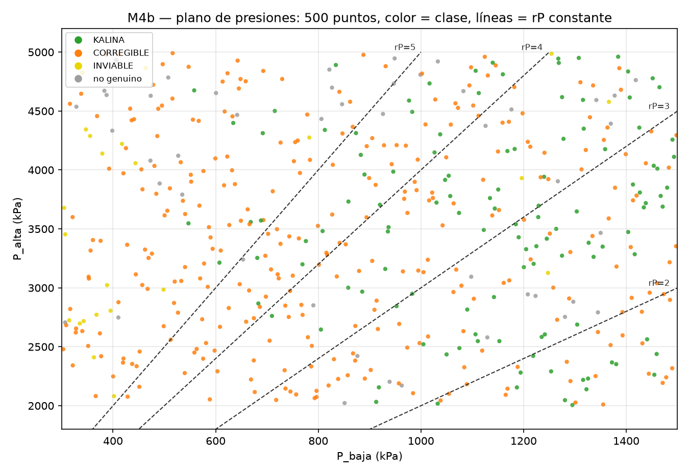
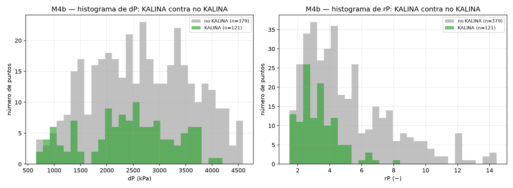

# REPORTE M4b — 500 puntos, foco en las presiones de KALINA
## 1. La pregunta
Lo primero ahora son **los rangos donde hay KALINA**, en particular **las presiones alta y baja y sus diferencias**: dP = P_alta − P_baja y rP = P_alta/P_baja. La pregunta es: **¿en qué ventana de P_alta, P_baja, dP y rP vive KALINA?, ¿cómo cambia esa ventana según la temperatura de la fuente y la del sumidero? y ¿qué criterio se rompe fuera de ella?** La eficiencia η es secundaria.
## 2. Qué se hizo
- **Muestreo nuevo.** 200 puntos con muestreo latino hipercubo (LHS, semilla 20261007) sobre la **misma caja de 10 variables** de M4, con `id_muestra` de 300 a 499. La muestra quedó en `m4b_muestra.csv` ANTES de correr.
- **Corrida.** Los 200 puntos se resolvieron con el motor `teqp` y 7 procesos, con el piso de O2 de cada punto igual a su propia `T_sumidero` (igual que M4). Todo quedó en `m4b_lhs.csv`.
- **Unión.** 300 (M4, semilla 20261006) + 200 (M4b, semilla 20261007) = **500 puntos**. **La unión de dos LHS no es un LHS estricto de 500**: los cortes de una muestra no caen necesariamente en el centro de las franjas de la otra. **Pero cada mitad sí lo es** —los 300 tienen la propiedad LHS con sus 300 franjas y los 200 con sus 200—.
- **Punto genuino (igual que M4).** Solo cuentan KALINA, CORREGIBLE e INVIABLE. Una fila que el solver cerró pero que el clasificador marca NO_CONVERGIO es un punto fijo espurio (N2) y es NO genuina en todo.
- **Análisis.** Se repitió el análisis de M4 sobre los 500 con las mismas fórmulas y parámetros: RSA con sus 4 separaciones (13 variables), PAWN, PRCC, CART, convergencia (aquí 300 vs 500) y top-10.
- **Presiones (lo nuevo).** Plano de P_baja contra P_alta, rangos de P_alta/P_baja/dP/rP dentro y fuera de KALINA, ventanas por P_alta, T_fuente y T_sumidero, histogramas y bloqueo por rP.
## 3. Conteos
De **500** puntos: **121 KALINA**. Conteos por clase: CORREGIBLE = 308, KALINA = 121, NO_CONVERGIO = 48, INVIABLE = 23.
Los primeros 300 son de M4 y los 200 nuevos de M4b. Puntos genuinos: 452. Espurios N2 (`convergio=True` y NO_CONVERGIO): 13. Fuera del rango confiable del motor de propiedades: 222.
## 4. La ventana de presiones de KALINA
La tabla (b) da, para P_alta, P_baja, dP y rP, el mínimo, el p5, la mediana, el p95 y el máximo **dentro de KALINA**, los mismos estadísticos de los genuinos que NO son KALINA, y el KS con su valor p que separa a los dos grupos. Cuanto más alto el KS, más distintas son las dos distribuciones.

| variable | grupo | n | mín | p5 | mediana | p95 | máximo | KS | valor p |
|---|---|---|---|---|---|---|---|---|---|
| P_alta | KALINA | 121 | 2005.4 | 2155.69 | 3571.41 | 4841.78 | 4960.89 | 0.149 | 0.03482 |
| P_alta | no_KALINA_genuino | 331 | 2009.95 | 2135.22 | 3365.24 | 4819 | 4991.23 | 0.149 | 0.03482 |
| P_baja | KALINA | 121 | 546.972 | 683.165 | 1182.62 | 1460.71 | 1493.2 | 0.437 | 9.347e-16 |
| P_baja | no_KALINA_genuino | 331 | 302.949 | 349.325 | 767.043 | 1416.74 | 1498 | 0.437 | 9.347e-16 |
| dP | KALINA | 121 | 710.238 | 968.027 | 2463.67 | 3717.63 | 4117.11 | 0.100 | 0.3112 |
| dP | no_KALINA_genuino | 331 | 654.761 | 1142.67 | 2575.19 | 4089.5 | 4589.51 | 0.100 | 0.3112 |
| rP | KALINA | 121 | 1.54838 | 1.68614 | 3.11053 | 5.33942 | 8.37616 | 0.347 | 5.171e-10 |
| rP | no_KALINA_genuino | 331 | 1.48315 | 1.95756 | 4.31034 | 10.0803 | 14.433 | 0.347 | 5.171e-10 |

La figura (a) muestra los 500 puntos en el plano P_baja (x) contra P_alta (y), con el color de su clase y las líneas de rP constante en 2, 3, 4 y 5:

## 5. Cómo cambia la ventana de P_baja, dP y rP según P_alta, T_fuente y T_sumidero
Cada variable se corta en franjas iguales; dentro de cada una se cuentan los puntos y los KALINA, y se dan los rangos (mín–máx) de P_baja, dP y rP **solo de los KALINA**.

### 5.1 Según P_alta: 6 franjas de 2000 a 5000

P_alta entre 2000 y 2500: 83 puntos, 18 KALINA (21.7 %), con P_baja de 912.814 a 1459.36 kPa, dP de 710.238 a 1413.88 kPa y rP de 1.54838 a 2.34814. P_alta entre 2500 y 3000: 83 puntos, 16 KALINA (19.3 %), con P_baja de 683.165 a 1440.71 kPa, dP de 1122.63 a 2184.14 kPa y rP de 1.77922 a 4.19709. P_alta entre 3000 y 3500: 84 puntos, 21 KALINA (25.0 %), con P_baja de 607.329 a 1416.58 kPa, dP de 1868.61 a 2673.48 kPa y rP de 2.3191 a 5.29108. P_alta entre 3500 y 4000: 83 puntos, 29 KALINA (34.9 %), con P_baja de 546.972 a 1479.81 kPa, dP de 2217.96 a 3071.42 kPa y rP de 2.50774 a 6.48507. P_alta entre 4000 y 4500: 84 puntos, 18 KALINA (21.4 %), con P_baja de 634.297 a 1493.2 kPa, dP de 2550.32 a 3764.41 kPa y rP de 2.74595 a 6.93478. P_alta entre 4500 y 5000: 83 puntos, 19 KALINA (22.9 %), con P_baja de 558.165 a 1464.87 kPa, dP de 3208.35 a 4117.11 kPa y rP de 3.21 a 8.37616.

| franja | lo | hi | n | n KALINA | % KALINA | P_baja (mín–máx) | dP (mín–máx) | rP (mín–máx) |
|---|---|---|---|---|---|---|---|---|
| 1 | 2000 | 2500 | 83 | 18 | 21.7 | 912.814 – 1459.36 | 710.238 – 1413.88 | 1.54838 – 2.34814 |
| 2 | 2500 | 3000 | 83 | 16 | 19.3 | 683.165 – 1440.71 | 1122.63 – 2184.14 | 1.77922 – 4.19709 |
| 3 | 3000 | 3500 | 84 | 21 | 25.0 | 607.329 – 1416.58 | 1868.61 – 2673.48 | 2.3191 – 5.29108 |
| 4 | 3500 | 4000 | 83 | 29 | 34.9 | 546.972 – 1479.81 | 2217.96 – 3071.42 | 2.50774 – 6.48507 |
| 5 | 4000 | 4500 | 84 | 18 | 21.4 | 634.297 – 1493.2 | 2550.32 – 3764.41 | 2.74595 – 6.93478 |
| 6 | 4500 | 5000 | 83 | 19 | 22.9 | 558.165 – 1464.87 | 3208.35 – 4117.11 | 3.21 – 8.37616 |

### 5.2 Según T_fuente: 6 franjas de 380 a 500

T_fuente entre 380 y 400: 83 puntos, 26 KALINA (31.3 %), con P_baja de 668.347 a 1471.05 kPa, dP de 902.996 a 3539.75 kPa y rP de 1.68614 a 5.32425. T_fuente entre 400 y 420: 84 puntos, 31 KALINA (36.9 %), con P_baja de 546.972 a 1460.71 kPa, dP de 710.238 a 4117.11 kPa y rP de 1.54838 a 8.37616. T_fuente entre 420 y 440: 83 puntos, 26 KALINA (31.3 %), con P_baja de 634.297 a 1493.2 kPa, dP de 1203.89 a 3764.41 kPa y rP de 1.98778 a 6.93478. T_fuente entre 440 y 460: 84 puntos, 19 KALINA (22.6 %), con P_baja de 607.329 a 1490.2 kPa, dP de 766.288 a 3576.57 kPa y rP de 1.55514 a 5.29108. T_fuente entre 460 y 480: 82 puntos, 8 KALINA (9.8 %), con P_baja de 688.244 a 1459.36 kPa, dP de 816.689 a 2883.16 kPa y rP de 1.61751 a 5.18916. T_fuente entre 480 y 500: 84 puntos, 11 KALINA (13.1 %), con P_baja de 769.124 a 1451.62 kPa, dP de 904.746 a 3326.41 kPa y rP de 1.68249 a 4.16017.

| franja | lo | hi | n | n KALINA | % KALINA | P_baja (mín–máx) | dP (mín–máx) | rP (mín–máx) |
|---|---|---|---|---|---|---|---|---|
| 1 | 380 | 400 | 83 | 26 | 31.3 | 668.347 – 1471.05 | 902.996 – 3539.75 | 1.68614 – 5.32425 |
| 2 | 400 | 420 | 84 | 31 | 36.9 | 546.972 – 1460.71 | 710.238 – 4117.11 | 1.54838 – 8.37616 |
| 3 | 420 | 440 | 83 | 26 | 31.3 | 634.297 – 1493.2 | 1203.89 – 3764.41 | 1.98778 – 6.93478 |
| 4 | 440 | 460 | 84 | 19 | 22.6 | 607.329 – 1490.2 | 766.288 – 3576.57 | 1.55514 – 5.29108 |
| 5 | 460 | 480 | 82 | 8 | 9.8 | 688.244 – 1459.36 | 816.689 – 2883.16 | 1.61751 – 5.18916 |
| 6 | 480 | 500 | 84 | 11 | 13.1 | 769.124 – 1451.62 | 904.746 – 3326.41 | 1.68249 – 4.16017 |

### 5.3 Según T_sumidero: 4 franjas de 278.15 a 303.55

T_sumidero entre 278.15 y 284.5: 125 puntos, 47 KALINA (37.6 %), con P_baja de 558.165 a 1493.2 kPa, dP de 766.288 a 4117.11 kPa y rP de 1.55514 a 8.37616. T_sumidero entre 284.5 y 290.85: 125 puntos, 27 KALINA (21.6 %), con P_baja de 546.972 a 1467.22 kPa, dP de 904.746 a 3785.73 kPa y rP de 1.68249 a 6.48507. T_sumidero entre 290.85 y 297.2: 125 puntos, 28 KALINA (22.4 %), con P_baja de 607.329 a 1490.2 kPa, dP de 710.238 a 3717.63 kPa y rP de 1.54838 a 5.32425. T_sumidero entre 297.2 y 303.55: 125 puntos, 19 KALINA (15.2 %), con P_baja de 634.297 a 1471.05 kPa, dP de 902.996 a 3770.27 kPa y rP de 1.68614 a 6.93478.

| franja | lo | hi | n | n KALINA | % KALINA | P_baja (mín–máx) | dP (mín–máx) | rP (mín–máx) |
|---|---|---|---|---|---|---|---|---|
| 1 | 278.15 | 284.5 | 125 | 47 | 37.6 | 558.165 – 1493.2 | 766.288 – 4117.11 | 1.55514 – 8.37616 |
| 2 | 284.5 | 290.85 | 125 | 27 | 21.6 | 546.972 – 1467.22 | 904.746 – 3785.73 | 1.68249 – 6.48507 |
| 3 | 290.85 | 297.2 | 125 | 28 | 22.4 | 607.329 – 1490.2 | 710.238 – 3717.63 | 1.54838 – 5.32425 |
| 4 | 297.2 | 303.55 | 125 | 19 | 15.2 | 634.297 – 1471.05 | 902.996 – 3770.27 | 1.68614 – 6.93478 |

## 6. Qué criterio se rompe fuera de la ventana
Entre los genuinos NO KALINA se cuenta `codigos_falla` según el rP caiga por debajo del p5 de KALINA (1.68614), por encima del p95 (5.33942) o dentro del intervalo. Totales por zona: rP < p5 KALINA = 7, rP dentro de [p5, p95] = 204, rP > p95 KALINA = 120.

| zona | codigos_falla | n |
|---|---|---|
| rP < p5 KALINA | O2 | 7 |
| rP dentro de [p5, p95] | O2 | 199 |
| rP dentro de [p5, p95] | O3 | 3 |
| rP dentro de [p5, p95] | O2,O3 | 1 |
| rP dentro de [p5, p95] | S3 | 1 |
| rP > p95 KALINA | O2 | 82 |
| rP > p95 KALINA | O1,O2 | 18 |
| rP > p95 KALINA | O2,O3 | 16 |
| rP > p95 KALINA | O1 | 2 |
| rP > p95 KALINA | O1,O2,O3 | 1 |
| rP > p95 KALINA | O3 | 1 |

Los histogramas de dP y de rP, KALINA contra no KALINA:

## 7. El RSA con 500 puntos, comparado con los 300
Rangos favorables (p5–p95 dentro de KALINA) y KS con los 500, junto a los mismos números de los 300 de M4:

| variable | KS (500) | rango favorable (500) | KS (300) | rango favorable (300) |
|---|---|---|---|---|
| P_baja | 0.427 | [683.165, 1460.71] | 0.436 | [689.621, 1459.7] |
| eps_cond | 0.426 | [0.739734, 0.945776] | 0.349 | [0.755767, 0.945828] |
| rP | 0.353 | [1.68614, 5.33942] | 0.354 | [1.67965, 5.45895] |
| T_fuente | 0.287 | [383.658, 486.22] | 0.355 | [382.81, 491.196] |
| dT_fs | 0.248 | [91.385, 199.35] | 0.329 | [89.8394, 204.032] |
| T_sumidero | 0.200 | [278.969, 301.676] | 0.163 | [279.041, 302.446] |
| x_b | 0.193 | [0.514153, 0.817466] | 0.236 | [0.513677, 0.799026] |
| dP | 0.138 | [968.027, 3717.63] | 0.140 | [904.309, 3742.45] |
| P_alta | 0.130 | [2155.69, 4841.78] | 0.148 | [2151.1, 4895.2] |
| eps_reg | 0.122 | [0.624036, 0.933102] | 0.130 | [0.62379, 0.933707] |
| eta_p | 0.095 | [0.663096, 0.886896] | 0.163 | [0.661562, 0.887276] |
| eta_t | 0.085 | [0.758375, 0.909964] | 0.085 | [0.760173, 0.907765] |
| eps_hrvg | 0.074 | [0.617226, 0.929928] | 0.090 | [0.615698, 0.926253] |

La tabla completa con 500 (IC95 % por bootstrap, valor p y tamaños de grupo):

| variable | KS | IC95 % | valor p | rango favorable (p5–p95) | n_B | n_B̄ |
|---|---|---|---|---|---|---|
| P_baja | 0.427 | [0.365, 0.519] | 1.433e-15 | [683.165, 1460.71] | 121 | 379 |
| eps_cond | 0.426 | [0.353, 0.524] | 1.566e-15 | [0.739734, 0.945776] | 121 | 379 |
| rP | 0.353 | [0.299, 0.446] | 1.106e-10 | [1.68614, 5.33942] | 121 | 379 |
| T_fuente | 0.287 | [0.207, 0.388] | 3.459e-07 | [383.658, 486.22] | 121 | 379 |
| dT_fs | 0.248 | [0.173, 0.343] | 1.791e-05 | [91.385, 199.35] | 121 | 379 |
| T_sumidero | 0.200 | [0.136, 0.312] | 0.001108 | [278.969, 301.676] | 121 | 379 |
| x_b | 0.193 | [0.142, 0.301] | 0.00181 | [0.514153, 0.817466] | 121 | 379 |
| dP | 0.138 | [0.107, 0.242] | 0.05328 | [968.027, 3717.63] | 121 | 379 |
| P_alta | 0.130 | [0.080, 0.231] | 0.07994 | [2155.69, 4841.78] | 121 | 379 |
| eps_reg | 0.122 | [0.074, 0.225] | 0.1204 | [0.624036, 0.933102] | 121 | 379 |
| eta_p | 0.095 | [0.069, 0.206] | 0.349 | [0.663096, 0.886896] | 121 | 379 |
| eta_t | 0.085 | [0.060, 0.197] | 0.485 | [0.758375, 0.909964] | 121 | 379 |
| eps_hrvg | 0.074 | [0.061, 0.185] | 0.6652 | [0.617226, 0.929928] | 121 | 379 |

Ningún grupo quedó por debajo de 20 puntos.
## 8. La convergencia
ρ de Spearman entre el ranking con los 300 puntos y el de los 500, con el criterio **ρ ≥ 0.9**: **KS (KALINA) = 0.9286** (cumple el criterio ρ ≥ 0.9) y **PRCC(η) = 0.9879** (cumple el criterio ρ ≥ 0.9).
## 9. PRCC y PAWN sobre η (secundario)
**PAWN** (10 franjas; cuanto más alto el índice, más cambia la distribución al fijar la variable):

| variable | PAWN η (mediana) | PAWN η (máx) | PAWN D (mediana) | PAWN D (máx) |
|---|---|---|---|---|
| P_baja | 0.290 | 0.441 | 0.261 | 0.632 |
| P_alta | 0.188 | 0.424 | 0.120 | 0.232 |
| eta_t | 0.150 | 0.300 | 0.115 | 0.185 |
| eps_reg | 0.144 | 0.232 | 0.112 | 0.217 |
| T_fuente | 0.143 | 0.271 | 0.222 | 0.415 |
| T_sumidero | 0.132 | 0.232 | 0.142 | 0.253 |
| eta_p | 0.131 | 0.173 | 0.105 | 0.167 |
| x_b | 0.116 | 0.166 | 0.115 | 0.240 |
| eps_cond | 0.108 | 0.200 | 0.260 | 0.502 |
| eps_hrvg | 0.107 | 0.252 | 0.130 | 0.186 |

**PRCC** (negativo = subir la variable baja η; el IC95 % que no cruza al cero indica que el efecto se distingue del ruido):

| variable | PRCC η | IC95 % (η) | valor p (η) | PRCC m_O1 | PRCC m_O2 | PRCC m_O5 |
|---|---|---|---|---|---|---|
| P_baja | -0.681 | [-0.751, -0.610] | 1.364e-58 | 0.921 | 0.757 | 0.055 |
| P_alta | 0.583 | [0.505, 0.661] | 1.018e-39 | -0.897 | 0.263 | 0.111 |
| eta_t | 0.375 | [0.286, 0.464] | 1.617e-15 | -0.582 | -0.010 | 0.026 |
| T_fuente | 0.291 | [0.199, 0.383] | 1.108e-09 | -0.780 | -0.680 | -0.372 |
| eps_reg | 0.267 | [0.174, 0.359] | 2.793e-08 | -0.172 | -0.041 | 0.126 |
| x_b | 0.236 | [0.143, 0.329] | 9.743e-07 | 0.171 | -0.470 | -0.090 |
| eps_cond | 0.083 | [-0.013, 0.179] | 0.08842 | 0.060 | 0.732 | 0.030 |
| T_sumidero | -0.041 | [-0.137, 0.055] | 0.397 | -0.130 | -0.537 | 0.027 |
| eta_p | 0.010 | [-0.086, 0.106] | 0.8448 | -0.003 | 0.040 | -0.096 |
| eps_hrvg | 0.008 | [-0.088, 0.104] | 0.8665 | -0.326 | -0.268 | -0.310 |
## 10. Las reglas de CART
Clasificador CART (`max_depth=4`, `min_samples_leaf=5`, `random_state=0`) sobre las 10 variables, KALINA vs no KALINA. exactitud CV (5 particiones): media = 0.7880 · por particion = [0.78, 0.78, 0.75, 0.8, 0.83].
- si eps_cond <= 0.8877 y P_baja <= 1025 y T_fuente <= 416.8 y eps_hrvg <= 0.6399 → **KALINA** (n = 7, 57.1 % KALINA)
- si eps_cond <= 0.8877 y P_baja <= 1025 y T_fuente <= 416.8 y eps_hrvg > 0.6399 → **no KALINA** (n = 64, 10.9 % KALINA)
- si eps_cond <= 0.8877 y P_baja <= 1025 y T_fuente > 416.8 y eps_reg <= 0.9192 → **no KALINA** (n = 151, 0.7 % KALINA)
- si eps_cond <= 0.8877 y P_baja <= 1025 y T_fuente > 416.8 y eps_reg > 0.9192 → **no KALINA** (n = 11, 18.2 % KALINA)
- si eps_cond <= 0.8877 y P_baja > 1025 y T_fuente <= 415.3 y T_sumidero <= 286.6 → **KALINA** (n = 13, 84.6 % KALINA)
- si eps_cond <= 0.8877 y P_baja > 1025 y T_fuente <= 415.3 y T_sumidero > 286.6 → **no KALINA** (n = 33, 42.4 % KALINA)
- si eps_cond <= 0.8877 y P_baja > 1025 y T_fuente > 415.3 y eps_cond <= 0.8286 → **no KALINA** (n = 68, 5.9 % KALINA)
- si eps_cond <= 0.8877 y P_baja > 1025 y T_fuente > 415.3 y eps_cond > 0.8286 → **no KALINA** (n = 28, 42.9 % KALINA)
- si eps_cond > 0.8877 y P_baja <= 765.6 y x_b <= 0.5471 → **KALINA** (n = 6, 50.0 % KALINA)
- si eps_cond > 0.8877 y P_baja <= 765.6 y x_b > 0.5471 y eps_cond <= 0.9392 → **no KALINA** (n = 32, 0.0 % KALINA)
- si eps_cond > 0.8877 y P_baja <= 765.6 y x_b > 0.5471 y eps_cond > 0.9392 → **no KALINA** (n = 5, 40.0 % KALINA)
- si eps_cond > 0.8877 y P_baja > 765.6 y T_fuente <= 454.5 y eps_hrvg <= 0.6486 → **KALINA** (n = 6, 66.7 % KALINA)
- si eps_cond > 0.8877 y P_baja > 765.6 y T_fuente <= 454.5 y eps_hrvg > 0.6486 → **KALINA** (n = 40, 95.0 % KALINA)
- si eps_cond > 0.8877 y P_baja > 765.6 y T_fuente > 454.5 y eta_t <= 0.8826 → **KALINA** (n = 29, 65.5 % KALINA)
- si eps_cond > 0.8877 y P_baja > 765.6 y T_fuente > 454.5 y eta_t > 0.8826 → **no KALINA** (n = 7, 0.0 % KALINA)
## 11. El top-10 KALINA (secundario)
Los 10 KALINA de mayor η de los 500:

| # | id | η | W_net (kW) | D | T_fuente | T_sumidero | P_alta | P_baja | x_b | eta_t | eta_p | eps_hrvg | eps_reg | eps_cond |
|---|---|---|---|---|---|---|---|---|---|---|---|---|---|---|
| 1 | 286.0 | 0.1230 | 91.42 | 0.00 | 436.097 | 279.098 | 3481.82 | 808.34 | 0.634749 | 0.918483 | 0.746081 | 0.677731 | 0.94153 | 0.841826 |
| 2 | 460.0 | 0.1185 | 142.25 | 0.00 | 464.51 | 289.762 | 3571.41 | 688.244 | 0.535685 | 0.854599 | 0.859905 | 0.800813 | 0.939334 | 0.905274 |
| 3 | 20.0 | 0.1091 | 57.84 | 0.00 | 414.265 | 287.822 | 4841.78 | 1106.65 | 0.676679 | 0.826498 | 0.818212 | 0.869164 | 0.90437 | 0.794862 |
| 4 | 149.0 | 0.1085 | 80.10 | 0.00 | 428.033 | 296.004 | 4127.89 | 882.806 | 0.671542 | 0.771052 | 0.807274 | 0.788939 | 0.912477 | 0.931908 |
| 5 | 380.0 | 0.1081 | 88.50 | 0.00 | 406.67 | 278.639 | 4811.75 | 1159.63 | 0.782333 | 0.878097 | 0.734324 | 0.909494 | 0.727744 | 0.897724 |
| 6 | 153.0 | 0.1077 | 85.08 | 0.00 | 441.069 | 292.126 | 3213.43 | 607.329 | 0.53951 | 0.816012 | 0.663761 | 0.756381 | 0.840128 | 0.945982 |
| 7 | 213.0 | 0.1064 | 47.00 | 0.00 | 402.978 | 281.559 | 4312.31 | 691.773 | 0.650244 | 0.7954 | 0.886896 | 0.859285 | 0.787737 | 0.798693 |
| 8 | 76.0 | 0.1061 | 152.51 | 0.00 | 490.779 | 287.893 | 4594.56 | 1315.79 | 0.820547 | 0.852919 | 0.730311 | 0.802814 | 0.926377 | 0.930827 |
| 9 | 15.0 | 0.1054 | 26.53 | 0.00 | 384.399 | 291.539 | 3558.44 | 668.347 | 0.675123 | 0.86271 | 0.755245 | 0.623233 | 0.913052 | 0.866496 |
| 10 | 325.0 | 0.1034 | 50.47 | 0.00 | 390.459 | 299.074 | 4652.46 | 1112.7 | 0.80847 | 0.861104 | 0.664819 | 0.717407 | 0.852512 | 0.937614 |
## 12. Los tiempos
M4b (los 200 nuevos): tardaron 3189 s (53 min) en 200 corridas. M4 (los 300 anteriores): tardaron 9374 s (156 min) en 300 corridas.
## 13. La conclusión: los rangos recomendados de P_alta, P_baja, dP y rP para KALINA
Los percentiles 5–95 de cada presión **dentro de los 121 KALINA** (misma definición de rango favorable que el RSA):

- **P_alta:** [2155.69, 4841.78] kPa
- **P_baja:** [683.165, 1460.71] kPa
- **dP:** [968.027, 3717.63] kPa
- **rP:** [1.68614, 5.33942]

Estos son los rangos donde vive KALINA en esta caja de 500 puntos; la ventana de rP (1.68614–5.33942) es la que separa a los KALINA del resto en §6. No se propuso ningún valor nuevo: las tablas son insumos para que el director decida.
## 14. Lo que no se sabe
- La unión de dos LHS **no es un LHS estricto de 500**; solo cada mitad lo es (§2).
- Las diferencias de η menores que 0.4–0.7 pp no son concluyentes: es la banda de incertidumbre del modelo de propiedades (G4-01).
- Hay puntos fuera de rango (motor de propiedades sin respaldo experimental): 222 de 500. Sus η hay que tomarlas con pinzas.
- Es una **caja favorable**, no todo el espacio: fuera de los rangos de `TASK_CONTEXT final_M4` no se dijo nada.
- Las franjas con pocos KALINA (§5) dan rangos poco confiables.
## 15. Qué sigue
M5 (búsqueda dirigida hacia KALINA dentro de la ventana de presiones de §13). El orden concreto lo decide el director.
