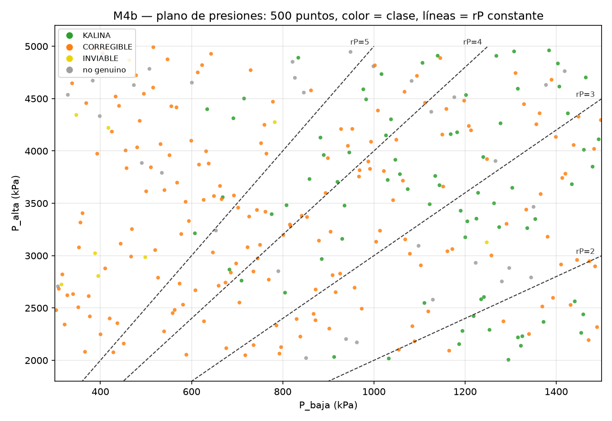
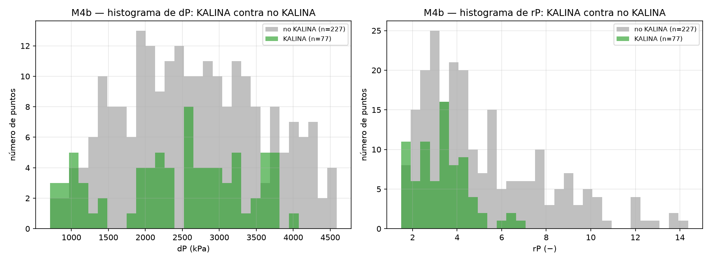

# REPORTE M4b — 500 puntos, foco en las presiones de KALINA
## 1. La pregunta
Lo primero ahora son **los rangos donde hay KALINA**, en particular **las presiones alta y baja y sus diferencias**: dP = P_alta − P_baja y rP = P_alta/P_baja. La pregunta es: **¿en qué ventana de P_alta, P_baja, dP y rP vive KALINA?, ¿cómo cambia esa ventana según la temperatura de la fuente y la del sumidero? y ¿qué criterio se rompe fuera de ella?** La eficiencia η es secundaria.
## 2. Qué se hizo
- **Muestreo nuevo.** 200 puntos con muestreo latino hipercubo (LHS, semilla 20261007) sobre la **misma caja de 10 variables** de M4, con `id_muestra` de 300 a 499. La muestra quedó en `m4b_muestra.csv` ANTES de correr.
- **Corrida.** Los 200 puntos se resolvieron con el motor `teqp` y 7 procesos, con el piso de O2 de cada punto igual a su propia `T_sumidero` (igual que M4). Todo quedó en `m4b_lhs.csv`.
- **Unión.** 300 (M4, semilla 20261006) + 200 (M4b, semilla 20261007) = **500 puntos**. **La unión de dos LHS no es un LHS estricto de 500**: los cortes de una muestra no caen necesariamente en el centro de las franjas de la otra. **Pero cada mitad sí lo es** —los 300 tienen la propiedad LHS con sus 300 franjas y los 200 con sus 200—.
- **Punto genuino (igual que M4).** Solo cuentan KALINA, CORREGIBLE e INVIABLE. Una fila que el solver cerró pero que el clasificador marca NO_CONVERGIO es un punto fijo espurio (N2) y es NO genuina en todo.
- **Análisis.** Se repitió el análisis de M4 sobre los 500 con las mismas fórmulas y parámetros: RSA con sus 4 separaciones (13 variables), PAWN, PRCC, CART, convergencia (aquí 300 vs 500) y top-10.
- **Presiones (lo nuevo).** Plano de P_baja contra P_alta, rangos de P_alta/P_baja/dP/rP dentro y fuera de KALINA, ventanas por P_alta, T_fuente y T_sumidero, histogramas y bloqueo por rP.
## 3. Conteos
De **304** puntos: **77 KALINA**. Conteos por clase: CORREGIBLE = 184, KALINA = 77, NO_CONVERGIO = 34, INVIABLE = 9.
Los primeros 300 son de M4 y los 200 nuevos de M4b. Puntos genuinos: 270. Espurios N2 (`convergio=True` y NO_CONVERGIO): 7. Fuera del rango confiable del motor de propiedades: 130.
## 4. La ventana de presiones de KALINA
La tabla (b) da, para P_alta, P_baja, dP y rP, el mínimo, el p5, la mediana, el p95 y el máximo **dentro de KALINA**, los mismos estadísticos de los genuinos que NO son KALINA, y el KS con su valor p que separa a los dos grupos. Cuanto más alto el KS, más distintas son las dos distribuciones.

| variable | grupo | n | mín | p5 | mediana | p95 | máximo | KS | valor p |
|---|---|---|---|---|---|---|---|---|---|
| P_alta | KALINA | 77 | 2005.4 | 2151.89 | 3648.12 | 4894.31 | 4960.89 | 0.173 | 0.06368 |
| P_alta | no_KALINA_genuino | 193 | 2048.68 | 2154.56 | 3331.04 | 4758.89 | 4991.23 | 0.173 | 0.06368 |
| P_baja | KALINA | 77 | 607.329 | 690.052 | 1187.03 | 1459.63 | 1493.2 | 0.456 | 6.612e-11 |
| P_baja | no_KALINA_genuino | 193 | 302.949 | 352.393 | 752.45 | 1424.75 | 1498 | 0.456 | 6.612e-11 |
| dP | KALINA | 77 | 710.238 | 904.396 | 2561.37 | 3740.98 | 4056.59 | 0.135 | 0.241 |
| dP | no_KALINA_genuino | 193 | 722.32 | 1226.66 | 2533.03 | 4108.59 | 4589.51 | 0.135 | 0.241 |
| rP | KALINA | 77 | 1.54838 | 1.68022 | 3.31513 | 5.43201 | 6.93478 | 0.342 | 2.955e-06 |
| rP | no_KALINA_genuino | 193 | 1.49101 | 1.99719 | 4.26605 | 9.94596 | 13.7493 | 0.342 | 2.955e-06 |

La figura (a) muestra los 500 puntos en el plano P_baja (x) contra P_alta (y), con el color de su clase y las líneas de rP constante en 2, 3, 4 y 5:

## 5. Cómo cambia la ventana de P_baja, dP y rP según P_alta, T_fuente y T_sumidero
Cada variable se corta en franjas iguales; dentro de cada una se cuentan los puntos y los KALINA, y se dan los rangos (mín–máx) de P_baja, dP y rP **solo de los KALINA**.

### 5.1 Según P_alta: 6 franjas de 2000 a 5000

P_alta entre 2000 y 2500: 51 puntos, 13 KALINA (25.5 %), con P_baja de 912.814 a 1459.36 kPa, dP de 710.238 a 1203.89 kPa y rP de 1.54838 a 2.22632. P_alta entre 2500 y 3000: 51 puntos, 8 KALINA (15.7 %), con P_baja de 683.165 a 1440.71 kPa, dP de 1122.63 a 2184.14 kPa y rP de 1.77922 a 4.19709. P_alta entre 3000 y 3500: 50 puntos, 13 KALINA (26.0 %), con P_baja de 607.329 a 1354.07 kPa, dP de 1926.44 a 2673.48 kPa y rP de 2.44148 a 5.29108. P_alta entre 3500 y 4000: 51 puntos, 17 KALINA (33.3 %), con P_baja de 668.347 a 1479.81 kPa, dP de 2236.66 a 3071.42 kPa y rP de 2.56752 a 5.32425. P_alta entre 4000 y 4500: 50 puntos, 12 KALINA (24.0 %), con P_baja de 634.297 a 1493.2 kPa, dP de 2550.32 a 3764.41 kPa y rP de 2.74595 a 6.93478. P_alta entre 4500 y 5000: 51 puntos, 14 KALINA (27.5 %), con P_baja de 715.198 a 1464.87 kPa, dP de 3208.35 a 4056.59 kPa y rP de 3.21 a 6.29326.

| franja | lo | hi | n | n KALINA | % KALINA | P_baja (mín–máx) | dP (mín–máx) | rP (mín–máx) |
|---|---|---|---|---|---|---|---|---|
| 1 | 2000 | 2500 | 51 | 13 | 25.5 | 912.814 – 1459.36 | 710.238 – 1203.89 | 1.54838 – 2.22632 |
| 2 | 2500 | 3000 | 51 | 8 | 15.7 | 683.165 – 1440.71 | 1122.63 – 2184.14 | 1.77922 – 4.19709 |
| 3 | 3000 | 3500 | 50 | 13 | 26.0 | 607.329 – 1354.07 | 1926.44 – 2673.48 | 2.44148 – 5.29108 |
| 4 | 3500 | 4000 | 51 | 17 | 33.3 | 668.347 – 1479.81 | 2236.66 – 3071.42 | 2.56752 – 5.32425 |
| 5 | 4000 | 4500 | 50 | 12 | 24.0 | 634.297 – 1493.2 | 2550.32 – 3764.41 | 2.74595 – 6.93478 |
| 6 | 4500 | 5000 | 51 | 14 | 27.5 | 715.198 – 1464.87 | 3208.35 – 4056.59 | 3.21 – 6.29326 |

### 5.2 Según T_fuente: 6 franjas de 380 a 500

T_fuente entre 380 y 400: 50 puntos, 17 KALINA (34.0 %), con P_baja de 668.347 a 1336.44 kPa, dP de 902.996 a 3264.81 kPa y rP de 1.68614 a 5.32425. T_fuente entre 400 y 420: 52 puntos, 22 KALINA (42.3 %), con P_baja de 683.165 a 1460.71 kPa, dP de 710.238 a 4056.59 kPa y rP de 1.54838 a 6.29326. T_fuente entre 420 y 440: 50 puntos, 18 KALINA (36.0 %), con P_baja de 634.297 a 1493.2 kPa, dP de 1203.89 a 3764.41 kPa y rP de 1.98778 a 6.93478. T_fuente entre 440 y 460: 50 puntos, 11 KALINA (22.0 %), con P_baja de 607.329 a 1479.81 kPa, dP de 807.635 a 3576.57 kPa y rP de 1.55514 a 5.29108. T_fuente entre 460 y 480: 51 puntos, 4 KALINA (7.8 %), con P_baja de 1239.94 a 1459.36 kPa, dP de 816.689 a 2702.29 kPa y rP de 1.61751 a 3.17937. T_fuente entre 480 y 500: 51 puntos, 5 KALINA (9.8 %), con P_baja de 805.104 a 1406.89 kPa, dP de 904.746 a 3278.77 kPa y rP de 1.68249 a 3.49187.

| franja | lo | hi | n | n KALINA | % KALINA | P_baja (mín–máx) | dP (mín–máx) | rP (mín–máx) |
|---|---|---|---|---|---|---|---|---|
| 1 | 380 | 400 | 50 | 17 | 34.0 | 668.347 – 1336.44 | 902.996 – 3264.81 | 1.68614 – 5.32425 |
| 2 | 400 | 420 | 52 | 22 | 42.3 | 683.165 – 1460.71 | 710.238 – 4056.59 | 1.54838 – 6.29326 |
| 3 | 420 | 440 | 50 | 18 | 36.0 | 634.297 – 1493.2 | 1203.89 – 3764.41 | 1.98778 – 6.93478 |
| 4 | 440 | 460 | 50 | 11 | 22.0 | 607.329 – 1479.81 | 807.635 – 3576.57 | 1.55514 – 5.29108 |
| 5 | 460 | 480 | 51 | 4 | 7.8 | 1239.94 – 1459.36 | 816.689 – 2702.29 | 1.61751 – 3.17937 |
| 6 | 480 | 500 | 51 | 5 | 9.8 | 805.104 – 1406.89 | 904.746 – 3278.77 | 1.68249 – 3.49187 |

### 5.3 Según T_sumidero: 4 franjas de 278.15 a 303.55

T_sumidero entre 278.15 y 284.5: 76 puntos, 27 KALINA (35.5 %), con P_baja de 691.773 a 1493.2 kPa, dP de 807.635 a 4056.59 kPa y rP de 1.55514 a 6.2337. T_sumidero entre 284.5 y 290.85: 76 puntos, 17 KALINA (22.4 %), con P_baja de 715.198 a 1434.31 kPa, dP de 904.746 a 3785.73 kPa y rP de 1.68249 a 6.29326. T_sumidero entre 290.85 y 297.2: 76 puntos, 17 KALINA (22.4 %), con P_baja de 607.329 a 1459.36 kPa, dP de 710.238 a 3717.63 kPa y rP de 1.54838 a 5.32425. T_sumidero entre 297.2 y 303.55: 76 puntos, 16 KALINA (21.1 %), con P_baja de 634.297 a 1464.87 kPa, dP de 902.996 a 3770.27 kPa y rP de 1.68614 a 6.93478.

| franja | lo | hi | n | n KALINA | % KALINA | P_baja (mín–máx) | dP (mín–máx) | rP (mín–máx) |
|---|---|---|---|---|---|---|---|---|
| 1 | 278.15 | 284.5 | 76 | 27 | 35.5 | 691.773 – 1493.2 | 807.635 – 4056.59 | 1.55514 – 6.2337 |
| 2 | 284.5 | 290.85 | 76 | 17 | 22.4 | 715.198 – 1434.31 | 904.746 – 3785.73 | 1.68249 – 6.29326 |
| 3 | 290.85 | 297.2 | 76 | 17 | 22.4 | 607.329 – 1459.36 | 710.238 – 3717.63 | 1.54838 – 5.32425 |
| 4 | 297.2 | 303.55 | 76 | 16 | 21.1 | 634.297 – 1464.87 | 902.996 – 3770.27 | 1.68614 – 6.93478 |

## 6. Qué criterio se rompe fuera de la ventana
Entre los genuinos NO KALINA se cuenta `codigos_falla` según el rP caiga por debajo del p5 de KALINA (1.68022), por encima del p95 (5.43201) o dentro del intervalo. Totales por zona: rP < p5 KALINA = 3, rP dentro de [p5, p95] = 121, rP > p95 KALINA = 69.

| zona | codigos_falla | n |
|---|---|---|
| rP < p5 KALINA | O2 | 3 |
| rP dentro de [p5, p95] | O2 | 120 |
| rP dentro de [p5, p95] | S3 | 1 |
| rP > p95 KALINA | O2 | 50 |
| rP > p95 KALINA | O1,O2 | 10 |
| rP > p95 KALINA | O2,O3 | 6 |
| rP > p95 KALINA | O1 | 1 |
| rP > p95 KALINA | O1,O2,O3 | 1 |
| rP > p95 KALINA | O3 | 1 |

Los histogramas de dP y de rP, KALINA contra no KALINA:

## 7. El RSA con 500 puntos, comparado con los 300
Rangos favorables (p5–p95 dentro de KALINA) y KS con los 500, junto a los mismos números de los 300 de M4:

| variable | KS (500) | rango favorable (500) | KS (300) | rango favorable (300) |
|---|---|---|---|---|
| P_baja | 0.439 | [690.052, 1459.63] | 0.436 | [689.621, 1459.7] |
| T_fuente | 0.359 | [382.836, 491.113] | 0.355 | [382.81, 491.196] |
| rP | 0.354 | [1.68022, 5.43201] | 0.354 | [1.67965, 5.45895] |
| eps_cond | 0.335 | [0.756723, 0.945818] | 0.349 | [0.755767, 0.945828] |
| dT_fs | 0.334 | [90.0787, 203.803] | 0.329 | [89.8394, 204.032] |
| x_b | 0.242 | [0.513772, 0.798772] | 0.236 | [0.513677, 0.799026] |
| T_sumidero | 0.156 | [279.049, 302.857] | 0.163 | [279.041, 302.446] |
| P_alta | 0.155 | [2151.89, 4894.31] | 0.148 | [2151.1, 4895.2] |
| eta_p | 0.152 | [0.661869, 0.8872] | 0.163 | [0.661562, 0.887276] |
| eps_reg | 0.141 | [0.62395, 0.933586] | 0.130 | [0.62379, 0.933707] |
| dP | 0.138 | [904.396, 3740.98] | 0.140 | [904.309, 3742.45] |
| eps_hrvg | 0.097 | [0.616003, 0.926008] | 0.090 | [0.615698, 0.926253] |
| eta_t | 0.075 | [0.760179, 0.907629] | 0.085 | [0.760173, 0.907765] |

La tabla completa con 500 (IC95 % por bootstrap, valor p y tamaños de grupo):

| variable | KS | IC95 % | valor p | rango favorable (p5–p95) | n_B | n_B̄ |
|---|---|---|---|---|---|---|
| P_baja | 0.439 | [0.361, 0.556] | 1.629e-10 | [690.052, 1459.63] | 77 | 227 |
| T_fuente | 0.359 | [0.274, 0.474] | 3.862e-07 | [382.836, 491.113] | 77 | 227 |
| rP | 0.354 | [0.284, 0.457] | 6.213e-07 | [1.68022, 5.43201] | 77 | 227 |
| eps_cond | 0.335 | [0.271, 0.472] | 2.949e-06 | [0.756723, 0.945818] | 77 | 227 |
| dT_fs | 0.334 | [0.258, 0.447] | 3.384e-06 | [90.0787, 203.803] | 77 | 227 |
| x_b | 0.242 | [0.168, 0.368] | 0.001913 | [0.513772, 0.798772] | 77 | 227 |
| T_sumidero | 0.156 | [0.094, 0.296] | 0.1069 | [279.049, 302.857] | 77 | 227 |
| P_alta | 0.155 | [0.099, 0.272] | 0.1127 | [2151.89, 4894.31] | 77 | 227 |
| eta_p | 0.152 | [0.091, 0.285] | 0.1251 | [0.661869, 0.8872] | 77 | 227 |
| eps_reg | 0.141 | [0.091, 0.278] | 0.181 | [0.62395, 0.933586] | 77 | 227 |
| dP | 0.138 | [0.124, 0.246] | 0.2016 | [904.396, 3740.98] | 77 | 227 |
| eps_hrvg | 0.097 | [0.078, 0.257] | 0.6052 | [0.616003, 0.926008] | 77 | 227 |
| eta_t | 0.075 | [0.079, 0.222] | 0.8754 | [0.760179, 0.907629] | 77 | 227 |

**Aviso:** estos grupos quedaron con menos de 20 puntos y NO se amplió el muestreo por cuenta propia (el director decide):
- `cumple_O1/T_fuente: n_B=258, n_Bbar=12`
- `cumple_O1/T_sumidero: n_B=258, n_Bbar=12`
- `cumple_O1/P_alta: n_B=258, n_Bbar=12`
- `cumple_O1/P_baja: n_B=258, n_Bbar=12`
- `cumple_O1/x_b: n_B=258, n_Bbar=12`
- `cumple_O1/eta_t: n_B=258, n_Bbar=12`
- `cumple_O1/eta_p: n_B=258, n_Bbar=12`
- `cumple_O1/eps_hrvg: n_B=258, n_Bbar=12`
- `cumple_O1/eps_reg: n_B=258, n_Bbar=12`
- `cumple_O1/eps_cond: n_B=258, n_Bbar=12`
- `cumple_O1/dP: n_B=258, n_Bbar=12`
- `cumple_O1/rP: n_B=258, n_Bbar=12`
- `cumple_O1/dT_fs: n_B=258, n_Bbar=12`
## 8. La convergencia
ρ de Spearman entre el ranking con los 300 puntos y el de los 500, con el criterio **ρ ≥ 0.9**: **KS (KALINA) = 0.9890** (cumple el criterio ρ ≥ 0.9) y **PRCC(η) = 1.0000** (cumple el criterio ρ ≥ 0.9).
## 9. PRCC y PAWN sobre η (secundario)
**PAWN** (10 franjas; cuanto más alto el índice, más cambia la distribución al fijar la variable):

| variable | PAWN η (mediana) | PAWN η (máx) | PAWN D (mediana) | PAWN D (máx) |
|---|---|---|---|---|
| P_baja | 0.313 | 0.453 | 0.302 | 0.605 |
| P_alta | 0.223 | 0.424 | 0.152 | 0.255 |
| eta_p | 0.201 | 0.272 | 0.151 | 0.222 |
| eps_reg | 0.188 | 0.272 | 0.150 | 0.304 |
| eta_t | 0.172 | 0.350 | 0.133 | 0.194 |
| T_fuente | 0.172 | 0.338 | 0.251 | 0.510 |
| T_sumidero | 0.169 | 0.281 | 0.131 | 0.223 |
| x_b | 0.165 | 0.230 | 0.164 | 0.264 |
| eps_hrvg | 0.150 | 0.319 | 0.181 | 0.344 |
| eps_cond | 0.136 | 0.197 | 0.257 | 0.540 |

**PRCC** (negativo = subir la variable baja η; el IC95 % que no cruza al cero indica que el efecto se distingue del ruido):

| variable | PRCC η | IC95 % (η) | valor p (η) | PRCC m_O1 | PRCC m_O2 | PRCC m_O5 |
|---|---|---|---|---|---|---|
| P_baja | -0.664 | [-0.757, -0.571] | 1.466e-33 | 0.921 | 0.795 | 0.043 |
| P_alta | 0.579 | [0.478, 0.680] | 4.741e-24 | -0.887 | 0.344 | 0.084 |
| eta_t | 0.346 | [0.229, 0.462] | 1.645e-08 | -0.575 | 0.012 | -0.049 |
| T_fuente | 0.283 | [0.163, 0.402] | 4.947e-06 | -0.778 | -0.717 | -0.356 |
| x_b | 0.263 | [0.143, 0.383] | 2.278e-05 | 0.156 | -0.520 | -0.055 |
| eps_reg | 0.255 | [0.135, 0.376] | 3.927e-05 | -0.201 | -0.048 | 0.131 |
| eps_cond | 0.107 | [-0.016, 0.231] | 0.08837 | 0.050 | 0.764 | 0.052 |
| T_sumidero | -0.056 | [-0.180, 0.068] | 0.3766 | -0.128 | -0.575 | 0.026 |
| eps_hrvg | -0.040 | [-0.164, 0.085] | 0.5307 | -0.328 | -0.244 | -0.335 |
| eta_p | 0.011 | [-0.113, 0.136] | 0.857 | -0.038 | 0.033 | -0.168 |
## 10. Las reglas de CART
Clasificador CART (`max_depth=4`, `min_samples_leaf=5`, `random_state=0`) sobre las 10 variables, KALINA vs no KALINA. exactitud CV (5 particiones): media = 0.7828 · por particion = [0.7049, 0.8197, 0.7705, 0.8689, 0.75].
- si P_baja <= 881.1 y eps_cond <= 0.9392 y eps_hrvg <= 0.6242 y x_b <= 0.678 → **KALINA** (n = 5, 60.0 % KALINA)
- si P_baja <= 881.1 y eps_cond <= 0.9392 y eps_hrvg <= 0.6242 y x_b > 0.678 → **no KALINA** (n = 6, 0.0 % KALINA)
- si P_baja <= 881.1 y eps_cond <= 0.9392 y eps_hrvg > 0.6242 y T_sumidero <= 281.6 → **no KALINA** (n = 19, 15.8 % KALINA)
- si P_baja <= 881.1 y eps_cond <= 0.9392 y eps_hrvg > 0.6242 y T_sumidero > 281.6 → **no KALINA** (n = 111, 0.9 % KALINA)
- si P_baja <= 881.1 y eps_cond > 0.9392 → **KALINA** (n = 6, 83.3 % KALINA)
- si P_baja > 881.1 y eps_cond <= 0.9029 y x_b <= 0.5858 y eta_p <= 0.7193 → **no KALINA** (n = 9, 33.3 % KALINA)
- si P_baja > 881.1 y eps_cond <= 0.9029 y x_b <= 0.5858 y eta_p > 0.7193 → **KALINA** (n = 22, 81.8 % KALINA)
- si P_baja > 881.1 y eps_cond <= 0.9029 y x_b > 0.5858 y T_fuente <= 406.2 → **KALINA** (n = 16, 62.5 % KALINA)
- si P_baja > 881.1 y eps_cond <= 0.9029 y x_b > 0.5858 y T_fuente > 406.2 → **no KALINA** (n = 79, 10.1 % KALINA)
- si P_baja > 881.1 y eps_cond > 0.9029 y eta_t <= 0.8826 y P_baja <= 1112 → **KALINA** (n = 6, 66.7 % KALINA)
- si P_baja > 881.1 y eps_cond > 0.9029 y eta_t <= 0.8826 y P_baja > 1112 → **KALINA** (n = 20, 100.0 % KALINA)
- si P_baja > 881.1 y eps_cond > 0.9029 y eta_t > 0.8826 → **no KALINA** (n = 5, 40.0 % KALINA)
## 11. El top-10 KALINA (secundario)
Los 10 KALINA de mayor η de los 500:

| # | id | η | W_net (kW) | D | T_fuente | T_sumidero | P_alta | P_baja | x_b | eta_t | eta_p | eps_hrvg | eps_reg | eps_cond |
|---|---|---|---|---|---|---|---|---|---|---|---|---|---|---|
| 1 | 286.0 | 0.1230 | 91.42 | 0.00 | 436.097 | 279.098 | 3481.82 | 808.34 | 0.634749 | 0.918483 | 0.746081 | 0.677731 | 0.94153 | 0.841826 |
| 2 | 20.0 | 0.1091 | 57.84 | 0.00 | 414.265 | 287.822 | 4841.78 | 1106.65 | 0.676679 | 0.826498 | 0.818212 | 0.869164 | 0.90437 | 0.794862 |
| 3 | 149.0 | 0.1085 | 80.10 | 0.00 | 428.033 | 296.004 | 4127.89 | 882.806 | 0.671542 | 0.771052 | 0.807274 | 0.788939 | 0.912477 | 0.931908 |
| 4 | 153.0 | 0.1077 | 85.08 | 0.00 | 441.069 | 292.126 | 3213.43 | 607.329 | 0.53951 | 0.816012 | 0.663761 | 0.756381 | 0.840128 | 0.945982 |
| 5 | 213.0 | 0.1064 | 47.00 | 0.00 | 402.978 | 281.559 | 4312.31 | 691.773 | 0.650244 | 0.7954 | 0.886896 | 0.859285 | 0.787737 | 0.798693 |
| 6 | 76.0 | 0.1061 | 152.51 | 0.00 | 490.779 | 287.893 | 4594.56 | 1315.79 | 0.820547 | 0.852919 | 0.730311 | 0.802814 | 0.926377 | 0.930827 |
| 7 | 15.0 | 0.1054 | 26.53 | 0.00 | 384.399 | 291.539 | 3558.44 | 668.347 | 0.675123 | 0.86271 | 0.755245 | 0.623233 | 0.913052 | 0.866496 |
| 8 | 257.0 | 0.1025 | 91.39 | 0.00 | 421.452 | 279.365 | 2761.69 | 709.67 | 0.735446 | 0.854067 | 0.824452 | 0.651982 | 0.685112 | 0.941753 |
| 9 | 291.0 | 0.1015 | 71.06 | 0.00 | 437.984 | 283.738 | 3396.52 | 775.802 | 0.626187 | 0.801803 | 0.891814 | 0.600039 | 0.880646 | 0.925209 |
| 10 | 157.0 | 0.0995 | 128.94 | 0.00 | 475.008 | 283.528 | 3942.23 | 1239.94 | 0.82444 | 0.859118 | 0.666887 | 0.738725 | 0.811315 | 0.920168 |
## 12. Los tiempos
M4b (los 200 nuevos): tardaron 143 s (2 min) en 4 corridas. M4 (los 300 anteriores): tardaron 9374 s (156 min) en 300 corridas.
## 13. La conclusión: los rangos recomendados de P_alta, P_baja, dP y rP para KALINA
Los percentiles 5–95 de cada presión **dentro de los 77 KALINA** (misma definición de rango favorable que el RSA):

- **P_alta:** [2151.89, 4894.31] kPa
- **P_baja:** [690.052, 1459.63] kPa
- **dP:** [904.396, 3740.98] kPa
- **rP:** [1.68022, 5.43201]

Estos son los rangos donde vive KALINA en esta caja de 500 puntos; la ventana de rP (1.68022–5.43201) es la que separa a los KALINA del resto en §6. No se propuso ningún valor nuevo: las tablas son insumos para que el director decida.
## 14. Lo que no se sabe
- La unión de dos LHS **no es un LHS estricto de 500**; solo cada mitad lo es (§2).
- Las diferencias de η menores que 0.4–0.7 pp no son concluyentes: es la banda de incertidumbre del modelo de propiedades (G4-01).
- Hay puntos fuera de rango (motor de propiedades sin respaldo experimental): 130 de 304. Sus η hay que tomarlas con pinzas.
- Es una **caja favorable**, no todo el espacio: fuera de los rangos de `TASK_CONTEXT final_M4` no se dijo nada.
- Las franjas con pocos KALINA (§5) dan rangos poco confiables.
## 15. Qué sigue
M5 (búsqueda dirigida hacia KALINA dentro de la ventana de presiones de §13). El orden concreto lo decide el director.
