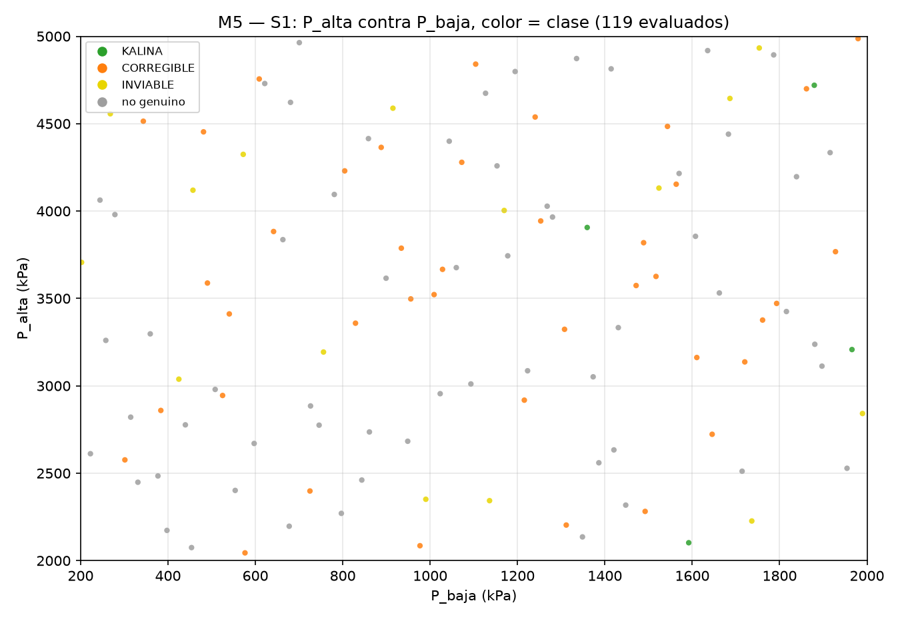
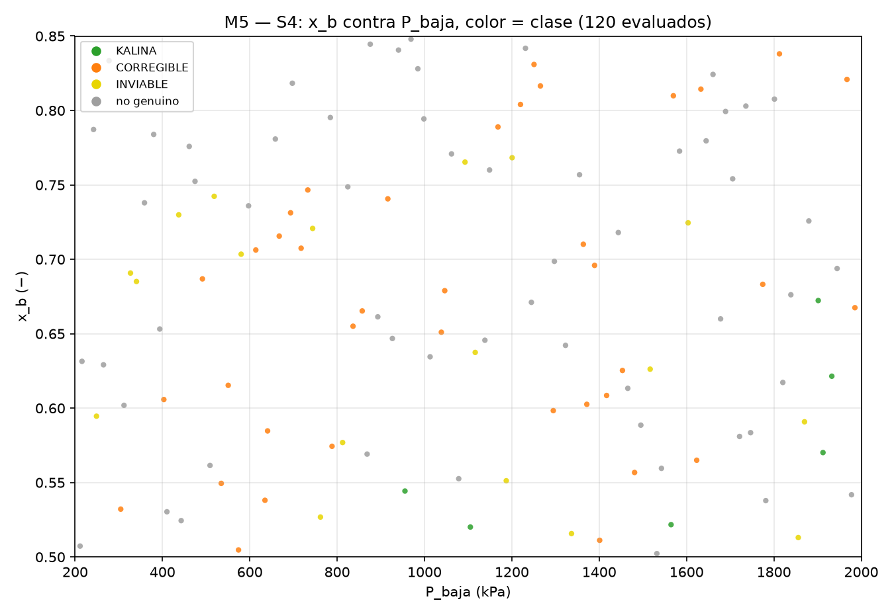
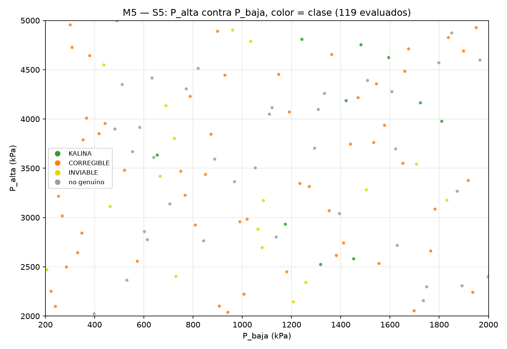

# REPORTE M5 — regiones KALINA conservando datos del profesor
## 1. La pregunta
**¿Qué datos del profesor se pueden conservar tal cual y aun así obtener un ciclo KALINA?** Para cada conjunto conservado, ¿en qué rangos tienen que estar las demás variables, en especial las presiones y sus diferencias? La eficiencia es secundaria: se reporta, pero no se optimiza.
## 2. Qué se hizo
- **Cinco escenarios.** En cada uno se fija un subconjunto de los datos del profesor (`comun.PROFESOR`) y el resto queda libre dentro de la caja de M5 (P_alta 2000–5000 kPa, P_baja 200–2000 kPa, T_fuente 380–623.15 K, T_sumidero 278.15–303.55 K, x_b 0.50–0.85 y las efectividades 0.40–0.95). Por escenario, un LHS de 120 puntos sobre sus variables libres con `scipy.stats.qmc.LatinHypercube(d=n_libres, seed=20261007 + k)` (k = 1…5). La muestra quedó en `m5_muestra.csv` ANTES de correr.
- **Corrida.** 600 corridas en un solo `ProcessPoolExecutor(max_workers=7)`, motor `teqp`, piso de O2 de cada punto igual a su propia `T_sumidero`. Todo quedó en `m5_lhs.csv` con las columnas `escenario, id, omitido` más las de `COLS`.
- **Restricción física.** Si `P_baja ≥ P_alta − 300` el punto no se evalúa: `omitido=True` con el motivo en `mensaje` (2 de 600 puntos).
- **Punto genuino (igual que M4).** Solo cuentan KALINA, CORREGIBLE e INVIABLE; una fila con `convergio=True` y NO_CONVERGIO es espuria (N2) y es NO genuina en todo.
- **Análisis.** Por escenario: conteos, ¿es posible?, rangos (mín, p5, mediana, p95, máx) de cada variable libre dentro de KALINA con el KS (RSA) cuando hay ≥ 10 KALINA, la figura de la ventana, el KALINA más parecido al profesor y, secundario, el de mayor η. De 598 evaluados salieron **20 KALINA**.
## 3. Tabla principal
| escenario | qué se conserva | ¿hay KALINA? | cuántos | rangos clave de lo que se mueve (p5–p95 en KALINA) | KALINA más parecido (id, d) | η de ese punto |
|---|---|---|---|---|---|---|
| S1 (sus temperaturas) | T_fuente = 623.15, T_sumidero = 300.032917 | sí | 4 KALINA / 119 evaluados | P_alta 2268–4597.62 kPa; P_baja 1394.42–1952.68 kPa; dP 619.984–2796.24 kPa; rP 1.3672–2.81871; x_b 0.580594–0.812069 | id 79, d = 2.6099 | 0.0435 |
| S2 (sus presiones) | P_alta = 3000.0, P_baja = 400.0 | NO | 0 KALINA / 120 evaluados | — | — | — |
| S3 (sus presiones y su clima) | P_alta = 3000.0, P_baja = 400.0, T_sumidero = 300.032917 | NO | 0 KALINA / 120 evaluados | — | — | — |
| S4 (su P_alta y sus temperaturas) | P_alta = 3000.0, T_fuente = 623.15, T_sumidero = 300.032917 | sí | 6 KALINA / 120 evaluados | P_baja 992.72–1927.61 kPa; dP 1072.39–2007.28 kPa; rP 1.55636–3.03404; x_b 0.52051–0.659581 | id 119, d = 2.00529 | 0.0374 |
| S5 (su fuente y su composición) | T_fuente = 623.15, x_b = 0.5 | sí | 10 KALINA / 119 evaluados | P_alta 2549.43–4783.59 kPa; P_baja 888.734–1771.59 kPa; dP 1163.07–3433.39 kPa; rP 1.83872–4.79531; T_sumidero 279.598–302.412 K | id 103, d = 2.40278 | 0.0692 |

## 4. Un escenario por escenario
### 4.1 — S1: sus temperaturas (conserva T_fuente = 623.15, T_sumidero = 300.032917)
Puntos: 120 por escenario; omitidos por la restricción `P_baja ≥ P_alta − 300`: 1; evaluados: 119. KALINA = 4, genuinos = 59, espurios N2 = 2, fuera de rango = 53.

Rangos de las variables libres **dentro de los 4 KALINA** (el KS es KALINA contra no KALINA, solo con ≥ 10 KALINA):

| variable | n | mín | p5 | mediana | p95 | máx | KS | valor p |
|---|---|---|---|---|---|---|---|---|
| P_alta | 4 | 2102.2 | 2268 | 3556.73 | 4597.62 | 4719.68 | n/d | n/d |
| P_baja | 4 | 1359.56 | 1394.42 | 1735.66 | 1952.68 | 1965.62 | n/d | n/d |
| x_b | 4 | 0.576898 | 0.580594 | 0.657477 | 0.812069 | 0.829478 | n/d | n/d |
| eta_t | 4 | 0.492467 | 0.535997 | 0.808766 | 0.835877 | 0.836056 | n/d | n/d |
| eta_p | 4 | 0.770109 | 0.77375 | 0.815958 | 0.86173 | 0.866 | n/d | n/d |
| eps_hrvg | 4 | 0.465216 | 0.469888 | 0.508477 | 0.556902 | 0.56331 | n/d | n/d |
| eps_reg | 4 | 0.607188 | 0.630592 | 0.786895 | 0.900762 | 0.916678 | n/d | n/d |
| eps_cond | 4 | 0.854503 | 0.860736 | 0.906634 | 0.941502 | 0.945788 | n/d | n/d |
| dP | 4 | 510.234 | 619.984 | 1894.15 | 2796.24 | 2840.33 | n/d | n/d |
| rP | 4 | 1.32051 | 1.3672 | 2.07157 | 2.81871 | 2.87296 | n/d | n/d |

La figura, solo con los 119 puntos evaluados y coloreada por clase:

El KALINA más parecido al profesor (menor d = Σ|v − v_prof|/(b − a) sobre las libres): id 79, d = 2.6099, η = 0.0435, D = 0, fuera de rango = no, B_verificado = True. Sus valores: P_alta = 3207.52, P_baja = 1965.62, x_b = 0.713419, eta_t = 0.834862, eta_p = 0.866, eps_hrvg = 0.465216, eps_reg = 0.763215, eps_cond = 0.854503

Secundario, el KALINA de mayor η: id 53, d = 3.17203, η = 0.0929, D = 0, fuera de rango = no, B_verificado = True. Sus valores: P_alta = 3905.95, P_baja = 1359.56, x_b = 0.829478, eta_t = 0.836056, eta_p = 0.837534, eps_hrvg = 0.496366, eps_reg = 0.916678, eps_cond = 0.945788

El criterio que bloquea al resto es `O2`: 55 de los 55 genuinos no KALINA.

### 4.2 — S2: sus presiones (conserva P_alta = 3000.0, P_baja = 400.0)
Puntos: 120 por escenario; omitidos por la restricción `P_baja ≥ P_alta − 300`: 0; evaluados: 120. KALINA = 0, genuinos = 95, espurios N2 = 2, fuera de rango = 66.

**No factible en esta caja:** de los 120 puntos evaluados, ninguno quedó KALINA.

El criterio que bloquea al resto es `O2`: 95 de los 95 genuinos no KALINA.

El punto genuino de menor D (D = Σviolaciones/τ, cuanto más cerca de factible) es: id 40, d = 4.43378, η = 0.0703, D = 0.219673, fuera de rango = no, B_verificado = sin error. Sus valores: T_fuente = 391.158, T_sumidero = 278.969, x_b = 0.70704, eta_t = 0.725821, eta_p = 0.444224, eps_hrvg = 0.498764, eps_reg = 0.52228, eps_cond = 0.92345

### 4.3 — S3: sus presiones y su clima (conserva P_alta = 3000.0, P_baja = 400.0, T_sumidero = 300.032917)
Puntos: 120 por escenario; omitidos por la restricción `P_baja ≥ P_alta − 300`: 0; evaluados: 120. KALINA = 0, genuinos = 84, espurios N2 = 6, fuera de rango = 64.

**No factible en esta caja:** de los 120 puntos evaluados, ninguno quedó KALINA.

El criterio que bloquea al resto es `O2`: 84 de los 84 genuinos no KALINA.

El punto genuino de menor D (D = Σviolaciones/τ, cuanto más cerca de factible) es: id 106, d = 1.45305, η = 0.1113, D = 1.57, fuera de rango = no, B_verificado = sin error. Sus valores: T_fuente = 398.185, x_b = 0.523886, eta_t = 0.919069, eta_p = 0.726052, eps_hrvg = 0.783179, eps_reg = 0.802565, eps_cond = 0.840376

### 4.4 — S4: su P_alta y sus temperaturas (conserva P_alta = 3000.0, T_fuente = 623.15, T_sumidero = 300.032917)
Puntos: 120 por escenario; omitidos por la restricción `P_baja ≥ P_alta − 300`: 0; evaluados: 120. KALINA = 6, genuinos = 62, espurios N2 = 2, fuera de rango = 57.

Rangos de las variables libres **dentro de los 6 KALINA** (el KS es KALINA contra no KALINA, solo con ≥ 10 KALINA):

| variable | n | mín | p5 | mediana | p95 | máx | KS | valor p |
|---|---|---|---|---|---|---|---|---|
| P_baja | 6 | 955.286 | 992.72 | 1733.07 | 1927.61 | 1932.67 | n/d | n/d |
| x_b | 6 | 0.520106 | 0.52051 | 0.557224 | 0.659581 | 0.672289 | n/d | n/d |
| eta_t | 6 | 0.446147 | 0.448445 | 0.598266 | 0.916001 | 0.94345 | n/d | n/d |
| eta_p | 6 | 0.509843 | 0.543038 | 0.702773 | 0.922873 | 0.93587 | n/d | n/d |
| eps_hrvg | 6 | 0.40425 | 0.404958 | 0.599899 | 0.787916 | 0.802681 | n/d | n/d |
| eps_reg | 6 | 0.482804 | 0.489431 | 0.756519 | 0.909996 | 0.924418 | n/d | n/d |
| eps_cond | 6 | 0.883155 | 0.885266 | 0.907086 | 0.935925 | 0.938282 | n/d | n/d |
| dP | 6 | 1067.33 | 1072.39 | 1266.93 | 2007.28 | 2044.71 | n/d | n/d |
| rP | 6 | 1.55226 | 1.55636 | 1.74755 | 3.03404 | 3.14042 | n/d | n/d |

La figura, solo con los 120 puntos evaluados y coloreada por clase:

El KALINA más parecido al profesor (menor d = Σ|v − v_prof|/(b − a) sobre las libres): id 119, d = 2.00529, η = 0.0374, D = 0, fuera de rango = sí, B_verificado = True. Sus valores: P_baja = 1105.02, x_b = 0.520106, eta_t = 0.455339, eta_p = 0.741565, eps_hrvg = 0.802681, eps_reg = 0.482804, eps_cond = 0.938282

Secundario, el KALINA de mayor η: id 93, d = 2.03055, η = 0.0672, D = 0, fuera de rango = sí, B_verificado = True. Sus valores: P_baja = 955.286, x_b = 0.544299, eta_t = 0.684189, eta_p = 0.642623, eps_hrvg = 0.40425, eps_reg = 0.816986, eps_cond = 0.891597

El criterio que bloquea al resto es `O2`: 56 de los 56 genuinos no KALINA.

### 4.5 — S5: su fuente y su composición (conserva T_fuente = 623.15, x_b = 0.5)
Puntos: 120 por escenario; omitidos por la restricción `P_baja ≥ P_alta − 300`: 1; evaluados: 119. KALINA = 10, genuinos = 82, espurios N2 = 0, fuera de rango = 82.

Rangos de las variables libres **dentro de los 10 KALINA** (el KS es KALINA contra no KALINA, solo con ≥ 10 KALINA):

| variable | n | mín | p5 | mediana | p95 | máx | KS | valor p |
|---|---|---|---|---|---|---|---|---|
| P_alta | 10 | 2523.42 | 2549.43 | 4070.05 | 4783.59 | 4808.34 | 0.279 | 0.3953 |
| P_baja | 10 | 654.553 | 888.734 | 1437.21 | 1771.59 | 1810.59 | 0.478 | 0.0199 |
| T_sumidero | 10 | 278.768 | 279.598 | 288.755 | 302.412 | 302.581 | 0.289 | 0.3515 |
| eta_t | 10 | 0.410314 | 0.461288 | 0.698791 | 0.910482 | 0.922492 | 0.225 | 0.6589 |
| eta_p | 10 | 0.433828 | 0.445072 | 0.667803 | 0.907668 | 0.911292 | 0.199 | 0.7865 |
| eps_hrvg | 10 | 0.407302 | 0.437223 | 0.57352 | 0.804189 | 0.807765 | 0.379 | 0.1077 |
| eps_reg | 10 | 0.410115 | 0.414387 | 0.547841 | 0.846476 | 0.940139 | 0.362 | 0.1350 |
| eps_cond | 10 | 0.812809 | 0.837715 | 0.894608 | 0.934859 | 0.939305 | 0.817 | 0.0000 |
| dP | 10 | 1128.68 | 1163.07 | 2602.02 | 3433.39 | 3566.07 | 0.134 | 0.9875 |
| rP | 10 | 1.77704 | 1.83872 | 2.69743 | 4.79531 | 5.55189 | 0.331 | 0.2160 |

La figura, solo con los 119 puntos evaluados y coloreada por clase:

El KALINA más parecido al profesor (menor d = Σ|v − v_prof|/(b − a) sobre las libres): id 103, d = 2.40278, η = 0.0692, D = 0, fuera de rango = sí, B_verificado = True. Sus valores: P_alta = 4186.25, P_baja = 1421.89, T_sumidero = 297.608, eta_t = 0.789686, eta_p = 0.655887, eps_hrvg = 0.594823, eps_reg = 0.488471, eps_cond = 0.868156

Secundario, el KALINA de mayor η: id 24, d = 3.18454, η = 0.0846, D = 0, fuera de rango = sí, B_verificado = True. Sus valores: P_alta = 4808.34, P_baja = 1242.27, T_sumidero = 302.581, eta_t = 0.922492, eta_p = 0.576066, eps_hrvg = 0.407302, eps_reg = 0.410115, eps_cond = 0.878416

El criterio que bloquea al resto es `O2`: 72 de los 72 genuinos no KALINA.

## 5. Los tiempos
La corrida: tardaron 9173 s (152 min) en 600 corridas. Suma de los tiempos de cómputo de los 598 puntos evaluados por escenario: S1 = 11566.7 s, S2 = 14464.9 s, S3 = 17054.2 s, S4 = 9901.5 s, S5 = 10783.5 s.
## 6. La conclusión
- **S1 — sus temperaturas:** de los datos del profesor se pueden conservar **T_fuente = 623.15, T_sumidero = 300.032917** siempre que las variables libres queden en P_alta 2268–4597.62 kPa; P_baja 1394.42–1952.68 kPa; dP 619.984–2796.24 kPa; rP 1.3672–2.81871; x_b 0.580594–0.812069 (p5–p95 de los 4 KALINA; el más parecido al profesor es el id 79, con η = 0.0435).
- **S2 — sus presiones:** con **P_alta = 3000.0, P_baja = 400.0** fijos no se pudo: de 120 puntos evaluados, 0 KALINA. El criterio que más se rompe es `O2` (95 puntos) y el genuino de menor D (D = 0.219673) es el id 40.
- **S3 — sus presiones y su clima:** con **P_alta = 3000.0, P_baja = 400.0, T_sumidero = 300.032917** fijos no se pudo: de 120 puntos evaluados, 0 KALINA. El criterio que más se rompe es `O2` (84 puntos) y el genuino de menor D (D = 1.57) es el id 106.
- **S4 — su P_alta y sus temperaturas:** de los datos del profesor se pueden conservar **P_alta = 3000.0, T_fuente = 623.15, T_sumidero = 300.032917** siempre que las variables libres queden en P_baja 992.72–1927.61 kPa; dP 1072.39–2007.28 kPa; rP 1.55636–3.03404; x_b 0.52051–0.659581 (p5–p95 de los 6 KALINA; el más parecido al profesor es el id 119, con η = 0.0374).
- **S5 — su fuente y su composición:** de los datos del profesor se pueden conservar **T_fuente = 623.15, x_b = 0.5** siempre que las variables libres queden en P_alta 2549.43–4783.59 kPa; P_baja 888.734–1771.59 kPa; dP 1163.07–3433.39 kPa; rP 1.83872–4.79531; T_sumidero 279.598–302.412 K (p5–p95 de los 10 KALINA; el más parecido al profesor es el id 103, con η = 0.0692).
## 7. Lo que no se sabe
- 120 puntos por escenario es una **exploración**, no un mapa fino: sirve para decir qué escenario es factible y qué criterio bloquea, no para cerrar rangos.
- Los puntos **fuera de rango** (motor de propiedades sin respaldo experimental): 322 de 598 evaluados. Sus η hay que tomarlas con pinzas.
- Los 2 puntos omitidos no se evaluaron: no dicen nada sobre el ciclo, solo que sus presiones estaban demasiado pegadas.
- La caja de las variables libres la fijó el director; fuera de ella no se dijo nada.
## 7b. Nota del director (Claude, auditoría 2026-10-07): S2 y S3 SÍ son factibles

El reporte declara S2 y S3 (presiones del profesor 3000/400 kPa) como "no factibles". **Eso es
un efecto del muestreo, no un resultado físico:**

- M2R (parte 3, `resultados/2026-10-06_final_M2R/m2r_kalina.csv`) ya encontró un KALINA con
  **exactamente** las presiones (3000/400 kPa), el clima (300.03 K) y la x_b (0.50) del profesor:
  T_fuente = 403 K y ε_cond = 0.95, η = 9.50 %, dentro de rango y con `B_verificado = True`.
  Ese punto pertenece a S3 (y por tanto también a S2).
- Ninguno de los 120 puntos LHS de S3 cayó en esa zona (T_fuente < 420 K y ε_cond > 0.9). Es una
  región angosta en un espacio de 7 dimensiones.
- Los genuinos más cercanos de este muestreo lo confirman. En S2, D = 0.22 (T_fuente 391 K,
  T_sumidero 279 K, ε_cond 0.92): le falta 0.2 K de O2. En S3, D = 1.57 (T_fuente 398 K): le
  faltan ~1.6 K de O2.

**Lectura correcta:** con las presiones del profesor hay KALINA, pero solo en una franja estrecha:
**T_fuente ≈ 390–405 K y ε_cond ≥ ~0.92**, con un clima a 27 °C o más frío. Para delimitarla haría
falta una malla fina dirigida.

**Rango confiable:** los KALINA de S4 y S5 (6 y 10) están todos fuera de rango (líquido > 420 K).
En S1 hay 2 de 4 dentro de rango; entre ellos está el más parecido al profesor (P_baja 1966 kPa,
ε_HRVG 0.47, x_b 0.71, η 4.4 %). Todos los KALINA de M5 tienen `B_verificado = True`.

## 8. Qué sigue
Que el director elija qué escenario llevar a un mapa fino (más puntos por escenario) y si conviene aflojar o no la restricción `P_baja ≥ P_alta − 300`, que es la que descarta los 2 puntos omitidos.
