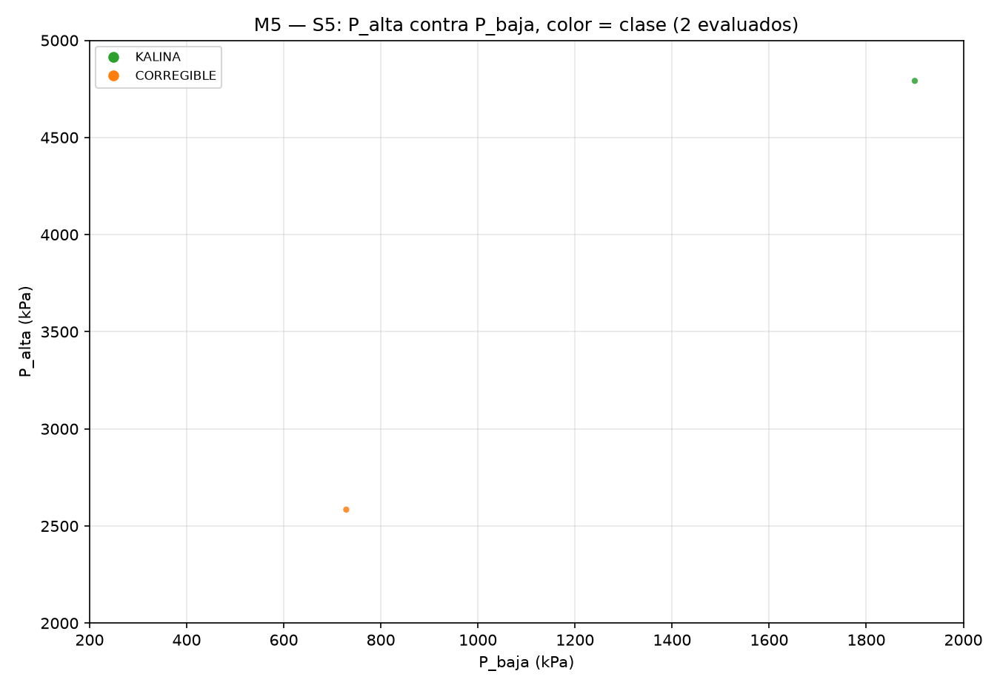

# REPORTE M5 — regiones KALINA conservando datos del profesor
## 1. La pregunta
**¿Qué datos del profesor se pueden conservar tal cual y aun así obtener un ciclo KALINA?** Para cada conjunto conservado, ¿en qué rangos tienen que estar las demás variables, en especial las presiones y sus diferencias? La eficiencia es secundaria: se reporta, pero no se optimiza.
## 2. Qué se hizo
- **Cinco escenarios.** En cada uno se fija un subconjunto de los datos del profesor (`comun.PROFESOR`) y el resto queda libre dentro de la caja de M5 (P_alta 2000–5000 kPa, P_baja 200–2000 kPa, T_fuente 380–623.15 K, T_sumidero 278.15–303.55 K, x_b 0.50–0.85 y las efectividades 0.40–0.95). Por escenario, un LHS de 2 puntos sobre sus variables libres con `scipy.stats.qmc.LatinHypercube(d=n_libres, seed=20261007 + k)` (k = 1…5). La muestra quedó en `m5_muestra.csv` ANTES de correr.
- **Corrida.** 10 corridas en un solo `ProcessPoolExecutor(max_workers=7)`, motor `teqp`, piso de O2 de cada punto igual a su propia `T_sumidero`. Todo quedó en `m5_lhs.csv` con las columnas `escenario, id, omitido` más las de `COLS`.
- **Restricción física.** Si `P_baja ≥ P_alta − 300` el punto no se evalúa: `omitido=True` con el motivo en `mensaje` (0 de 10 puntos).
- **Punto genuino (igual que M4).** Solo cuentan KALINA, CORREGIBLE e INVIABLE; una fila con `convergio=True` y NO_CONVERGIO es espuria (N2) y es NO genuina en todo.
- **Análisis.** Por escenario: conteos, ¿es posible?, rangos (mín, p5, mediana, p95, máx) de cada variable libre dentro de KALINA con el KS (RSA) cuando hay ≥ 10 KALINA, la figura de la ventana, el KALINA más parecido al profesor y, secundario, el de mayor η. De 10 evaluados salieron **1 KALINA**.
## 3. Tabla principal
| escenario | qué se conserva | ¿hay KALINA? | cuántos | rangos clave de lo que se mueve (p5–p95 en KALINA) | KALINA más parecido (id, d) | η de ese punto |
|---|---|---|---|---|---|---|
| S1 (sus temperaturas) | T_fuente = 623.15, T_sumidero = 300.032917 | NO | 0 KALINA / 2 evaluados | — | — | — |
| S2 (sus presiones) | P_alta = 3000.0, P_baja = 400.0 | NO | 0 KALINA / 2 evaluados | — | — | — |
| S3 (sus presiones y su clima) | P_alta = 3000.0, P_baja = 400.0, T_sumidero = 300.032917 | NO | 0 KALINA / 2 evaluados | — | — | — |
| S4 (su P_alta y sus temperaturas) | P_alta = 3000.0, T_fuente = 623.15, T_sumidero = 300.032917 | NO | 0 KALINA / 2 evaluados | — | — | — |
| S5 (su fuente y su composición) | T_fuente = 623.15, x_b = 0.5 | sí | 1 KALINA / 2 evaluados | P_alta 4791.3–4791.3 kPa; P_baja 1900–1900 kPa; dP 2891.3–2891.3 kPa; rP 2.52174–2.52174; T_sumidero 291.609–291.609 K | id 1, d = 2.96055 | 0.0470 |

## 4. Un escenario por escenario
### 4.1 — S1: sus temperaturas (conserva T_fuente = 623.15, T_sumidero = 300.032917)
Puntos: 2 por escenario; omitidos por la restricción `P_baja ≥ P_alta − 300`: 0; evaluados: 2. KALINA = 0, genuinos = 0, espurios N2 = 0, fuera de rango = 0.

**No factible en esta caja:** de los 2 puntos evaluados, ninguno quedó KALINA.

No hay genuinos sin KALINA: ningún criterio se rompe.

### 4.2 — S2: sus presiones (conserva P_alta = 3000.0, P_baja = 400.0)
Puntos: 2 por escenario; omitidos por la restricción `P_baja ≥ P_alta − 300`: 0; evaluados: 2. KALINA = 0, genuinos = 1, espurios N2 = 0, fuera de rango = 0.

**No factible en esta caja:** de los 2 puntos evaluados, ninguno quedó KALINA.

El criterio que bloquea al resto es `O2`: 1 de los 1 genuinos no KALINA.

El punto genuino de menor D (D = Σviolaciones/τ, cuanto más cerca de factible) es: id 0, d = 2.75182, η = 0.0919, D = 2.18669, fuera de rango = no, B_verificado = sin error. Sus valores: T_fuente = 444.082, T_sumidero = 285.589, x_b = 0.566962, eta_t = 0.617463, eta_p = 0.68815, eps_hrvg = 0.56323, eps_reg = 0.693393, eps_cond = 0.852704

### 4.3 — S3: sus presiones y su clima (conserva P_alta = 3000.0, P_baja = 400.0, T_sumidero = 300.032917)
Puntos: 2 por escenario; omitidos por la restricción `P_baja ≥ P_alta − 300`: 0; evaluados: 2. KALINA = 0, genuinos = 1, espurios N2 = 0, fuera de rango = 0.

**No factible en esta caja:** de los 2 puntos evaluados, ninguno quedó KALINA.

El criterio que bloquea al resto es `O3`: 1 de los 1 genuinos no KALINA.

El punto genuino de menor D (D = Σviolaciones/τ, cuanto más cerca de factible) es: id 0, d = 3.14801, η = -0.6011, D = 88.2367, fuera de rango = no, B_verificado = sin error. Sus valores: T_fuente = 395.539, x_b = 0.669616, eta_t = 0.941858, eta_p = 0.594882, eps_hrvg = 0.472135, eps_reg = 0.646603, eps_cond = 0.578221

### 4.4 — S4: su P_alta y sus temperaturas (conserva P_alta = 3000.0, T_fuente = 623.15, T_sumidero = 300.032917)
Puntos: 2 por escenario; omitidos por la restricción `P_baja ≥ P_alta − 300`: 0; evaluados: 2. KALINA = 0, genuinos = 1, espurios N2 = 0, fuera de rango = 1.

**No factible en esta caja:** de los 2 puntos evaluados, ninguno quedó KALINA.

El criterio que bloquea al resto es `O2`: 1 de los 1 genuinos no KALINA.

El punto genuino de menor D (D = Σviolaciones/τ, cuanto más cerca de factible) es: id 0, d = 1.62143, η = 0.0931, D = 14.023, fuera de rango = sí, B_verificado = sin error. Sus valores: P_baja = 717.366, x_b = 0.670952, eta_t = 0.861835, eta_p = 0.750411, eps_hrvg = 0.553545, eps_reg = 0.640304, eps_cond = 0.692223

### 4.5 — S5: su fuente y su composición (conserva T_fuente = 623.15, x_b = 0.5)
Puntos: 2 por escenario; omitidos por la restricción `P_baja ≥ P_alta − 300`: 0; evaluados: 2. KALINA = 1, genuinos = 2, espurios N2 = 0, fuera de rango = 2.

Rangos de las variables libres **dentro de los 1 KALINA** (el KS es KALINA contra no KALINA, solo con ≥ 10 KALINA):

| variable | n | mín | p5 | mediana | p95 | máx | KS | valor p |
|---|---|---|---|---|---|---|---|---|
| P_alta | 1 | 4791.3 | 4791.3 | 4791.3 | 4791.3 | 4791.3 | n/d | n/d |
| P_baja | 1 | 1900 | 1900 | 1900 | 1900 | 1900 | n/d | n/d |
| T_sumidero | 1 | 291.609 | 291.609 | 291.609 | 291.609 | 291.609 | n/d | n/d |
| eta_t | 1 | 0.632452 | 0.632452 | 0.632452 | 0.632452 | 0.632452 | n/d | n/d |
| eta_p | 1 | 0.543273 | 0.543273 | 0.543273 | 0.543273 | 0.543273 | n/d | n/d |
| eps_hrvg | 1 | 0.714986 | 0.714986 | 0.714986 | 0.714986 | 0.714986 | n/d | n/d |
| eps_reg | 1 | 0.756671 | 0.756671 | 0.756671 | 0.756671 | 0.756671 | n/d | n/d |
| eps_cond | 1 | 0.893205 | 0.893205 | 0.893205 | 0.893205 | 0.893205 | n/d | n/d |
| dP | 1 | 2891.3 | 2891.3 | 2891.3 | 2891.3 | 2891.3 | n/d | n/d |
| rP | 1 | 2.52174 | 2.52174 | 2.52174 | 2.52174 | 2.52174 | n/d | n/d |

La figura, solo con los 2 puntos evaluados y coloreada por clase:

El KALINA más parecido al profesor (menor d = Σ|v − v_prof|/(b − a) sobre las libres): id 1, d = 2.96055, η = 0.0470, D = 0, fuera de rango = sí, B_verificado = True. Sus valores: P_alta = 4791.3, P_baja = 1900, T_sumidero = 291.609, eta_t = 0.632452, eta_p = 0.543273, eps_hrvg = 0.714986, eps_reg = 0.756671, eps_cond = 0.893205

Secundario, el KALINA de mayor η: id 1, d = 2.96055, η = 0.0470, D = 0, fuera de rango = sí, B_verificado = True. Sus valores: P_alta = 4791.3, P_baja = 1900, T_sumidero = 291.609, eta_t = 0.632452, eta_p = 0.543273, eps_hrvg = 0.714986, eps_reg = 0.756671, eps_cond = 0.893205

El criterio que bloquea al resto es `O2`: 1 de los 1 genuinos no KALINA.

## 5. Los tiempos
La corrida: tardaron 159 s (2 min) en 10 corridas. Suma de los tiempos de cómputo de los 10 puntos evaluados por escenario: S1 = 56.3 s, S2 = 207.2 s, S3 = 187.7 s, S4 = 184.3 s, S5 = 154.6 s.
## 6. La conclusión
- **S1 — sus temperaturas:** con **T_fuente = 623.15, T_sumidero = 300.032917** fijos no se pudo: de 2 puntos evaluados, 0 KALINA. El criterio que más se rompe es `ninguno` (0 puntos) y el genuino de menor D (D = n/d) es el id None.
- **S2 — sus presiones:** con **P_alta = 3000.0, P_baja = 400.0** fijos no se pudo: de 2 puntos evaluados, 0 KALINA. El criterio que más se rompe es `O2` (1 puntos) y el genuino de menor D (D = 2.18669) es el id 0.
- **S3 — sus presiones y su clima:** con **P_alta = 3000.0, P_baja = 400.0, T_sumidero = 300.032917** fijos no se pudo: de 2 puntos evaluados, 0 KALINA. El criterio que más se rompe es `O3` (1 puntos) y el genuino de menor D (D = 88.2367) es el id 0.
- **S4 — su P_alta y sus temperaturas:** con **P_alta = 3000.0, T_fuente = 623.15, T_sumidero = 300.032917** fijos no se pudo: de 2 puntos evaluados, 0 KALINA. El criterio que más se rompe es `O2` (1 puntos) y el genuino de menor D (D = 14.023) es el id 0.
- **S5 — su fuente y su composición:** de los datos del profesor se pueden conservar **T_fuente = 623.15, x_b = 0.5** siempre que las variables libres queden en P_alta 4791.3–4791.3 kPa; P_baja 1900–1900 kPa; dP 2891.3–2891.3 kPa; rP 2.52174–2.52174; T_sumidero 291.609–291.609 K (p5–p95 de los 1 KALINA; el más parecido al profesor es el id 1, con η = 0.0470).
## 7. Lo que no se sabe
- 2 puntos por escenario es una **exploración**, no un mapa fino: sirve para decir qué escenario es factible y qué criterio bloquea, no para cerrar rangos.
- Los puntos **fuera de rango** (motor de propiedades sin respaldo experimental): 3 de 10 evaluados. Sus η hay que tomarlas con pinzas.
- Los 0 puntos omitidos no se evaluaron: no dicen nada sobre el ciclo, solo que sus presiones estaban demasiado pegadas.
- La caja de las variables libres la fijó el director; fuera de ella no se dijo nada.
## 8. Qué sigue
Que el director elija qué escenario llevar a un mapa fino (más puntos por escenario) y si conviene aflojar o no la restricción `P_baja ≥ P_alta − 300`, que es la que descarta los 0 puntos omitidos.
