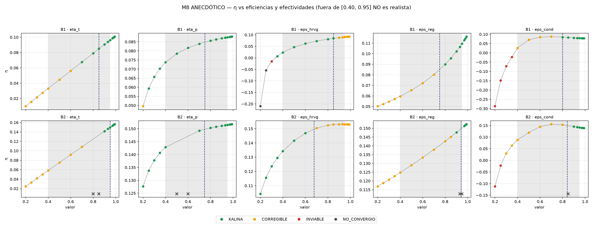

# M8 — ANECDÓTICO — fuera del rango realista

> **⚠ ANECDÓTICO — fuera del rango realista.**
> Esta campaña es **curiosidad**, no diseño. Los valores de η_t, η_p, ε_HRVG, ε_reg y ε_cond
> **fuera de [0.40, 0.95] no son realistas** para este proyecto: nada de lo que aparece fuera de
> esa franja es una recomendación ni un resultado de diseño. Los 90 puntos "realistas" de esta
> campaña **tampoco sustituyen** a los barridos M4/M7, que sí exploran la región de trabajo.

**Fecha:** 2026-10-07 · **Rama:** `test/barrido_final` · **Motor:** solo `teqp` (verificado) ·
**Prioridad:** baja (curiosidad del usuario).

---

## 1. Qué se hizo

OAT (una variable a la vez) de las cinco eficiencias/efectividades sobre dos puntos base,
con los 16 valores `[0.20 … 0.99]` y el resto de las variables en la base:

- **B1** = ancla A\* (`dict(PROFESOR, T_fuente=403.0, P_baja=563.6363636363637)`), piso de O2 = 300.032917 K.
- **B2** = óptimo sin restricciones de M7 (arranque A1 de `resultados/2026-10-07_final_M7/m7_optimos.csv`),
  piso de O2 = su `T_sumidero` = 279.0977013205448 K (misma convención que M7: `piso = T_sumidero`).

2 bases × 5 variables × 16 valores = **160 corridas** con
`ProcessPoolExecutor(max_workers=7)`, `t_amb_diseno` = piso de O2 de cada base, y
`realista = (0.40 ≤ valor ≤ 0.95)`: **90 realistas / 70 fuera** (9 en la franja por grupo,
4 por debajo, 3 por encima).

Corrida única en primer plano: **160/160 en 1358 s** (≈ 22,6 min de tiempo de pared con
7 workers; ≈ 60 s de CPU por corrida). Todo el CSV está en `m8_oat.csv`.

### Criterios que aparecen (de `src/restricciones/`)

| Código | Significado | Clase que produce |
|---|---|---|
| O2 | succión de la bomba bifásica bajo el peor caso de T_amb (riesgo de cavitación) | CORREGIBLE |
| O3 | potencia neta no positiva: el ciclo no genera trabajo útil | INVIABLE |
| O5 | salida del HRVG líquida o sobrecalentada (deja de ser Kalina) | INVIABLE |
| C1 | orden de composiciones invertido / separación bajo la banda de incertidumbre | CORREGIBLE / INVIABLE |
| C3 | caudales del separador que no suman el caudal base / fracción fuera de [0,1] | INVIABLE |
| N2 | el balance global de energía no cierra dentro de la tolerancia | NO_CONVERGIO (espurio si `convergio=True`) |

Conteo de códigos sobre las 160 filas: **O2 x66, O3 x9, C3 x4, N2 x2, O5 x2, C1 x2.**

---

## 2. Figura



2 × 5 paneles de η contra el valor barrido: color = clase, franja gris = [0.40, 0.95],
línea vertical punteada = valor de la base, `x` = punto sin η (la corrida lanzó excepción).

---

## 3. Bloques con cifras (§1 a §4, salida literal de `m8_analisis.py`)

=== §1 conteos y diseño ===
- 160 filas = 2 bases x 5 variables x 16 valores; 90 realistas y 70 fuera de [0.40, 0.95].
- Por grupo: 16 puntos = 9 en [0.40, 0.95] + 4 por debajo (0.20–0.35) + 3 por encima (0.97–0.99).
- Clases en las filas: CORREGIBLE x60, INVIABLE x7, KALINA x84, NO_CONVERGIO x9.
- B1: T_fuente=403 K, P_baja=563.636 kPa, T_sumidero=300.033 K, piso_O2=300.033 K; bases eta_t=0.85, eta_p=0.75, eps_hrvg=0.85, eps_reg=0.75, eps_cond=0.8.
- B2: T_fuente=436.097 K, P_baja=808.34 kPa, T_sumidero=279.098 K, piso_O2=279.098 K; bases eta_t=0.95, eta_p=0.746081, eps_hrvg=0.677731, eps_reg=0.94153, eps_cond=0.841826.

=== §2 por base y variable ===
- **B1 · eta_t** — valor de la base 0.85
  - dentro [0.40, 0.95]: η(0.4)=0.0331, η(0.95)=0.0962 | clases: CORREGIBLE x3, KALINA x6 | criterios: O2 x3 | NO_CONVERGIO: ninguno
  - fuera: η(0.2)=0.0099, η(0.35)=0.0273 | clases: CORREGIBLE x4 | criterios: O2 x4 | NO_CONVERGIO: ninguno | η(0.97)=0.0985, η(0.99)=0.1008 | clases: KALINA x3 | criterios: ninguno | NO_CONVERGIO: ninguno
  - monotonía: 15/15 tramos con η creciente; ninguna bajada al subir el valor
- **B1 · eta_p** — valor de la base 0.75
  - dentro [0.40, 0.95]: η(0.4)=0.0737, η(0.95)=0.0875 | clases: KALINA x9 | criterios: ninguno | NO_CONVERGIO: ninguno
  - fuera: η(0.2)=0.0496, η(0.35)=0.0703 | clases: CORREGIBLE x1, KALINA x3 | criterios: O2 x1 | NO_CONVERGIO: ninguno | η(0.97)=0.0877, η(0.99)=0.0879 | clases: KALINA x3 | criterios: ninguno | NO_CONVERGIO: ninguno
  - monotonía: 15/15 tramos con η creciente; ninguna bajada al subir el valor
- **B1 · eps_hrvg** — valor de la base 0.85
  - dentro [0.40, 0.95]: η(0.4)=0.0236, η(0.95)=0.0905 | clases: CORREGIBLE x3, KALINA x6 | criterios: O2 x3 | NO_CONVERGIO: ninguno
  - fuera: η(0.2)=-0.2099, η(0.35)=0.0072 | clases: INVIABLE x1, KALINA x1, NO_CONVERGIO x2 | criterios: C1 x2, C3 x4, N2 x2, O3 x3, O5 x2 | NO_CONVERGIO: 0.2, 0.25 | η(0.97)=0.0915, η(0.99)=0.0925 | clases: CORREGIBLE x3 | criterios: O2 x3 | NO_CONVERGIO: ninguno
  - monotonía: 15/15 tramos con η creciente; ninguna bajada al subir el valor
- **B1 · eps_reg** — valor de la base 0.75
  - dentro [0.40, 0.95]: η(0.4)=0.0596, η(0.95)=0.1096 | clases: CORREGIBLE x4, KALINA x5 | criterios: O2 x4 | NO_CONVERGIO: ninguno
  - fuera: η(0.2)=0.0503, η(0.35)=0.0571 | clases: CORREGIBLE x4 | criterios: O2 x4 | NO_CONVERGIO: ninguno | η(0.97)=0.1128, η(0.99)=0.1162 | clases: KALINA x3 | criterios: ninguno | NO_CONVERGIO: ninguno
  - monotonía: 15/15 tramos con η creciente; ninguna bajada al subir el valor
- **B1 · eps_cond** — valor de la base 0.8
  - dentro [0.40, 0.95]: η(0.4)=0.0261, η(0.95)=0.0794 | clases: CORREGIBLE x4, KALINA x5 | criterios: O2 x4 | NO_CONVERGIO: ninguno
  - fuera: η(0.2)=-0.2869, η(0.35)=-0.0223 | clases: INVIABLE x4 | criterios: O2 x4, O3 x4 | NO_CONVERGIO: ninguno | η(0.97)=0.0788, η(0.99)=0.0782 | clases: KALINA x3 | criterios: ninguno | NO_CONVERGIO: ninguno
  - monotonía: 7/15 tramos con η creciente; bajadas: 0.7→0.8 (0.0876→0.0848); 0.8→0.85 (0.0848→0.0828); 0.85→0.9 (0.0828→0.0810); 0.9→0.93 (0.0810→0.0800); 0.93→0.95 (0.0800→0.0794); 0.95→0.97 (0.0794→0.0788); 0.97→0.98 (0.0788→0.0785); 0.98→0.99 (0.0785→0.0782)
- **B2 · eta_t** — valor de la base 0.95
  - dentro [0.40, 0.95]: η(0.4)=0.0584, η(0.95)=0.1498 | clases: CORREGIBLE x4, KALINA x3, NO_CONVERGIO x2 | criterios: O2 x4 | NO_CONVERGIO: 0.8, 0.85
  - fuera: η(0.2)=0.0247, η(0.35)=0.0500 | clases: CORREGIBLE x4 | criterios: O2 x4 | NO_CONVERGIO: ninguno | η(0.97)=0.1531, η(0.99)=0.1564 | clases: KALINA x3 | criterios: ninguno | NO_CONVERGIO: ninguno
  - monotonía: 12/12 tramos con η creciente; ninguna bajada al subir el valor
- **B2 · eta_p** — valor de la base 0.746081
  - dentro [0.40, 0.95]: η(0.4)=0.1428, η(0.95)=0.1515 | clases: KALINA x7, NO_CONVERGIO x2 | criterios: ninguno | NO_CONVERGIO: 0.5, 0.6
  - fuera: η(0.2)=0.1277, η(0.35)=0.1407 | clases: KALINA x4 | criterios: ninguno | NO_CONVERGIO: ninguno | η(0.97)=0.1516, η(0.99)=0.1518 | clases: KALINA x3 | criterios: ninguno | NO_CONVERGIO: ninguno
  - monotonía: 12/12 tramos con η creciente; ninguna bajada al subir el valor
- **B2 · eps_hrvg** — valor de la base 0.677731
  - dentro [0.40, 0.95]: η(0.4)=0.1343, η(0.95)=0.1532 | clases: CORREGIBLE x6, KALINA x3 | criterios: O2 x6 | NO_CONVERGIO: ninguno
  - fuera: η(0.2)=0.1043, η(0.35)=0.1295 | clases: KALINA x4 | criterios: ninguno | NO_CONVERGIO: ninguno | η(0.97)=0.1531, η(0.99)=0.1530 | clases: CORREGIBLE x3 | criterios: O2 x3 | NO_CONVERGIO: ninguno
  - monotonía: 11/15 tramos con η creciente; bajadas: 0.93→0.95 (0.1532→0.1532); 0.95→0.97 (0.1532→0.1531); 0.97→0.98 (0.1531→0.1531); 0.98→0.99 (0.1531→0.1530)
- **B2 · eps_reg** — valor de la base 0.94153
  - dentro [0.40, 0.95]: η(0.4)=0.1248, η(0.95)=n/d | clases: CORREGIBLE x6, KALINA x1, NO_CONVERGIO x2 | criterios: O2 x6 | NO_CONVERGIO: 0.93, 0.95
  - fuera: η(0.2)=0.1169, η(0.35)=0.1227 | clases: CORREGIBLE x4 | criterios: O2 x4 | NO_CONVERGIO: ninguno | η(0.97)=0.1513, η(0.99)=0.1523 | clases: KALINA x3 | criterios: ninguno | NO_CONVERGIO: ninguno
  - monotonía: 12/12 tramos con η creciente; ninguna bajada al subir el valor
- **B2 · eps_cond** — valor de la base 0.841826
  - dentro [0.40, 0.95]: η(0.4)=0.0880, η(0.95)=0.1414 | clases: CORREGIBLE x5, KALINA x3, NO_CONVERGIO x1 | criterios: O2 x5 | NO_CONVERGIO: 0.85
  - fuera: η(0.2)=-0.1119, η(0.35)=0.0639 | clases: CORREGIBLE x2, INVIABLE x2 | criterios: O2 x4, O3 x2 | NO_CONVERGIO: ninguno | η(0.97)=0.1400, η(0.99)=0.1388 | clases: KALINA x3 | criterios: ninguno | NO_CONVERGIO: ninguno
  - monotonía: 7/13 tramos con η creciente; bajadas: 0.7→0.8 (0.1555→0.1530); 0.9→0.93 (0.1450→0.1428); 0.93→0.95 (0.1428→0.1414); 0.95→0.97 (0.1414→0.1400); 0.97→0.98 (0.1400→0.1394); 0.98→0.99 (0.1394→0.1388)

=== §3 η y clase por punto (NC = sin convergencia) ===
| base | variable | 0.2 | 0.25 | 0.3 | 0.35 | 0.4 | 0.5 | 0.6 | 0.7 | 0.8 | 0.85 | 0.9 | 0.93 | 0.95 | 0.97 | 0.98 | 0.99 |
|---|---|---|---|---|---|---|---|---|---|---|---|---|---|---|---|---|---|
| B1 | eta_t | 0.0099[CORREGIBLE] | 0.0157[CORREGIBLE] | 0.0215[CORREGIBLE] | 0.0273[CORREGIBLE] | 0.0331[CORREGIBLE] | 0.0446[CORREGIBLE] | 0.0561[CORREGIBLE] | 0.0676[KALINA] | 0.0791[KALINA] | 0.0848[KALINA] | 0.0905[KALINA] | 0.0940[KALINA] | 0.0962[KALINA] | 0.0985[KALINA] | 0.0997[KALINA] | 0.1008[KALINA] |
| B1 | eta_p | 0.0496[CORREGIBLE] | 0.0593[KALINA] | 0.0657[KALINA] | 0.0703[KALINA] | 0.0737[KALINA] | 0.0785[KALINA] | 0.0817[KALINA] | 0.0839[KALINA] | 0.0856[KALINA] | 0.0863[KALINA] | 0.0869[KALINA] | 0.0873[KALINA] | 0.0875[KALINA] | 0.0877[KALINA] | 0.0878[KALINA] | 0.0879[KALINA] |
| B1 | eps_hrvg | -0.2099[NO_CONVERGIO] | -0.0543[NO_CONVERGIO] | -0.0147[INVIABLE] | 0.0072[KALINA] | 0.0236[KALINA] | 0.0467[KALINA] | 0.0621[KALINA] | 0.0731[KALINA] | 0.0814[KALINA] | 0.0848[KALINA] | 0.0878[CORREGIBLE] | 0.0895[CORREGIBLE] | 0.0905[CORREGIBLE] | 0.0915[CORREGIBLE] | 0.0920[CORREGIBLE] | 0.0925[CORREGIBLE] |
| B1 | eps_reg | 0.0503[CORREGIBLE] | 0.0524[CORREGIBLE] | 0.0547[CORREGIBLE] | 0.0571[CORREGIBLE] | 0.0596[CORREGIBLE] | 0.0654[CORREGIBLE] | 0.0722[CORREGIBLE] | 0.0802[CORREGIBLE] | 0.0900[KALINA] | 0.0957[KALINA] | 0.1022[KALINA] | 0.1065[KALINA] | 0.1096[KALINA] | 0.1128[KALINA] | 0.1145[KALINA] | 0.1162[KALINA] |
| B1 | eps_cond | -0.2869[INVIABLE] | -0.1483[INVIABLE] | -0.0715[INVIABLE] | -0.0223[INVIABLE] | 0.0261[CORREGIBLE] | 0.0701[CORREGIBLE] | 0.0848[CORREGIBLE] | 0.0876[CORREGIBLE] | 0.0848[KALINA] | 0.0828[KALINA] | 0.0810[KALINA] | 0.0800[KALINA] | 0.0794[KALINA] | 0.0788[KALINA] | 0.0785[KALINA] | 0.0782[KALINA] |
| B2 | eta_t | 0.0247[CORREGIBLE] | 0.0332[CORREGIBLE] | 0.0416[CORREGIBLE] | 0.0500[CORREGIBLE] | 0.0584[CORREGIBLE] | 0.0751[CORREGIBLE] | 0.0918[CORREGIBLE] | 0.1085[CORREGIBLE] | NC[NO_CONVERGIO] | NC[NO_CONVERGIO] | 0.1415[KALINA] | 0.1465[KALINA] | 0.1498[KALINA] | 0.1531[KALINA] | 0.1547[KALINA] | 0.1564[KALINA] |
| B2 | eta_p | 0.1277[KALINA] | 0.1337[KALINA] | 0.1378[KALINA] | 0.1407[KALINA] | 0.1428[KALINA] | NC[NO_CONVERGIO] | NC[NO_CONVERGIO] | 0.1493[KALINA] | 0.1503[KALINA] | 0.1508[KALINA] | 0.1512[KALINA] | 0.1514[KALINA] | 0.1515[KALINA] | 0.1516[KALINA] | 0.1517[KALINA] | 0.1518[KALINA] |
| B2 | eps_hrvg | 0.1043[KALINA] | 0.1156[KALINA] | 0.1235[KALINA] | 0.1295[KALINA] | 0.1343[KALINA] | 0.1416[KALINA] | 0.1469[KALINA] | 0.1504[CORREGIBLE] | 0.1524[CORREGIBLE] | 0.1529[CORREGIBLE] | 0.1532[CORREGIBLE] | 0.1532[CORREGIBLE] | 0.1532[CORREGIBLE] | 0.1531[CORREGIBLE] | 0.1531[CORREGIBLE] | 0.1530[CORREGIBLE] |
| B2 | eps_reg | 0.1169[CORREGIBLE] | 0.1188[CORREGIBLE] | 0.1208[CORREGIBLE] | 0.1227[CORREGIBLE] | 0.1248[CORREGIBLE] | 0.1290[CORREGIBLE] | 0.1333[CORREGIBLE] | 0.1379[CORREGIBLE] | 0.1427[CORREGIBLE] | 0.1451[CORREGIBLE] | 0.1476[KALINA] | NC[NO_CONVERGIO] | NC[NO_CONVERGIO] | 0.1513[KALINA] | 0.1518[KALINA] | 0.1523[KALINA] |
| B2 | eps_cond | -0.1119[INVIABLE] | -0.0228[INVIABLE] | 0.0296[CORREGIBLE] | 0.0639[CORREGIBLE] | 0.0880[CORREGIBLE] | 0.1194[CORREGIBLE] | 0.1448[CORREGIBLE] | 0.1555[CORREGIBLE] | 0.1530[CORREGIBLE] | NC[NO_CONVERGIO] | 0.1450[KALINA] | 0.1428[KALINA] | 0.1414[KALINA] | 0.1400[KALINA] | 0.1394[KALINA] | 0.1388[KALINA] |

=== §4 comportamientos no monótonos o inesperados ===
- Sin convergencia: B1·eps_hrvg: 0.2, 0.25; B2·eta_t: 0.8, 0.85; B2·eta_p: 0.5, 0.6; B2·eps_reg: 0.93, 0.95; B2·eps_cond: 0.85
- η que baja al subir el valor: B1·eps_cond: bajadas: 0.7→0.8 (0.0876→0.0848); 0.8→0.85 (0.0848→0.0828); 0.85→0.9 (0.0828→0.0810); 0.9→0.93 (0.0810→0.0800); 0.93→0.95 (0.0800→0.0794); 0.95→0.97 (0.0794→0.0788); 0.97→0.98 (0.0788→0.0785); 0.98→0.99 (0.0785→0.0782); B2·eps_hrvg: bajadas: 0.93→0.95 (0.1532→0.1532); 0.95→0.97 (0.1532→0.1531); 0.97→0.98 (0.1531→0.1531); 0.98→0.99 (0.1531→0.1530); B2·eps_cond: bajadas: 0.7→0.8 (0.1555→0.1530); 0.9→0.93 (0.1450→0.1428); 0.93→0.95 (0.1428→0.1414); 0.95→0.97 (0.1414→0.1400); 0.97→0.98 (0.1400→0.1394); 0.98→0.99 (0.1394→0.1388)
- Clases: por serie B1·eta_t (CORREGIBLE x7, KALINA x9); B1·eta_p (CORREGIBLE x1, KALINA x15); B1·eps_hrvg (CORREGIBLE x6, INVIABLE x1, KALINA x7, NO_CONVERGIO x2); B1·eps_reg (CORREGIBLE x8, KALINA x8); B1·eps_cond (CORREGIBLE x4, INVIABLE x4, KALINA x8); B2·eta_t (CORREGIBLE x8, KALINA x6, NO_CONVERGIO x2); B2·eta_p (KALINA x14, NO_CONVERGIO x2); B2·eps_hrvg (CORREGIBLE x9, KALINA x7); B2·eps_reg (CORREGIBLE x10, KALINA x4, NO_CONVERGIO x2); B2·eps_cond (CORREGIBLE x7, INVIABLE x2, KALINA x6, NO_CONVERGIO x1) | DENTRO de [0.40, 0.95] B1·eta_t (CORREGIBLE x3, KALINA x6); B1·eps_hrvg (CORREGIBLE x3, KALINA x6); B1·eps_reg (CORREGIBLE x4, KALINA x5); B1·eps_cond (CORREGIBLE x4, KALINA x5); B2·eta_t (CORREGIBLE x4, KALINA x3, NO_CONVERGIO x2); B2·eta_p (KALINA x7, NO_CONVERGIO x2); B2·eps_hrvg (CORREGIBLE x6, KALINA x3); B2·eps_reg (CORREGIBLE x6, KALINA x1, NO_CONVERGIO x2); B2·eps_cond (CORREGIBLE x5, KALINA x3, NO_CONVERGIO x1)
- KALINA con valor fuera de [0.40, 0.95] (parámetro irreal): 36 de 70 filas
- η fuera de rango por encima del máximo de [0.40, 0.95]: B1·eta_t: η=0.1008 en v=0.99 > máx dentro 0.0962; B1·eta_p: η=0.0879 en v=0.99 > máx dentro 0.0875; B1·eps_hrvg: η=0.0925 en v=0.99 > máx dentro 0.0905; B1·eps_reg: η=0.1162 en v=0.99 > máx dentro 0.1096; B2·eta_t: η=0.1564 en v=0.99 > máx dentro 0.1498; B2·eta_p: η=0.1518 en v=0.99 > máx dentro 0.1515; B2·eps_reg: η=0.1523 en v=0.99 > máx dentro 0.1476

---

## 4. Lectura por variable

Recuerda: **todo lo que queda fuera de [0.40, 0.95] es irreal**; se describe por curiosidad.

### 4.1 η_t (eficiencia de la turbina)

- **Por abajo (0.20–0.35):** η se desploma y la única falla es **O2** (cavitación en la
  succión de la bomba): B1 pasa de 0.0331 (0.40) a 0.0099 (0.20); B2 de 0.0584 a 0.0247.
  Nunca deja de converger. Clase: **CORREGIBLE** en los dos extremos de la serie.
- **Por encima (0.97–0.99):** η sigue subiendo sin romper nada (**KALINA**, sin códigos) y el
  máximo de la serie cae justo en el valor más irreal (B1: 0.1008 en 0.99; B2: 0.1564 en 0.99).
- **Inesperado (solo B2):** dentro de la franja realista aparece un **hueco de no convergencia
  en 0.80 y 0.85** (`convergio=False`, η = n/d, sin códigos: la corrida lanzó excepción), y
  justo al lado, en 0.90–0.99, sí converge y es KALINA. Es decir, en B2 la zona irreal alta
  converge mejor que un punto interior realista.
- Monotonía: 15/15 (B1) y 12/12 (B2) tramos crecientes; sin bajadas.

### 4.2 η_p (eficiencia de la bomba)

- **B1:** solo 0.20 cae a **CORREGIBLE (O2)** con η=0.0496; de 0.25 en adelante es KALINA.
  η crece siempre (15/15), pero **se satura**: de 0.80 a 0.99 se mueve de 0.0856 a 0.0879
  (+0.0023), mientras que de 0.40 a 0.80 sube 0.0737 → 0.0856.
- **B2:** KALINA en toda la serie excepto **NO_CONVERGIO en 0.50 y 0.60** (excepción, η = n/d):
  otro hueco interior realista, igual que en η_t. η pasa de 0.1277 (0.20) a 0.1518 (0.99).
- **Ojo:** 0.25 y 0.30 están **fuera** de la franja realista y aun así dan KALINA: la clase no
  detecta lo irreal (36 de las 70 filas fuera de rango son KALINA).

### 4.3 ε_HRVG (efectividad del HRVG)

- **B1 por abajo — el caso más severo de toda la campaña:** 0.20 y 0.25 son
  **NO_CONVERGIO espurios** (`convergio=True` con **N2**: el balance global de energía no cierra;
  además arrastran O3, O5, C1 y C3) con η negativa (−0.2099 y −0.0543); 0.30 es
  **INVIABLE por O3** (Wnet ≤ 0, η = −0.0147); a 0.35 ya vuelve a KALINA.
- **B1 por encima:** la serie pasa de KALINA (≤ 0.85) a **CORREGIBLE por O2** en 0.90–0.99:
  aquí el exceso no degrada la clase, solo introduce cavitación.
- **B2:** por debajo (0.20–0.35) sigue siendo KALINA con η todavía alta (0.1043–0.1295);
  dentro, KALINA hasta 0.60 y CORREGIBLE (O2) de 0.70 a 0.95; por encima, CORREGIBLE (O2) con
  η prácticamente plano (0.1531 → 0.1530) y **cuatro bajadas** al subir ε (meseta + descenso mínimo).
- Monotonía: B1 15/15 creciente (a pesar del colapso, η crece); B2 11/15.

### 4.4 ε_reg (efectividad del regenerador)

- **B1:** por abajo **CORREGIBLE (O2)** con η baja (0.0503–0.0571); dentro, CORREGIBLE hasta
  0.70 y KALINA desde 0.80; por encima KALINA y η sigue subiendo hasta 0.1162 (máx en 0.99).
- **B2:** CORREGIBLE (O2) de 0.20 a 0.85, KALINA en 0.90 y en 0.97–0.99, y —otra vez dentro de
  la franja realista— **NO_CONVERGIO en 0.93 y 0.95** (excepción, η = n/d), justo en los valores
  que M7 usa como tope de diseño. η máxima de la serie: 0.1523 en 0.99.
- Monotonía: 15/15 y 12/12 creciente.

### 4.5 ε_cond (efectividad del condensador) — la única verdaderamente no monótona

- **B1 por abajo:** 0.20–0.35 **INVIABLE con O2,O3** (Wnet ≤ 0 y cavitación) y η fuertemente
  negativa (−0.2869 → −0.0223): el ciclo no produce trabajo.
- **B1 dentro/encima:** CORREGIBLE (O2) de 0.40 a 0.70 y KALINA de 0.80 en adelante, **pero η
  cae desde 0.70** (0.0876) hasta 0.99 (0.0782): solo 7 de 15 tramos crecientes, ocho bajadas
  consecutivas. **Subir ε_cond por encima de 0.70 empeora η** en B1, aun estando en KALINA.
- **B2:** INVIABLE (O2,O3) en 0.20/0.25, CORREGIBLE de 0.30 a 0.80 con **pico en 0.70
  (η = 0.1555)**, NO_CONVERGIO en 0.85, y KALINA de 0.90 a 0.99 **con η descendente**
  (0.1450 → 0.1388): aquí el **máximo está DENTRO de la franja** (0.1555 en 0.70) y al salir
  por arriba η baja. 7 de 13 tramos crecientes, seis bajadas.
- Es la única variable donde el criterio que "se rompe" por abajo es O3 (no O2 solo) y donde
  los extremos irreal no dan el mejor η.

### 4.6 Síntesis (siempre con la salvedad anécdota)

1. **O2 (cavitación) domina:** aparece en 66 de las 70 violaciones registradas; es el criterio
   que primero se rompe tanto por exceso como por defecto, en las dos bases.
2. **Por debajo de 0.40 el ciclo se degrada** (CORREGIBLE → INVIABLE → NO_CONVERGIO): η cae y
   en ε_HRVG/ε_cond llega a ser negativa (O3: Wnet ≤ 0).
3. **Por encima de 0.95 la clase casi no reacciona** (KALINA o CORREGIBLE por O2) y en 7 de las
   10 series el η máximo cae en 0.99, un valor irreal: la curva sigue "mejorando" donde no
   debería mirarse.
4. **La clase no es un termómetro de lo irreal:** 36 de 70 puntos fuera de rango dan KALINA.
5. **Comportamientos inesperados:** huecos de NO_CONVERGIO *dentro* de [0.40, 0.95]
   (B2·η_t 0.80/0.85, B2·η_p 0.50/0.60, B2·ε_reg 0.93/0.95, B2·ε_cond 0.85) con η = n/d, y
   ε_cond no monótona en ambas bases (η baja al subir ε por encima del pico).
6. **Puntos espurios:** B1·ε_HRVG en 0.20 y 0.25 tienen `convergio=True` y NO_CONVERGIO por
   N2: convergen "en falso" con el balance de energía sin cerrar.

---

## 5. Verificación (Pasos 4 del TASK_CONTEXT)

Ejecutado tras escribir este reporte: `m8_analisis.py` (sin `M8_HUMO`).

```
=== verificación (TASK_CONTEXT §Pasos 4) ===
OK    filas: 160 == 2 bases x 5 variables x 16 valores
OK    10 grupos con 16 filas en orden y 9 realistas cada uno
OK    en las 160 filas: la barrida vale su valor, el resto en la base y su piso de O2
OK    las 66 líneas con cifras de los bloques están en REPORTE_M8.md
FIN: 0 fallo(s); análisis en 1 s -> ...\resultados\2026-10-07_final_M8_anecdotico
```

---

## 6. Formato de salida (AGENTS.md)

STATUS: done
SUMMARY: Campaña M8 anécdota completada: OAT de η_t, η_p, ε_HRVG, ε_reg y ε_cond de 0.20 a 0.99 sobre B1 (ancla A*) y B2 (óptimo A1 de M7), 160 corridas con motor teqp, con `m8_oat.csv`, `m8_curvas.png` y este reporte.
FILES_CHANGED: `scripts/barrido_final/m8_corrida.py` (creado, 103 líneas), `scripts/barrido_final/m8_analisis.py` (creado, 200 líneas), `resultados/2026-10-07_final_M8_anecdotico/{m8_oat.csv, m8_curvas.png, REPORTE_M8.md, bloques.txt}` (creados).
TESTS: humo `M8_HUMO=1` (3 corridas + análisis), corrida completa 160/160, análisis dos veces (antes y después de escribir el reporte), conteos y correspondencia reporte↔CSV.
RESULTS: ver sección 5 y §1–§4 de arriba.
ERRORS: ninguno.
ASSUMPTIONS: piso de O2 de B2 = `T_sumidero` del óptimo A1 (convención M7).
UNRESOLVED: ninguno.
RECOMMENDATIONS: ver respuesta final del ejecutor.
